# Meta Ads Master Guide: Foundations, Algorithmic Shifts & Next-Gen AI Workflows

Synthesized from practitioner video masterclasses, 2025–2026 performance engineering updates, and verified against official **Meta Business & Shopify documentation**:
- 📹 **Source 1**: [How to Run META Ads for Shopify (FULL Setup & Tutorial)](https://www.youtube.com/watch?v=9LRrPTQkTS8) (*Learn With Shopify*)
- 📹 **Source 2**: [How to Run Meta Ads For Beginners (Meta Ads Tutorial 2026)](https://www.youtube.com/watch?v=t-6c16BH-0U) (*Hostinger Academy*)
- 📹 **Source 3 (Update)**: [DON’T Run Meta Ads Before Watching This Update!](https://www.youtube.com/watch?v=xOJ16CR8Ug8) (*WsCube Tech*)
- 📹 **Source 4 (Advanced/AI)**: [GPT-6 Astra Changed Meta Ads Forever!](https://www.youtube.com/watch?v=gVPZU1btFA8) (*Higgsfield AI*)
- 📹 **Source 5 (Shop Native & Meta Cross-Placement)**: [Shopify Tutorial: Advertising with Shop](https://www.youtube.com/watch?v=3zzWUoLVtZo) (*Josh Dichele*)

---

## 1. Evidence Synthesis & Methodology Review

### Source Evaluation Matrix

| Source & Direct Link | Creator / Authority | Evidence Tier | Primary Focus | Synthesis Role |
| :--- | :--- | :--- | :--- | :--- |
| **[Learn With Shopify](https://www.youtube.com/watch?v=9LRrPTQkTS8)** | Official Shopify Channel (Breezy O'Rourke) | Primary Technical Guide | Shopify CAPI / Pixel setup, e-com metrics (ROAS, CPA), mobile shoot production, A/B creative testing. | **Baseline Standard** for Shopify store integration & e-commerce campaign structure. |
| **[Hostinger Academy](https://www.youtube.com/watch?v=t-6c16BH-0U)** | Hostinger Web & Marketing Team | Primary Educational Tutorial | General Ads Manager structure (Campaign / Ad Set / Ad), Advantage+ placements, budget types, diagnostic metrics (Frequency, CTR, Hook rate). | **Universal Setup Baseline** for landing pages, funnel mechanics, and analytical troubleshooting. |
| **[WsCube Tech Update](https://www.youtube.com/watch?v=xOJ16CR8Ug8)** | WsCube Tech Performance Marketing Lead | Practitioner Field Intelligence | Critical 2025/2026 Meta Ads UI shifts: Customer Lifecycle exclusions, Personalized Destinations, Advantage+ creative auto-enhancement pitfalls. | **Governance & Guardrail Layer** preventing ad budget waste on returning buyers and distorted AI auto-crops. |
| **[Higgsfield AI](https://www.youtube.com/watch?v=gVPZU1btFA8)** | Higgsfield AI (Adil) | Applied Workflow Demonstration | Generative AI creative production (Astra / Higgsfield MCP), PROOF framework (e-com), QUEST framework (services), Ad Library reverse-engineering, organic pre-testing. | **Creative Scaling Layer** transforming static hooks into high-converting UGC assets at low production cost. |
| **[Josh Dichele (Shop App)](https://www.youtube.com/watch?v=3zzWUoLVtZo)** | Shopify Growth Specialist (Josh Dichele) | Platform-Specific Masterclass | Shopify Shop App ads & Shop Campaigns, CAC-capped bidding, target ROAS rules, Shop Cash leverage, and Meta cross-placement. | **Native Commerce Layer** utilizing Shopify's 1-tap Shop Pay network and cross-platform Meta distribution. |

---

### Official Documentation Alignment & Technical Verification

```text
========================================================================================================================
OFFICIAL METADATA VALIDATION CHECKLIST (META BUSINESS HELP CENTER & SHOPIFY DOCS)
========================================================================================================================
1. Tracking Protocol (Meta & Shopify Docs):
   - [VERIFIED] Manual 8-event prioritization in Aggregated Event Measurement (AEM) was retired by Meta.
   - [VERIFIED] Modern health standard: Conversions API (CAPI) Event Match Quality (EMQ) score (>7.0/10) with server-side deduplication.
   - [VERIFIED] Shopify setting: "Maximum" data sharing sends CAPI events directly via Shopify's backend servers.

2. Customer Lifecycle Strategy (Meta Ads Manager Docs):
   - [VERIFIED] Native setting at Ad Set level in Sales campaigns.
   - [VERIFIED] Modes: "Get conversions from all audiences" vs "Acquire new customers" (requires defining Existing Customers segment).
   - [VERIFIED] Eliminates budget waste caused by Meta artificially inflating ROAS through passive customer retargeting.

3. Multiple & Personalized Destinations (Meta Ads Help Center):
   - [VERIFIED] Multi-messaging: Routes dynamically between WhatsApp, Messenger, and Instagram Direct.
   - [VERIFIED] Leads/Sales multi-location: Optimizes delivery between Website, Phone Call, and WhatsApp per user propensity.

4. Advantage+ Creative Controls (Meta Ads Help Center):
   - [VERIFIED] Separates standard enhancements (brightness/crop) from generative AI features (image expansion, background generation).
   - [VERIFIED] Performance Best Practice: Turn OFF experimental "Test new creative features" to protect branding and aspect ratios.

5. Shop App & Shop Campaigns (Shopify Help Center):
   - [VERIFIED] Native marketplace app (100M+ registered Shop Pay users).
   - [VERIFIED] Shop Campaigns offers performance-based customer acquisition cost (CAC) and ROAS targeting.
   - [VERIFIED] Supports multi-channel distribution: displays ads on both Shop App and Meta (Facebook & Instagram).
========================================================================================================================
```

---

## 2. Step-by-Step Meta Ads Master Implementation Guide

```mermaid
flowchart TD
    subgraph S1["Step 1: Technical Infrastructure"]
        BM["Meta Business Portfolio"] --> Pixel["Meta Pixel & CAPI (Shopify / Web)"]
        Pixel --> EMQ["Verify CAPI Deduplication & EMQ Score (>7.0)"]
    end

    subgraph S2["Step 2: Campaign Architecture"]
        EMQ --> Obj["Objective: Sales (E-com) or Leads (Services)"]
        Obj --> Budget["Budget Mode: CBO (Scaling) or ABO (Testing)"]
    end

    subgraph S3["Step 3: Ad Set Configuration"]
        Budget --> Life["Customer Lifecycle: Mode = Acquire New Customers"]
        Life --> Dest["Destination: Website or Multiple (WhatsApp/Web/Form)"]
        Dest --> Aud["Audience: Advantage+ Audience with Soft Suggestion"]
    end

    subgraph S4["Step 4: Creative Engineering & Guardrails"]
        Aud --> Format["Upload Native 1:1, 9:16, 1.91:1 Ratios"]
        Format --> Guard["DISABLE Broken Auto-Enhancements / 'Test New Features'"]
        Guard --> Angle["Deploy PROOF (E-com) or QUEST (Services) Hooks"]
    end

    subgraph S5["Step 5: Measurement & Optimization"]
        Angle --> Launch["Launch & Monitor Metric Triad"]
        Launch --> Metrics["Hook Rate (>25%) | CTR (>1.5%) | CPA vs Target"]
        Metrics --> Fatigue["Check Frequency (>2.5 = Refresh Creative)"]
    end

    subgraph S6["Step 6: Native Shop App Scaling"]
        Fatigue --> Shop["Shop Campaigns (Shop App + Meta Placement)"]
        Shop --> CAC["CAC Cap + Shop Pay 1-Tap Checkout + Shop Cash Boost"]
    end
```



---

### Step 1: Technical Foundation & Server-Side Tracking

> 📺 **VIDEO DEMO QUEUE**:
> - [▶️ Click here to watch Shopify CAPI & Pixel Setup (03:00) ↗](https://www.youtube.com/watch?v=9LRrPTQkTS8&t=180s) *(Learn With Shopify: Watch Breezy connect the Shopify Meta Sales Channel step-by-step)*
> - [▶️ Click here to watch Meta Business Manager Base Setup (03:00) ↗](https://www.youtube.com/watch?v=t-6c16BH-0U&t=180s) *(Hostinger Academy: Watch how to create Business Portfolio and generate your Pixel ID)*

#### Official Setup Actions:
1. **Meta Business Portfolio & Business Account**:
   - Access [business.facebook.com](https://business.facebook.com/) and create your Business Portfolio.
   - Verify business domain ownership and connect your official Facebook Page and Instagram Business Account.
2. **Server-Side Tracking via Conversions API (CAPI)**:
   - **For Shopify Stores**: Install the official **Facebook & Instagram** app. Navigate to **Settings > Data Sharing Settings** and select **Maximum**. This triggers server-to-server Conversions API directly, bypassing browser ad-blockers and iOS privacy restrictions.
   - **For Custom/Hostinger Sites**: Deploy the Meta Pixel in your `<head>` tag and configure server-side CAPI via Meta Gateway or Google Tag Manager.
3. **Verify Event Match Quality (EMQ)**:
   - In Events Manager, inspect your `Purchase` and `Lead` events. Ensure the **Event Match Quality (EMQ)** score is at least **7.0/10** with active deduplication (`event_id` matched between browser and server).

---

### Step 2: Campaign Hierarchy & Objective Selection

> 📺 **VIDEO DEMO QUEUE**:
> - [▶️ Click here to watch Campaign Structure & Objectives (04:46) ↗](https://www.youtube.com/watch?v=t-6c16BH-0U&t=286s) *(Hostinger Academy: Visual walkthrough of the 3-tier hierarchy and why picking the wrong objective drains money)*
> - [▶️ Click here to watch Shopify Campaign Sales Setup (05:00) ↗](https://www.youtube.com/watch?v=9LRrPTQkTS8&t=300s) *(Learn With Shopify: Direct setup for e-commerce purchases)*

#### Official Setup Actions:
1. **Choose the Right Objective**:
   - **E-commerce Stores**: Choose **Sales** (Performance Goal: *Maximize number of conversions* -> Conversion Event: *Purchase*).
   - **Service & Lead Gen**: Choose **Leads** (Conversion Location: *Website*, *Instant Forms*, or *Messenger/WhatsApp*).
   - > [!WARNING]
     > Never choose "Traffic" or "Engagement" hoping for sales. Meta optimizes strictly for the requested outcome. "Traffic" sends users with high bounce rates; "Sales" routes impressions to users with verified transaction histories.
2. **Budget Architecture**:
   - **ABO (Ad Set Budget Optimization)**: Use for creative/audience testing. Guarantees each creative angle receives enough spend to gather statistically significant data.
   - **CBO (Advantage Campaign Budget)**: Use when scaling 3+ validated ad sets. Meta automatically shifts budget to the highest-performing ad sets in real time.
   - **Budget Sizing Rule**: Allocate at least **3x–5x your target CPA per day** per ad set to generate the minimum **50 conversions per week** needed to exit the Meta learning phase.

---

### Step 3: Modern Ad Set Configuration & Crucial 2026 Updates

> 📺 **VIDEO DEMO QUEUE**:
> - [▶️ Click here to watch Customer Lifecycle & Destination Updates (01:10) ↗](https://www.youtube.com/watch?v=xOJ16CR8Ug8&t=70s) *(WsCube Tech: Watch the exact Ad Set screen settings for "New Customers Only" and "Personalized Destinations")*
> - [▶️ Click here to watch Advantage+ Audience Targeting Rules (07:06) ↗](https://www.youtube.com/watch?v=t-6c16BH-0U&t=426s) *(Hostinger Academy: Why interest stacking hurts delivery and how Advantage+ audience works)*

#### Official Setup Actions:
1. **Configure "Customer Lifecycle Strategy"**:
   - In the Ad Set settings under conversion location, locate **Customer Lifecycle**.
   - Choose **Acquire new customers** (or set a higher bid cap for new customer acquisition).
   - Connect your **Existing Customers** segment in Advertising Settings (based on 180-day Pixel purchases and your uploaded customer email list).
   - *Why this is mandatory*: Without this setting, Meta frequently expends up to 40% of acquisition budgets re-targeting existing customers who would have purchased organically.
2. **Configure "Personalized Destinations" / Multi-Destination**:
   - If generating leads or operating in chat-friendly markets, activate **Multiple Destinations**.
   - Select **Website + WhatsApp + Instant Form / Call**.
   - Meta’s machine learning routes each user to their preferred conversion touchpoint dynamically.
3. **Deploy Advantage+ Audience**:
   - Rely on Advantage+ Audience as default. Use broad demographic suggestions (age bracket, country) and avoid micro-stacking 15+ competing interests. In modern Meta Ads, your creative acts as your true targeting filter.

---

### Step 4: Creative Placement Guardrails & Sizing

> 📺 **VIDEO DEMO QUEUE**:
> - [▶️ Click here to watch Turning OFF Broken Auto-Enhancements (04:30) ↗](https://www.youtube.com/watch?v=xOJ16CR8Ug8&t=270s) *(WsCube Tech: Watch where Meta hides the "Test new creative features" toggle and how to disable it)*
> - [▶️ Click here to watch Native Ratio Setup: Feed vs Reels (14:18) ↗](https://www.youtube.com/watch?v=9LRrPTQkTS8&t=858s) *(Learn With Shopify: How to prepare your assets for 1:1 Feed vs 9:16 Stories/Reels)*

#### Official Setup Actions:
1. **Disable Broken Advantage+ Creative Auto-Enhancements**:
   - In the Ad Level, locate the **Advantage+ creative** module.
   - > [!CAUTION]
     > Turn **OFF** "Test new creative features" and automated generative AI image expansions/backgrounds. These features can alter branding, blur logos, and generate misaligned background visuals.
   - Keep **ON** only standard basic adjustments: image contrast calibration and aspect-ratio text positioning.
2. **Upload Native Placement Ratios**:
   - **1:1 Square (1080×1080 px)**: Feeds, Search results.
   - **9:16 Vertical (1080×1920 px)**: Instagram Reels, Stories, Facebook Reels.
   - **1.91:1 Landscape (1200×628 px)**: Desktop feeds and Audience Network.

---

### Step 5: High-Converting Creative Frameworks (PROOF & QUEST)

> 📺 **VIDEO DEMO QUEUE**:
> - [▶️ Click here to watch The PROOF E-Commerce Framework (01:00) ↗](https://www.youtube.com/watch?v=gVPZU1btFA8&t=60s) *(Higgsfield AI: Breakdown of the Callout Diagram, Review Card, and Offer Card)*
> - [▶️ Click here to watch The QUEST Services Framework (07:07) ↗](https://www.youtube.com/watch?v=gVPZU1btFA8&t=427s) *(Higgsfield AI: Breakdown of Quiz hook, storytelling case study, and high-value lead magnet)*
> - [▶️ Click here to watch Smartphone Shooting Techniques (12:02) ↗](https://www.youtube.com/watch?v=9LRrPTQkTS8&t=722s) *(Learn With Shopify: How to shoot authentic, high-converting UGC with equipment you already own)*

#### E-Commerce Copy & Creative: The **PROOF** Framework
```text
P - Problem Presentation    : Visual friction in the opening 2 seconds (e.g., messy overflowing bag).
R - Real-Life Application   : Showing the item solving the problem effortlessly.
O - Outstanding Feature     : Explicit callout pointer to the main differentiator.
O - Overcome Skepticism     : Verified customer quote card with 5 gold stars.
F - Frictionless Offer      : Clear bundle discount or free-shipping guarantee CTA.
```

**Winning E-Commerce Formats:**
1. **The Callout Diagram**: Clean product shot with thin pointers connecting features to real-world benefits (e.g., *"Waterproof ballistic nylon"*, *"Dedicated 16" laptop sleeve"*).
2. **The Review Card**: High-contrast customer quote box with verified buyer badge.
3. **UGC-Style Video**: Fast-paced native smartphone unboxing/demonstration (*"Look what finally arrived..."*).

#### Service & B2B Copy & Creative: The **QUEST** Framework
```text
Q - Question / Hook         : Disruptive qualification (e.g., "Answer in 3 seconds: What's 8% of 25?").
U - Understand Pain         : Empathizing with user struggle (e.g., "If your child freezes, they aren't bad at math").
E - Explain Solution        : Introducing the underlying mechanism.
S - Showcase Transformation : Case study story (e.g., "How John added $10,000/mo by switching to recurring cleaning").
T - Tangible Free Magnet    : Irresistible filter offer (Free diagnostic audit, trial lesson, rebrand review).
```

---

### Step 6: Rapid Production & $0 Organic Pre-Testing

> 📺 **VIDEO DEMO QUEUE**:
> - [▶️ Click here to watch 60-Day Meta Ad Library Research (02:50) ↗](https://www.youtube.com/watch?v=gVPZU1btFA8&t=170s) *(Higgsfield AI: How to find proven competitors and extract winning angles)*
> - [▶️ Click here to watch The $0 Organic Reel Pre-Testing Hack (05:40) ↗](https://www.youtube.com/watch?v=gVPZU1btFA8&t=340s) *(Higgsfield AI: Testing hooks on organic Reels before spending ad dollars)*

#### Official Setup Actions:
1. **Meta Ad Library Reverse-Engineering**:
   - Visit the [Meta Ad Library](https://www.facebook.com/ads/library/).
   - Filter for direct competitors. Look specifically for ads running **60+ consecutive days**. Longevity is the single strongest indicator of profitability.
   - Note the core opening visual, hook copy, and landing page offer.
2. **The $0 Organic Validation Technique**:
   - Rather than deploying unproven concepts directly into paid ad sets, publish 3–5 variations as organic Reels/Shorts.
   - Monitor the **first 1,000 views**: track comment intent, shares, and watch time.
   - Take the top 20% winning hooks directly into paid Ads Manager campaigns.

---

### Step 7: Campaign Measurement, Diagnostics & Scaling

> 📺 **VIDEO DEMO QUEUE**:
> - [▶️ Click here to watch Metric Triad Benchmarks (09:08) ↗](https://www.youtube.com/watch?v=gVPZU1btFA8&t=548s) *(Higgsfield AI: How to analyze Hook Rate, CTR, and Cost Per Lead)*
> - [▶️ Click here to watch Frequency & Ad Fatigue Diagnostics (21:00) ↗](https://www.youtube.com/watch?v=t-6c16BH-0U&t=1260s) *(Hostinger Academy: Diagnosing when ads burn out and how to rotate creatives)*
> - [▶️ Click here to watch E-Com Profit Math & ROAS Calculations (08:11) ↗](https://www.youtube.com/watch?v=9LRrPTQkTS8&t=491s) *(Learn With Shopify: Break-even ROAS formula and customer acquisition math)*

#### The Performance Metric Triad
Customize your Ads Manager columns to display:
1. **Hook Rate (Thumb-Stop Rate)**:
   $$\text{Hook Rate} = \frac{\text{3-Second Video Plays}}{\text{Impressions}} \times 100$$
   - **Target Benchmark**: **> 25% – 30%**. If below 20%, your opening 3 seconds failed to capture attention.
2. **Outbound Click-Through Rate (CTR Link Click)**:
   - **Target Benchmark**: **> 1.5%**. If hook rate is high but CTR is low, the body copy/story did not maintain interest.
3. **Cost Per Acquisition (CPA) / ROAS**:
   - Maintain ad spend above your Break-Even ROAS:
     $$\text{Break-Even ROAS} = \frac{1}{\text{Gross Margin \%}}$$

#### Diagnostic Matrix

| Symptom | Root Cause | Actionable Fix | Direct Video Cue |
| :--- | :--- | :--- | :--- |
| **Low Hook Rate (< 20%)** | Opening 3s is slow or generic. | Swap opening 3s; add high-contrast text overlay; lead with bold question. | [Higgsfield AI (09:08) ↗](https://www.youtube.com/watch?v=gVPZU1btFA8&t=548s) |
| **High CTR, Zero Orders** | Landing page disconnect or slow mobile load time. | Align landing page headline with ad promise; audit page speed & shipping fees. | [Shopify Tutorial (18:30) ↗](https://www.youtube.com/watch?v=9LRrPTQkTS8&t=1110s) |
| **CPA Spikes after 2–3 weeks** | Ad fatigue (Frequency > 2.5–3.0). | Rotate in new creative hooks; shift formats (e.g., from callout diagram to UGC). | [Hostinger (21:44) ↗](https://www.youtube.com/watch?v=t-6c16BH-0U&t=1304s) |
| **High Reported ROAS, Flat Revenue** | Algorithm retargeting existing buyers. | Turn on **Customer Lifecycle** and enforce **Acquire new customers**. | [WsCube Tech (01:10) ↗](https://www.youtube.com/watch?v=xOJ16CR8Ug8&t=70s) |

---

### Step 8: Native Social Commerce — Advertising with the Shop App & Meta Cross-Placement
*Primary Reference:* [Shopify Tutorial: Advertising with Shop](https://www.youtube.com/watch?v=3zzWUoLVtZo) (*Josh Dichele*)

> 📺 **VIDEO DEMO QUEUE**:
> - [▶️ Click here to watch Shop App Ads Overview & Access (00:50) ↗](https://www.youtube.com/watch?v=3zzWUoLVtZo&t=50s) *(Josh Dichele: Navigating Shopify Admin Sales Channels > Shop > Advertising)*
> - [▶️ Click here to watch Setting Tactics & Meta Cross-Placement (02:00) ↗](https://www.youtube.com/watch?v=3zzWUoLVtZo&t=120s) *(Josh Dichele: Enabling ads across both the Shop App and Meta: Facebook & Instagram)*
> - [▶️ Click here to watch Setting CAC Cap & Target ROAS (03:30) ↗](https://www.youtube.com/watch?v=3zzWUoLVtZo&t=210s) *(Josh Dichele: How Customer Acquisition Cost caps and Target ROAS work)*
> - [▶️ Click here to watch The 30–60–90 Day Optimization Rule (08:30) ↗](https://www.youtube.com/watch?v=3zzWUoLVtZo&t=510s) *(Josh Dichele: Why you must not kill Shop campaigns early and how to review weekly)*

The **Shop App** is Shopify's proprietary marketplace application with over 100 million buyers who store their credit cards and shipping details inside **Shop Pay** for 1-tap checkout. Advertising on Shop operates via **Shop Campaigns**, which offers unique advantages over standard Meta Ads Manager campaigns.

#### 1. Why Shop App Advertising Matters for Meta Advertisers
- **Frictionless 1-Tap Conversion**: Standard Meta ads redirect to a mobile web browser where users may abandon checkout due to typing shipping or credit card info. Shop Campaigns utilize Shop Pay's saved credentials across millions of Shopify merchants.
- **Pay-for-Customer Acquisition (CPA-capped model)**: Unlike Meta's impression-based auction (CPM) where you pay regardless of conversions, Shop Campaigns lets you define your **maximum acceptable Customer Acquisition Cost (CAC)** and **Target ROAS**.
- **Shop Cash Buyer Incentive**: Shopify frequently provides buyers with **Shop Cash multipliers** (e.g., $5 to $10 bonus Shop Cash funded by Shopify), subsidizing discounts for the buyer without reducing merchant margins.

#### 2. Step-by-Step Setup Inside Shopify Admin
1. **Navigate to the Channel**:
   - In Shopify Admin, click on **Sales Channels** in the left sidebar.
   - Click **Shop**.
   - Select **Advertising** (or **Campaigns**).
   - In the top-right corner, click **Create Campaign**.
2. **Naming & Tactics (The Meta Synergy)**:
   - Name your campaign clearly (e.g., `Shop-Ads_Prospecting_Meta-Cross_Q4`).
   - Under **Tactics**, you will see distribution choices:
     - **Ads on Shop**: Displays your products directly in the Shop App home feed, search results, and category collections.
     - **Ads on Meta (Facebook & Instagram)**: *Crucial feature*. Allows Shopify's algorithm to programmatically deliver your ads into Facebook and Instagram feeds, routing shoppers directly into native Shop Pay 1-tap checkout.
     - *Best Practice*: Enable **both** options. Josh Dichele notes that including Meta cross-placement delivers significantly higher sales velocity than Shop App placements alone.
3. **Setting Bidding & Budget Controls**:
   - **Customer Acquisition Cost (CAC)**: Set your target cost to acquire a *net-new* customer. Shopify suggests a benchmark based on historical store conversion rates (e.g., $35–$45).
     - *Math Rule*: Align your CAC cap with your Average Order Value (AOV) and gross margin ($AOV \times Margin \ge CAC$).
   - **Target ROAS**: Define your target multiplier (e.g., $1.2\times$ to $2.0\times$).
   - **Daily Budget**: Establish your daily spending ceiling.

#### 3. Execution & Optimization Best Practices

| Best Practice Rule | Explanation & Guidance |
| :--- | :--- |
| **The 30–60–90 Day Lifespan Rule** | Do **not** cancel or alter campaigns after 3–5 days. Shopify's customer matching model needs 30 days to build predictive purchase cohorts. Most brands see ROAS surge significantly *after* day 30. |
| **Weekly (Not Daily) Monitoring** | Avoid micro-optimizing daily fluctuations. Check results once or twice a week. Track actual CAC vs. Target CAC. |
| **Performance Outperforms Estimates** | Shopify’s projected results in the setup modal are intentionally conservative. In practice, mature Shop Campaigns consistently yield higher ROAS and lower CAC than the initial estimated ranges. |

#### 4. Comparison: Standard Meta Ads Manager vs. Shop Campaigns

| Dimension | Standard Meta Ads Manager | Shop Campaigns via Shop App & Meta |
| :--- | :--- | :--- |
| **Billing Model** | Impression-based (CPM). You pay for every view regardless of purchase. | Performance-targeted (CAC Cap & Target ROAS). Focuses strictly on customer acquisition. |
| **Checkout Experience** | Mobile website landing page (Higher friction for guest checkout). | Native **Shop Pay 1-tap checkout** (Pre-saved payment and address details). |
| **Buyer Incentives** | Merchant-funded coupons only. | **Shop Cash boosts** co-funded by Shopify without eroding product profit margins. |
| **Primary Placement** | Full Meta network (Feed, Stories, Reels, Audience Network, Search). | Shop App Home & Search + Targeted dynamic Meta placements. |
| **Best Used For** | Broad brand storytelling, custom creative angles (PROOF/QUEST), and video testing. | Pure conversion harvesting, frictionless 1-tap product checkout, and risk-controlled customer acquisition. |

---

## 3. Quick-Reference Launch Checklist

```markdown
- [ ] 1. Meta Pixel & CAPI verified with "Maximum" Data Sharing (EMQ Score > 7.0).
- [ ] 2. Campaign objective set to Sales (E-com) or Leads (Services).
- [ ] 3. Customer Lifecycle: "Acquire new customers" enabled with 180-day purchaser exclusion.
- [ ] 4. Destination set to Website or Multiple Destinations (WhatsApp/Web/Form).
- [ ] 5. Advantage+ Creative: Unchecked "Test new creative features" and automated background fills.
- [ ] 6. Dedicated aspect ratios uploaded: 1:1 (Feed), 9:16 (Reels/Stories), 1.91:1 (Landscape).
- [ ] 7. Ad creative structured with PROOF (E-com) or QUEST (Services).
- [ ] 8. Hook validated organically or benchmarked against 60+ day Ad Library winners.
- [ ] 9. Custom columns configured in Ads Manager for Hook Rate, CTR (Link), and CPA/ROAS.
- [ ] 10. Shop Campaigns configured in Shopify Admin (Shop App + Meta cross-placement enabled with CAC cap).
```
