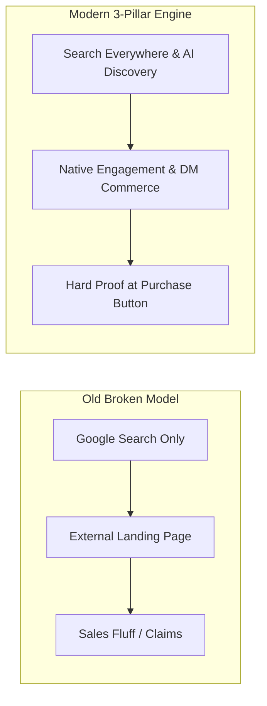
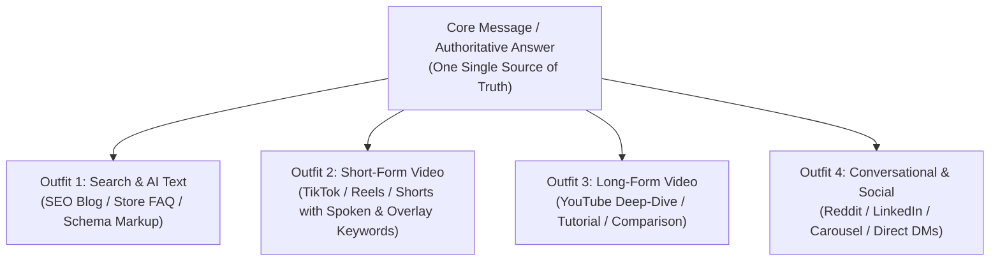
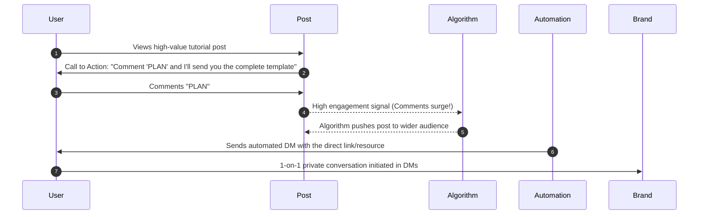
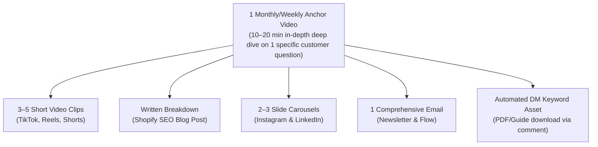

# Must-Know Marketing Strategy: The Modern Playbook

> **Executive Summary:** A distilled, actionable synthesis of the core marketing principles that drive modern customer discovery and sales. Based on $1B+ in marketing data and omnichannel search insights (curated from Neil Patel's 2026 digital marketing masterclasses).

---

## 📌 Table of Contents

1. [The Big Shift: Why the Old Playbook Died](#the-big-shift-why-the-old-playbook-died)
2. [The 3-Pillar Modern Marketing Framework](#the-3-pillar-modern-marketing-framework)
3. [Pillar 1: Search Everywhere Optimization (SEvO & GEO)](#pillar-1-search-everywhere-optimization-sevo--geo)
   - [The "One Answer, Four Outfits" System](#the-one-answer-four-outfits-system)
   - [Why Algorithmic Consistency Wins](#why-algorithmic-consistency-wins)
4. [Pillar 2: Keep Them Where They Are (Zero-Click & DM Commerce)](#pillar-2-keep-them-where-they-are-zero-click--dm-commerce)
   - [The "Link in Bio" Trap](#the-link-in-bio-trap)
   - [The Comment-to-DM Engine](#the-comment-to-dm-engine)
   - [The 1-Hour Speed-to-Lead Rule](#the-1-hour-speed-to-lead-rule)
5. [Pillar 3: Verifiable Proof at the Point of Decision](#pillar-3-verifiable-proof-at-the-point-of-decision)
   - [Fluff vs. Proof](#fluff-vs-proof)
   - [Placement: Never Hide Your Proof](#placement-never-hide-your-proof)
6. [The Content Engine: 1 Anchor into 40+ Assets](#the-content-engine-1-anchor-into-40-assets)
   - [The "Three Jobs" Content Rule](#the-three-jobs-content-rule)
   - [Removing the Founder Bottleneck](#removing-the-founder-bottleneck)
7. [Implementation Checklist: 30-Day Action Plan](#implementation-checklist-30-day-action-plan)
8. [Original Video References](#original-video-references)

---

## The Big Shift: Why the Old Playbook Died

Historically, digital marketing followed a simple, linear formula:
1. Optimize a website to rank #1 on Google.
2. Run paid ads that push external traffic directly to a sales landing page.
3. Blast generic claims (*"World's Best Coffee"*, *"Award-Winning Service"*).

**Today, that playbook is broken for three reasons:**

1. **Search has fragmented:** Traditional Google web search represents only ~24% of initial customer discovery. AI engines (ChatGPT, Gemini, Claude, Perplexity) capture ~16%, while social platforms (YouTube, TikTok, Instagram, Reddit) account for the majority of top-of-funnel searches.
2. **Social algorithms penalize link-dropping:** Telling users to *"Click the link in bio"* ends their on-platform session. The algorithms actively demote posts that drive users away.
3. **Consumers have proof fatigue:** Unsubstantiated marketing claims are tuned out. Buyers expect hard, verifiable data and social proof right where they click "Buy".



---

## The 3-Pillar Modern Marketing Framework

To win today, brands do not need 20 disconnected tactics. You only need to master three core mechanics:

| Pillar | Core Principle | The Goal |
| :--- | :--- | :--- |
| **1. Get Found Everywhere** | Search Everywhere Optimization (SEvO) & GEO | Be the undisputed answer across Google, TikTok, YouTube, Reddit, and AI engines. |
| **2. Keep Them Native** | Zero-Click Engagement & Fast Response | Engage customers on the platform they are already on; convert interest via DMs within 1 hour. |
| **3. Prove It With Receipts** | Concrete Evidence at Point of Sale | Replace marketing buzzwords with verifiable proof placed next to the purchase trigger. |

---

## Pillar 1: Search Everywhere Optimization (SEvO & GEO)

SEO no longer means just getting web links on Google. Today, **every major social platform is a search engine**, and AI engines pull answers across all of them.

### Where Discovery Happens Today

```
┌──────────────────────────────────────────────────────────┐
│  Search & Discovery Breakdown:                           │
│  ├── Google Traditional Search: ~24%                     │
│  ├── AI Platforms (ChatGPT, Gemini, Perplexity): ~16%   │
│  └── Social & Vertical Platforms (TikTok, IG, YT, Reddit)│
│      60%+ of modern user queries                         │
└──────────────────────────────────────────────────────────┘
```

When users search today, they type **full questions and real problems**, such as:
- *"Best natural moisturizer for eczema in winter"*
- *"How to organize a small pantry on a budget"*

If your brand only exists as a website blog, you miss out on over 75% of active intent searches.

---

### The "One Answer, Four Outfits" System

You do not need to invent four different marketing campaigns. Take **one authoritative core answer** and dress it in four distinct format "outfits":



#### The 4 Outfits in Practice:
1. **Outfit 1: Structured Text (Google & AI GEO):** A clear blog post or FAQ on your Shopify store with schema markup, question headings, and direct answers.
2. **Outfit 2: Short-Form Video (TikTok / IG Reels / Shorts):** A 30–60 second clip stating the question within the first 3 seconds, repeating targeted keywords in audio, on-screen captions, and the video description.
3. **Outfit 3: Long-Form Video (YouTube):** An in-depth 8–15 minute video covering the exact problem, step-by-step breakdown, and real demo.
4. **Outfit 4: Conversational / Community (Reddit, Carousel, DMs):** A step-by-step carousel on Instagram or high-value community contribution on Reddit.

---

### Why Algorithmic Consistency Wins

AI search models (ChatGPT, Google AI Overviews, Perplexity) cross-reference multiple web sources before citing a brand:
- If your pricing, features, or product claims differ between your TikTok, YouTube, and website, AI algorithms flag the discrepancy as low-confidence or a hallucination risk.
- **Consistency is your ranking factor:** When your brand delivers identical, corroborating answers across all surfaces, AI models cite you as the authoritative recommendation.

> [!IMPORTANT]
> **Audio SEO Rule:** Social video algorithms transcribe spoken audio. Speak your exact target search phrase clearly within the first 5 seconds of your video, place it as on-screen text, and include it in your closed captions and caption description.

---

## Pillar 2: Keep Them Where They Are (Zero-Click & DM Commerce)

### The "Link in Bio" Trap

Platforms like Instagram, TikTok, LinkedIn, and YouTube want users to remain on their apps. 

When you post: *"Click the link in my bio to read the rest / buy now!"*:
1. You prompt the user to end their session on that app.
2. The platform's algorithm detects lower watch time and off-platform bounce.
3. The platform drastically chokes your organic impressions and reach.

---

### The Comment-to-DM Engine

Instead of fighting the algorithm, use **native engagement**:



#### Why This Works:
- **Maximizes Reach:** Comments and saves are the highest-weighted signals in modern feed algorithms.
- **Direct Lead Qualification:** It moves casual scrollers into private, direct-messaging channels where conversion rates are 3x–5x higher than public comments.
- **Zero Friction:** Customers get the exact resource delivered instantly into their inbox without hunting through bio links.

---

### The 1-Hour Speed-to-Lead Rule

Lead response time is the single highest-leverage conversion metric in modern sales:

> [!TIP]
> **The 7x Conversion Multiplier:** Reaching out or responding to a prospect within **60 minutes** makes you **nearly 700% (7x) more likely** to qualify and convert the sale compared to waiting even 2 to 3 hours.

- **Set up automated triggers:** Use DM automation tools (such as ManyChat) to reply instantly with download links or product sizing recommendations.
- **Human follow-up:** Have your customer support or sales team jump into warm conversations within the first hour of receipt.

---

## Pillar 3: Verifiable Proof at the Point of Decision

### Fluff vs. Proof

Generic claims kill conversion rates. Replace vague buzzwords with undeniable, verifiable evidence:

| Lazy Marketing (Tuned Out) | Verifiable Proof (Converts) |
| :--- | :--- |
| *"Our skincare works fast!"* | *"Clinically tested: 84% saw reduced redness within 72 hours (48-participant trial)."* |
| *"Trusted by thousands of happy customers."* | *"4,821 verified purchases with an average rating of 4.9/5 stars."* |
| *"Best-in-class customer service."* | *"Average response time: 4 minutes via live chat. 30-day money-back guarantee."* |
| *"Top quality materials."* | Raw, unedited video demo showing scratch and drop tests on the actual product. |

---

### Placement: Never Hide Your Proof

Most businesses make the mistake of burying reviews and case studies on an isolated `/testimonials` page that less than 2% of visitors ever visit.

```
┌──────────────────────────────────────────────────────────┐
│  High-Converting Product Page / Checkout Layout:         │
│                                                          │
│   [Product Title & Price]                                │
│   [⭐ 4.9/5 (1,240 Verified Reviews)]                     │
│                                                          │
│   [ 🔥 ADD TO CART / BUY NOW BUTTON ]                     │
│                                                          │
│   ┌──────────────────────────────────────────────────┐   │
│   │ 🛡️ PROOF CLUSTER (Right Below the Button):        │   │
│   │ • Unedited customer photo / video receipt         │   │
│   │ • Specific result stat ("84% saw results in 72h") │   │
│   │ • 30-Day Money-Back Guarantee badge              │   │
│   └──────────────────────────────────────────────────┘   │
└──────────────────────────────────────────────────────────┘
```

> [!CAUTION]
> If a customer has to scroll away from the "Buy" or "Checkout" button to verify whether your product actually works, you will lose up to 50% of borderline buyers. Place proof directly adjacent to the conversion button.

---

## The Content Engine: 1 Anchor into 40+ Assets

To maintain omnipresence across Google, AI, and social media without burning out, use the **Anchor Content Repurposing System**:



---

### The "Three Jobs" Content Rule

Never post random updates. Every single piece of content you release must serve one of three specific purposes:

```
┌────────────────────────────────────────────────────────────┐
│                    THE THREE CONTENT JOBS                  │
├─────────────────┬─────────────────────┬────────────────────┤
│ 1. REACH        │ 2. TRUST            │ 3. USEFULNESS      │
│ (Attract New)   │ (Build Relation)    │ (Solve & Convert)  │
├─────────────────┼─────────────────────┼────────────────────┤
│ • Controversial │ • Behind-the-scenes │ • Step-by-step how │
│   hot takes     │ • Mistakes made     │   -to tutorials    │
│ • Industry myths│ • Founder story     │ • Actionable tools │
│ • Trend hooks   │ • Unedited daily ops│ • Teardowns / SOPs │
│                 │                     │                    │
│ Goal: New eyes  │ Goal: Likability    │ Goal: Demonstrates │
│ & followers     │ & brand affinity    │ domain competence  │
└─────────────────┴─────────────────────┴────────────────────┘
```

**Rotation Formula:**
- 40% Usefulness (tactical problem solving)
- 30% Reach (hooks and broad discoverability)
- 30% Trust (authentic connection and behind-the-scenes)

---

### Removing the Founder Bottleneck

Founders and operators burn out when they try to write every single post from scratch. Use this 2-step delegation model:

1. **Create a 5–10 Page Brand Voice Guide:**
   - Define vocabulary you use vs. words you forbid.
   - Outline strong opinions, viewpoints, and core pricing/service facts.
   - Detail customer pain points and standard objections.
2. **Shift from "Writer" to "Editor":**
   - Team members or AI tools draft posts, carousels, and scripts matching the Brand Voice Guide.
   - You spend just **30 minutes once a week** in Notion or Asana reviewing, tweaking, and approving content.

---

## Implementation Checklist: 30-Day Action Plan

### Week 1: Audit & Search Everywhere Setup
- [ ] **Mine Customer Questions:** Use [AnswerThePublic](https://answerthepublic.com) and search autosuggest to list the top 20 questions your buyers ask.
- [ ] **Ensure Messaging Consistency:** Check your website, social bios, and FAQs to guarantee pricing, product benefits, and details match 100%.
- [ ] **Set Up On-Page Schema:** Ensure Shopify product pages use structured data (Product, Review, FAQ schema) so AI scrapers can parse them cleanly.

### Week 2: Produce the Anchor & Outfits
- [ ] **Record 1 In-Depth Anchor Video (10–15 mins):** Solve one customer problem completely.
- [ ] **Spoken Keywords:** State the main keyword/query out loud within the first 5 seconds.
- [ ] **Slice into 4 Outfits:**
  - 1 long-form YouTube video.
  - 3–4 short-form vertical videos (TikTok, Reels, Shorts) with on-screen text.
  - 1 detailed store blog post.
  - 1 carousel post for Instagram.

### Week 3: Turn on Zero-Click DM Commerce
- [ ] **Stop "Link in Bio" calls:** Transition all post calls-to-action to *"Comment [KEYWORD] below and I'll send you the link/guide."*
- [ ] **Configure DM Automation:** Connect ManyChat or Meta Business Suite to auto-send the link instantly upon comment.
- [ ] **Enforce the 1-Hour SLA:** Ensure notifications alert your team so direct inquiries get answered in under 60 minutes.

### Week 4: Place Receipts at Point of Decision
- [ ] **Audit Product / Landing Pages:** Remove vague claims like *"highest quality"* or *"trusted brand"*.
- [ ] **Embed Concrete Proof Adjacent to Buy Buttons:**
  - Star ratings + verified purchase count.
  - Clinical/data metrics or customer before/after photos.
  - Risk-reversal guarantees (money-back guarantee, free returns).

---

## Original Video References

The strategies in this document are synthesized from Neil Patel's digital marketing playbooks:

1. [The Only Marketing Strategy That Is Working In 2026](https://www.youtube.com/watch?v=UlfniLzuwa0)  
   *Focus: Search Everywhere Optimization (SEvO), "One Answer, Four Outfits", and Generative Engine Optimization (GEO).*
2. [How to Master Social Media SEO in 2026 (Complete Guide)](https://www.youtube.com/watch?v=iL8SK8t5CvM)  
   *Focus: Social platform search algorithms, the 4-move content flywheel, and the Three Jobs framework.*
3. [The Only Marketing Strategy You Need To Master This Year](https://www.youtube.com/watch?v=bSEsLcoNp5E)  
   *Focus: The 3 core pillars (Get Found Everywhere, Keep Them On-Platform, and Verifiable Proof at Decision Points).*
