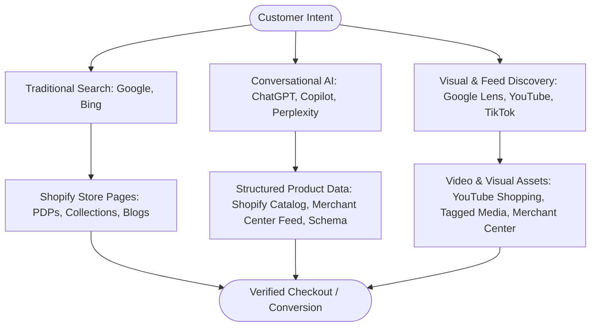
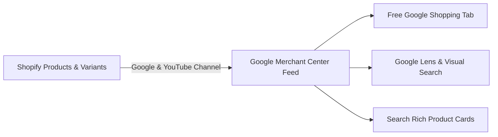
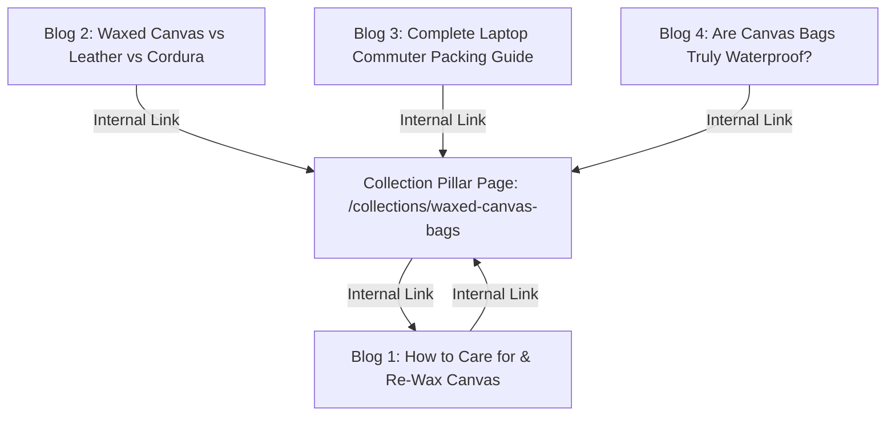
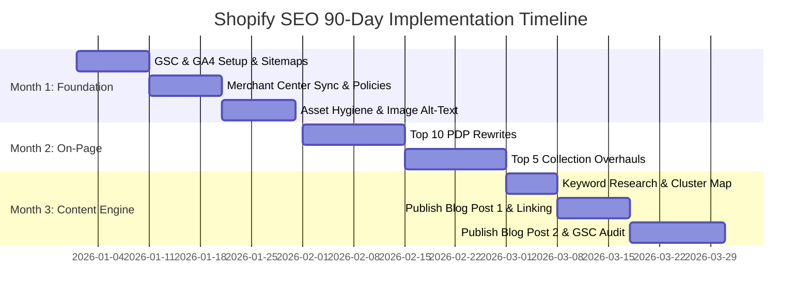
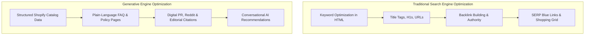

# Shopify SEO & Content Marketing: The Complete Playbook (2026 Edition)

Welcome! If you run a Shopify store and want more qualified shoppers to find your products organically across Google, Bing, YouTube, ChatGPT, and AI agents, this guide is designed for you.

We break down the fundamentals of SEO (Search Engine Optimization), Content Marketing, and Generative Engine Optimization (GEO) into actionable steps, concrete templates, real-world examples, and proven workflows.

---

## How to Use This Guide

This guide is organized progressively—each part builds on the foundation laid before it. **You don't need to read it all in one sitting.**

| Your Current Stage | Recommended Path | Time Investment | Focus Areas |
|---|---|---|---|
| **Brand new to SEO** | Read **Part 1**, complete **Part 2**, then work through **Part 3** | ~45 min reading + setup | Indexation, GA4 tracking, keyword basics |
| **Store just launched** | Jump directly to **Part 4 (Section 9 & 10)** | 90 days, 3–5 hrs/week | Technical setup, top 10 PDP rewrites, first blog posts |
| **Steady sales, ready to grow** | Study **Part 5 (Section 11: Tier 2)** and **Part 3** | 5–10 hrs/week | Keyword clustering, content cadence, schema apps |
| **Established store scaling up** | Study **Part 5 (Section 11: Tier 3 & Section 12: AI Storefronts)** | Ongoing / Dedicated team | Programmatic SEO, GEO, international hreflang, digital PR |

> [!IMPORTANT]
> **The Golden Rule for Beginners:** Master the free, native fundamentals (Parts 1–4) before subscribing to a single third-party SEO app or agency. Shopify's built-in toolset combined with Google's free utilities provides 80% of your early growth leverage.

---

## Table of Contents

- [Shopify SEO & Content Marketing: The Complete Playbook (2026 Edition)](#shopify-seo--content-marketing-the-complete-playbook-2026-edition)
  - [How to Use This Guide](#how-to-use-this-guide)
  - [Table of Contents](#table-of-contents)
- [Part 1: The Basics (Start Here)](#part-1-the-basics-start-here)
  - [1. What is SEO and Content Marketing?](#1-what-is-seo-and-content-marketing)
  - [2. Why SEO is Critical for Ecommerce](#2-why-seo-is-critical-for-ecommerce)
  - [3. How Search Works in 2026](#3-how-search-works-in-2026)
- [Part 2: One-Time Technical Setup](#part-2-one-time-technical-setup)
  - [4. Setting Up Google & YouTube Channels](#4-setting-up-google--youtube-channels)
    - [4a. Google Analytics 4 (GA4 Ecommerce Tracking)](#4a-google-analytics-4-ga4-ecommerce-tracking)
    - [4b. Google Search Console (GSC) Setup & Sitemap Submission](#4b-google-search-console-gsc-setup--sitemap-submission)
    - [4c. Google Merchant Center (Free Shopping Listings)](#4c-google-merchant-center-free-shopping-listings)
    - [4d. YouTube Shopping Integration](#4d-youtube-shopping-integration)
    - [4e. Shopify Core URL & Redirect Architecture](#4e-shopify-core-url--redirect-architecture)
- [Part 3: Store & Content Optimization](#part-3-store--content-optimization)
  - [5. Keyword Research: Frameworks & Intent Mapping](#5-keyword-research-frameworks--intent-mapping)
  - [6. On-Page Optimization: Product & Collection Pages](#6-on-page-optimization-product--collection-pages)
    - [6a. High-Converting Product Detail Page (PDP) Blueprint](#6a-high-converting-product-detail-page-pdp-blueprint)
    - [6b. Collection Page Optimization Architecture](#6b-collection-page-optimization-architecture)
    - [6c. Image Optimization & Alt-Text Mastery](#6c-image-optimization--alt-text-mastery)
  - [7. Content Marketing & Topic Clusters](#7-content-marketing--topic-clusters)
    - [7a. High-Performing Content Formats](#7a-high-performing-content-formats)
    - [7b. The Topic Cluster & Hub-and-Spoke Model](#7b-the-topic-cluster--hub-and-spoke-model)
    - [7c. Product-Led Content Writing Template](#7c-product-led-content-writing-template)
  - [8. Site Speed, Technical Health & Core Web Vitals](#8-site-speed-technical-health--core-web-vitals)
- [Part 4: Your Action Plan & Checklists](#part-4-your-action-plan--checklists)
  - [9. Actionable 90-Day Execution Roadmap](#9-actionable-90-day-execution-roadmap)
  - [10. Pre-Launch Product & Collection Checklists](#10-pre-launch-product--collection-checklists)
- [Part 5: Level Up (Growth, Scale & Generative AI)](#part-5-level-up-growth-scale--generative-ai)
  - [11. The Tiered SEO Framework for Shopify](#11-the-tiered-seo-framework-for-shopify)
    - [Tier 1: Foundation (Native Shopify — $0/mo)](#tier-1-foundation-native-shopify--0mo)
    - [Tier 2: Growth (Apps, Keyword Tooling & Content Cadence — ~$30–$150/mo)](#tier-2-growth-apps-keyword-tooling--content-cadence---30150mo)
    - [Tier 3: Scale & AI-Ready (Programmatic, International & Digital PR — $200–$1,000+/mo)](#tier-3-scale--ai-ready-programmatic-international--digital-pr---2001000mo)
  - [12. Traditional SEO vs. Generative Engine Optimization (GEO)](#12-traditional-seo-vs-generative-engine-optimization-geo)
    - [12a. Traditional Storefront SEO Review](#12a-traditional-storefront-seo-review)
    - [12b. Generative Engine Optimization (GEO) & Agentic Storefronts](#12b-generative-engine-optimization-geo--agentic-storefronts)
    - [12c. JSON-LD Structured Data Schema Snippets](#12c-json-ld-structured-data-schema-snippets)
- [References](#references)

---

# Part 1: The Basics (Start Here)

## 1. What is SEO and Content Marketing?

- **Search Engine Optimization (SEO):** The ongoing process of structuring your store's architecture, metadata, copy, and product catalogs so search engines (Google, Bing) and AI retrieval engines understand what you sell and serve your pages to users conducting relevant queries.
- **Content Marketing:** Creating educational, entertaining, and solution-oriented assets (buying guides, styling tutorials, care manuals, comparison tables) that address customer pain points during their discovery journey, earning trust and guiding them naturally toward purchase.

When combined, SEO provides the discovery engine, while content marketing provides the conversion bridge.

---

## 2. Why SEO is Critical for Ecommerce

Paid advertising costs (Meta Ads, Google Ads, TikTok Ads) fluctuate and compound over time. SEO provides sustainable equity:

1. **Lower Blended Customer Acquisition Cost (CAC):** Organic visitors click for free. When your organic baseline grows, your blended acquisition costs drop substantially.
2. **High Purchase Intent:** A user searching `"men's organic cotton canvas tote bag waterproof"` has far higher buying intent than a passive social media scroller seeing an impression.
3. **Compound Compounding Returns:** A thoroughly researched comparison guide or product category page can drive qualified, converting traffic for 24–36 months with minimal quarterly maintenance.
4. **Resilience Against Ad Account Outages:** A balanced marketing mix ensures your cash flow isn't entirely dependent on third-party ad algorithms.

---

## 3. How Search Works in 2026

Modern discovery is no longer a simple blue-link search engine. Search is now multi-modal, conversational, and personalized:



- **Traditional Web Crawlers:** Googlebot and Bingbot index HTML, rendered JavaScript, and schema tags.
- **LLM Retrieval-Augmented Generation (RAG):** AI engines ingest Merchant Center feeds, Shopify Catalog data, Reddit discussions, and editorial review sites to synthesize immediate product recommendations.
- **Social & Video Search:** Buyers validate products via TikTok reviews, YouTube unboxings, and Instagram reels before purchasing.

---

# Part 2: One-Time Technical Setup

## 4. Setting Up Google & YouTube Channels

Shopify offers an official **Google & YouTube** sales channel that connects your inventory directly to Google Analytics 4, Google Merchant Center, Google Ads, and YouTube.

**Installation Step:**
In your Shopify Admin, navigate to **Settings > Apps and sales channels > Shopify App Store**, search for **Google & YouTube**, click **Install**, and authenticate your primary corporate Google account.

---

### 4a. Google Analytics 4 (GA4 Ecommerce Tracking)

GA4 tracks customer behavior, channel performance, and ecommerce funnels across sessions.

1. **Enable GA4 in the Channel:** Inside the Google & YouTube app, select **Looking only to set up Google Analytics 4?** (or click **Settings > Google Analytics**).
2. **Select Property:** Link your existing GA4 property (or create a new one). Click **Connect**. Shopify automatically provisions the Google tag (`gtag.js`) across all store pages and checkout steps.
3. **Turn on Enhanced Measurement:** In Google Analytics under **Admin > Data Streams > Web**, verify that Enhanced Measurement is active (tracks scrolls, site search, outbound clicks).
4. **Verify Live Data:** Navigate to **GA4 > Reports > Realtime**, open your Shopify storefront in an incognito window, browse two products, and add one to your cart. Ensure events appear in the Realtime report within 30 seconds.

**Standard E-Commerce Events Tracked Out-of-the-Box:**
- `view_item_list` (Browsing collection pages)
- `view_item` (Viewing a product detail page)
- `add_to_cart` (Adding an item to the cart)
- `begin_checkout` (Navigating to checkout)
- `purchase` (Completing an order with currency, tax, and revenue parameters)

**Key Reports to Monitor:**
- **Reports > Acquisition > Traffic Acquisition:** Identify non-brand organic search revenue vs. direct or paid.
- **Reports > Monetization > Ecommerce Purchases:** Check conversion rates by individual product title and SKU.

---

### 4b. Google Search Console (GSC) Setup & Sitemap Submission

Google Search Console is the direct communication line between Google and your store. It reports technical indexing errors, crawl health, and keyword impressions.

1. **Verify Store Ownership:**
   - Go to [search.google.com/search-console](https://search.google.com/search-console).
   - Choose **URL prefix** (e.g., `https://yourstore.com`) or **Domain** (via DNS TXT record at your domain registrar).
   - If using URL prefix, select the **HTML tag** method, copy the verification meta tag, and in Shopify go to **Online Store > Themes > Edit code > `theme.liquid`**, pasting the code immediately inside the `<head>` section. Save and click **Verify**.
2. **Submit Your XML Sitemap:**
   - Shopify generates dynamic sitemaps automatically at `/sitemap.xml`.
   - In GSC, click **Sitemaps** in the left sidebar.
   - Enter `sitemap.xml` in the field and click **Submit**.
   - Shopify's master sitemap automatically links child sitemaps: `/sitemap_products_1.xml`, `/sitemap_pages_1.xml`, `/sitemap_collections_1.xml`, and `/sitemap_blogs_1.xml`.
   - **Video Walkthrough (Sitemap Submission):** [How to Submit Shopify Sitemap to Google Search Console (Tutorial)](https://www.youtube.com/watch?v=fGoxFgd7pIw).

> [!TIP]
> **Video Walkthrough:** Follow this step-by-step video tutorial to connect Google Search Console with Shopify: [How to Connect Google Search Console to Shopify (Step-by-Step Tutorial)](https://www.youtube.com/watch?v=me2VIw5ywNI).

---

### 4c. Google Merchant Center (Free Shopping Listings)

Google Merchant Center (GMC) distributes your product catalog into Google's organic Shopping tab, Google Images, Lens, and rich search carousels at no ad cost.



1. **Account Linkage:** In the Google & YouTube channel on Shopify, link or create your GMC account.
2. **Shipping & Tax Configuration:** Select **Automatically import shipping settings** from Shopify. Mismatched shipping rates between Google and your checkout page will result in feed suspension.
3. **Product Identifier Integrity:**
   - **GTIN/UPC/EAN:** Every branded commercial product requires a valid barcode in Shopify under **Product > Inventory > Barcode**.
   - **Custom Goods:** If your items are custom-made, handcrafted, or private label without standard barcodes, toggle `"This is a custom product"` inside the Google channel bulk editor to bypass the GTIN requirement.
   - **Google Product Category:** Categorize each product accurately (e.g., `Apparel & Accessories > Clothing > Outerwear > Coats & Jackets`) to prevent indexing mismatches.
4. **Feed Hygiene:** Check **Google & YouTube Channel > Products > All products** weekly. Immediately resolve issues flagged as *Disapproved* (common causes: missing return policies, inaccurate tax setups, or prohibited claims).

> [!TIP]
> **Video Walkthrough & Channel Resource:** Follow this step-by-step video tutorial to connect Google Merchant Center with Shopify: [How to Connect Google Merchant Center to Shopify (Step-by-Step Tutorial)](https://www.youtube.com/watch?v=l6OLQb1D6rA). For dedicated in-depth Google Merchant Center guides and troubleshooting, check out [@RobinTesselaar](https://www.youtube.com/@RobinTesselaar).

---

### 4d. YouTube Shopping Integration

Turn videos, YouTube Shorts, and livestreams into direct checkout touchpoints.

1. **Store Channel Linking:** In the Google & YouTube channel, locate the **YouTube Store** card. Connect your YouTube brand channel (requires Manager or Owner permissions).
2. **Product Tagging:** Once approved (typically 24–48 hours), you can tag products directly in YouTube Studio when editing video descriptions, timestamps, and Shorts. Viewers click the product sticker to purchase directly.
3. **Affiliate Program (Advanced/Plus stores):** If your store runs on Shopify Advanced or Plus and has a US entity, activate the **YouTube Shopping Affiliate Program**. Set a default creator commission (e.g., 10–15%) and return window attribution (30–45 days). Independent YouTube creators can tag your products in their content without direct outreach.

---

### 4e. Shopify Core URL & Redirect Architecture

Shopify enforces rigid URL structures:
- Products: `/products/product-handle`
- Collections: `/collections/collection-handle`
- Collection product links: `/collections/collection-handle/products/product-handle`
- Blog Posts: `/blogs/news/post-handle`
- Static Pages: `/pages/page-handle`

> [!TIP]
> **Canonical Tag Handling:** By default, Shopify themes link to products via `/collections/shoes/products/sneaker`. Shopify automatically adds canonical tags pointing back to the master `/products/sneaker` URL to prevent duplicate content penalties. Whenever possible, update your theme collection templates to link directly to `/products/sneaker` for cleaner internal link equity.

**Setting Up 301 Redirects:**
When you unpublish, rename, or merge a product:
1. In Shopify, go to **Content > Menus > View URL Redirects** (or **Navigation > URL Redirects**).
2. Click **Create URL redirect**.
3. Point old discontinued links (`/products/old-jacket`) to the closest relevant replacement collection (`/collections/jackets`) or successor product.

---

# Part 3: Store & Content Optimization

## 5. Keyword Research: Frameworks & Intent Mapping

Effective ecommerce keyword research maps customer intent directly to the appropriate page template:

| Search Intent | Example Search Query | Primary Target Template | Goal |
|---|---|---|---|
| **Transactional (High Intent)** | `"buy organic cotton tote bag"` | Product Detail Page (PDP) | Direct conversion |
| **Commercial Investigation** | `"best water-resistant canvas backpacks"` | Collection Page or Buying Guide | Brand comparison & filtering |
| **Informational (Learning)** | `"how to clean waxed canvas bag"` | Blog Article / Care Guide | Authority, trust, backlink acquisition |
| **Navigational** | `"[Brand Name] return policy"` | Policy / Support / About Page | User experience & customer service |

### The Free Keyword Research Workflow
1. **Google Autocomplete & People Also Ask:** Type your root keyword (e.g., `"organic cotton tote"`) into Google. Note the drop-down autocompletions and the "People Also Ask" questions.
2. **Google Search Console Performance:** After 30 days of live traffic, open GSC > **Search Results**. Filter by queries with high impressions but low click-through rates (CTR). These represent easy wins where tweaking page titles can yield immediate traffic.
3. **Google Keyword Planner:** In your free Google Ads account, use Keyword Planner to pull search volumes and competition levels for your core category terms.

---

## 6. On-Page Optimization: Product & Collection Pages

### 6a. High-Converting Product Detail Page (PDP) Blueprint

A high-ranking product page must balance technical SEO tags with persuasive conversion copy.

```
+-------------------------------------------------------------------+
|  Breadcrumbs: Home > Sustainable Bags > Canvas Totes               |
|                                                                   |
|  [H1 Product Title]: Haven Waxed Canvas Tote Bag - Water-Resistant|
|                                                                   |
|  [Price & Reviews]: $88.00  ★★★★★ (42 reviews)                    |
|                                                                   |
|  [Hook / Core Benefit]: Engineered from GOTS-certified organic    |
|  cotton canvas and treated with plant-based wax for daily weather |
|  protection.                                                      |
|                                                                   |
|  [Specifications Table]:                                          |
|  - Dimensions: 15" H x 14" W x 5" D                               |
|  - Material: 14oz Organic Waxed Cotton Canvas                     |
|  - Strap Drop: 11 inches                                          |
|                                                                   |
|  [Accordion FAQs]:                                                |
|  ▶ Is this tote machine washable? (Spot clean with cold water)     |
|  ▶ What laptop sizes fit inside? (Fits up to 16" MacBook Pro)     |
|                                                                   |
|  [CTA Button]: [ Add to Cart - Free US Shipping ]                 |
+-------------------------------------------------------------------+
```

#### On-Page Element Checklist:
- **SEO Title Tag (<60 characters):**
  `Primary Keyword - Core Benefit / Feature | Brand Name`
  *Example:* `Waxed Canvas Tote Bag - Water-Resistant | Haven Goods`
- **Meta Description (<155 characters):**
  `Direct solution statement + key specifications + call to action (free shipping/warranty).`
  *Example:* `Shop our 14oz organic waxed canvas tote bag. Durable, water-resistant, and sized for 16-inch laptops. Handcrafted with lifetime stitching. Free US shipping.`
- **H1 Header:** Clear product name with distinguishing attributes. Avoid vague artistic names like `"The Nomad"`—use `"The Nomad Waxed Canvas Weekender Duffle"`.
- **Body Copy:** Focus on benefits, materials, sizing, fit, and origin. Write 200–400 words of original copy; never copy-paste manufacturer catalog bullets.
- **Micro-FAQ Module:** Add 2–4 expandable accordion questions directly on the PDP addressing common pre-purchase doubts.

---

### 6b. Collection Page Optimization Architecture

Collection pages rank for broad commercial queries (e.g., `"organic tote bags"`, `"men's canvas backpacks"`).

```
+-------------------------------------------------------------------+
|  [H1]: Organic Cotton Tote Bags                                    |
|                                                                   |
|  [Intro Copy - 50-75 words]:                                      |
|  Discover our collection of durable, GOTS-certified organic tote  |
|  bags. Designed for grocery runs, daily commutes, and weekend     |
|  travel, each piece is crafted with reinforced stitching and      |
|  zero synthetic dyes.                                             |
|                                                                   |
|  [Faceted Filters]: Material | Color | Capacity | Price            |
|                                                                   |
|  [Product Grid]:                                                  |
|  [ Product 1 ]    [ Product 2 ]    [ Product 3 ]    [ Product 4 ] |
|                                                                   |
|  --- Bottom Educational Content (200-300 words) ---               |
|  [H2]: How to Choose the Right Organic Canvas Tote                |
|  (Explains fabric weights, pocket configurations, and care steps) |
+-------------------------------------------------------------------+
```

- **Top Summary:** Place 1–2 concise introductory sentences above the product grid to establish keyword context without pushing products below the mobile fold.
- **Bottom Guide:** Add 200–300 words of educational copy below the product grid covering materials, buying criteria, and styling tips. This provides topical depth for search crawlers while keeping the shopping experience clean.
- **Faceted Navigation Rules:** If using Shopify's free **Search & Discovery** app for filters (color, size, price), verify your theme uses URL parameters (`?filter.v.option.color=green`) rather than generating separate crawlable pages that could trigger duplicate content issues.

---

### 6c. Image Optimization & Alt-Text Mastery

High-resolution photography sells products, but uncompressed files degrade page speed and hurt rankings.

#### 1. File Naming Conventions:
- **Bad:** `IMG_9021_FINAL_v2.jpg`, `screenshot2.png`
- **Good:** `waxed-canvas-tote-bag-olive-green-front.webp`, `canvas-tote-interior-laptop-pocket.webp`

#### 2. Image Compression & Modern Formats:
- Upload images as WebP or high-quality JPEG at a maximum width of 2000px (ideal for high-DPI zoom). Shopify's CDN automatically serves WebP format to supported browsers.

#### 3. Descriptive Alt Text Formula:
Alt text assists visually impaired shoppers using screen readers and gives search engines visual context.

| Image View | Poor Alt Text | Optimized Alt Text |
|---|---|---|
| Front product view | `"bag"` or `"tote bag best buy"` | `"Haven olive green waxed canvas tote bag resting upright on wooden table"` |
| Model carrying bag | `"model with bag"` | `"Woman carrying dark olive waxed canvas tote on shoulder wearing casual coat"` |
| Close-up interior | `"pockets"` | `"Close-up of tote bag interior displaying zippered phone pocket and brass key clip"` |

---

## 7. Content Marketing & Topic Clusters

### 7a. High-Performing Content Formats

E-commerce blogs should prioritize customer education and decision-making over company announcements:

1. **Definitive Buying Guides:** `"How to Choose the Right Daily Commuter Backpack: Sizing, Materials, and Laptop Fit"`
2. **Maintenance & Care Tutorials:** `"How to Re-Wax a Canvas Bag: Step-by-Step Restoration Guide"`
3. **Head-to-Head Comparisons:** `"Waxed Canvas vs. Cordura Nylon: Which Material Lasts Longer?"`
4. **Curated Gift & Style Roundups:** `"The Minimalist Packing Checklist: 7 Sustainable Travel Essentials"`

---

### 7b. The Topic Cluster & Hub-and-Spoke Model

Organize your content into thematic clusters that channel topical authority back to your primary collection pages:



- **Pillar Hub:** High-intent commercial collection page (`/collections/waxed-canvas-bags`).
- **Educational Spokes:** Informative articles targeting long-tail queries.
- **Link Architecture:** Every blog post links directly to the collection hub and references relevant product detail pages using descriptive anchor text (e.g., `[view our waxed canvas commuter totes]`, not `[click here]`).

---

### 7c. Product-Led Content Writing Template

Use this reusable article framework to create educational content that drives conversions:

```markdown
# [Catchy, Search-Optimized Title: e.g., Waxed Canvas vs. Full-Grain Leather: Durability, Care, and Style Compared]

**Summary/TL;DR:** [2-3 sentences answering the core question immediately for AI snippet extraction].

---

## Quick Comparison Table
| Feature | Waxed Canvas | Full-Grain Leather |
|---|---|---|
| Water Resistance | High (repels rain) | Moderate (requires conditioning) |
| Weight | Lightweight to medium | Heavy |
| Maintenance | Spot clean & re-wax every 1–2 yrs | Regular leather conditioner |
| Average Price | $75 – $180 | $200 – $500+ |

---

## 1. Durability and Weather Protection
[In-depth breakdown explaining how wax repels rain, resistance to scuffs, etc.]

> *Product Spotlight:* If you commute in unpredictable weather, our 
> [Haven Waxed Canvas Weekender](/products/waxed-canvas-weekender) provides 
> water resistance without the weight of traditional steerhide.

---

## 2. Maintenance and Long-Term Aging (Patina)
[Detailed maintenance guide explaining how both materials age over time.]

---

## 3. Which One Is Right for You?
- **Choose Waxed Canvas if:** You need weatherproof utility, lighter carry weight, and a rugged heritage aesthetic.
- **Choose Leather if:** You require formal corporate styling and don't mind heavier carry weights.

---

## Frequently Asked Questions
### Can you re-wax canvas at home?
Yes. Using natural paraffin or beeswax bars, you can restore full water resistance in 15 minutes using a standard hairdryer.
```

---

## 8. Site Speed, Technical Health & Core Web Vitals

A slow site hurts conversion rates and degrades search rankings. Google evaluates real-user performance through **Core Web Vitals**:

| Metric | Target | What It Measures | Common Cause of Failure |
|---|---|---|---|
| **LCP (Largest Contentful Paint)** | `< 2.5s` | Time for main banner or product image to render | Giant hero images, slow third-party fonts |
| **INP (Interaction to Next Paint)** | `< 200ms` | Responsiveness to user taps, clicks, and filters | Bulky JavaScript tracking scripts, bloated chat apps |
| **CLS (Cumulative Layout Shift)** | `< 0.1` | Visual stability (elements jumping around while loading) | Images missing width/height attributes, late banner popups |

### Actionable Speed Optimization Checklist
- [ ] **Audit Installed Apps:** Review **Settings > Apps and sales channels** quarterly. Delete apps you no longer actively use. Many uninstalled apps leave unused scripts behind in your theme.
- [ ] **Avoid Multiple Carousels:** Avoid stacking multiple full-width image sliders on your homepage. Use single, high-impact hero images with explicit width and height attributes.
- [ ] **Load Fonts Efficiently:** Stick to standard system fonts or modern web fonts hosted directly on Shopify's CDN. Avoid loading multiple Google Font weights.
- [ ] **Audit Tag Managers:** Consolidate tracking pixels inside Shopify's native **Customer Privacy / Web Pixels API** rather than injecting multiple third-party tags into `theme.liquid`.

---

# Part 4: Your Action Plan & Checklists

## 9. Actionable 90-Day Execution Roadmap

A structured schedule prevents burnout and ensures consistent progress.



### Month 1: Technical Foundation & Asset Hygiene
- **Week 1:** Connect Google Analytics 4 via the Google & YouTube channel. Submit `sitemap.xml` in Google Search Console.
- **Week 2:** Configure Google Merchant Center for free listings. Confirm phone verification, tax rules, and synchronized shipping rates.
- **Week 3:** Audit your top 20 existing products. Rename all image files to descriptive terms and add alt text to each image.
- **Week 4:** Verify core utility pages (About Us, Contact Us, Shipping Policy, Returns & Refund Policy, Privacy Policy). Ensure all links work with no 404 errors.

### Month 2: Core Catalog On-Page Overhaul
- **Week 5–6:** Rewrite your top 10 best-selling Product Detail Pages:
  - Add keyword-optimized Title tags (<60 chars) and Meta Descriptions (<155 chars).
  - Write 250+ words of benefit-driven copy and technical specifications.
  - Add 2–4 accordion FAQ questions on each PDP.
- **Week 7–8:** Optimize your top 5 category Collection Pages:
  - Create unique H1 headers and concise 50-word introductory summaries.
  - Add 200 words of educational buying advice below the product grid.
  - Review collection navigation to ensure all collections are reachable within 3 clicks of the homepage.

### Month 3: Content Engine & Initial Authority
- **Week 9:** Review Google Search Console's Performance tab. Identify 5 questions or queries with growing impressions.
- **Week 10:** Draft and publish **Blog Post #1** (a comprehensive Buying Guide or Comparison). Link directly to 2–3 relevant products and your primary collection page.
- **Week 11:** Draft and publish **Blog Post #2** (a Care, Maintenance, or How-To tutorial). Include a step-by-step instructional layout with custom product spotlights.
- **Week 12:** First quarterly audit: Check GSC for indexing issues and crawl errors, review GA4 organic traffic numbers, and set up 301 redirects for any outdated links.

---

## 10. Pre-Launch Product & Collection Checklists

### New Product Detail Page (PDP) Checklist
- [ ] **Descriptive URL Handle:** Clean URL slug without automated numbers (e.g., `/products/waxed-canvas-commuter-tote`).
- [ ] **H1 Product Title:** Contains brand, model name, primary material, and distinguishing feature.
- [ ] **Unique Product Description:** 200+ words highlighting materials, benefits, dimensions, and care instructions.
- [ ] **SEO Title Tag:** Under 60 characters, with primary keyword and brand suffix.
- [ ] **Meta Description:** Under 155 characters, with specs, benefits, and shipping info.
- [ ] **Image Optimization:** Descriptive file names (`tote-interior.webp`) with descriptive alt text on every angle.
- [ ] **Structured Product Identifiers:** Valid GTIN/UPC barcode added (or marked as custom product).
- [ ] **Product Categorization:** Standard Google Product Category assigned in product details.
- [ ] **Navigation & Tagging:** Linked to at least one manual or automated collection.
- [ ] **Accordion FAQ:** At least 2 common pre-purchase questions answered on the page.

### New Collection Page Checklist
- [ ] **Clear H1 Title:** Reflects the category's primary search query (`Organic Canvas Tote Bags`).
- [ ] **Top Introductory Paragraph:** 50–75 words introducing the collection above the product grid.
- [ ] **Bottom Context Guide:** 150–300 words of educational context below the grid for topical depth.
- [ ] **Custom Meta Tags:** Unique title tag and meta description tailored to category searchers.
- [ ] **Navigation Placement:** Linked from the main navigation menu or a parent dropdown.

---

# Part 5: Level Up (Growth, Scale & Generative AI)

## 11. The Tiered SEO Framework for Shopify

SEO requirements evolve alongside your catalog size, market reach, and team capacity:

| Dimension | **Tier 1: Foundation** | **Tier 2: Growth** | **Tier 3: Scale & AI-Ready** |
|---|---|---|---|
| **Store Stage** | New store / Organic unproven | Steady daily sales / Proven channel | Enterprise / 500+ SKUs / International |
| **Primary Goal** | Indexation, hygiene, free listings | Content cadence, rank tracking, collection expansion | Programmatic SEO, GEO, international hreflang |
| **Content Pace** | 2 posts in first 90 days | 2–4 posts per month | Systematic topic clusters & programmatic hubs |
| **Tool Stack** | Native Shopify, GA4, GSC | + Schema App, Bulk Meta/Image App, Semrush/Ahrefs | + Screaming Frog, Profound (AI tracking), Digital PR |
| **Monthly Budget** | **$0 / month** | **~$30 – $150 / month** | **$300 – $1,500+ / month** |
| **Weekly Time** | 3–5 hours / week | 5–10 hours / week | Dedicated internal owner or specialized agency |
| **Core KPIs** | Indexed pages, impressions, clicks | Organic revenue, non-brand rankings, CTR | Share of voice, AI referral revenue, market yield |

---

### Tier 1: Foundation (Native Shopify — $0/mo)
*Focus on getting indexed, setting up clean architecture, and launching your first assets without tool spend.*
- Complete the 90-Day Plan (Section 9).
- Submit your XML sitemap in Google Search Console and link GA4.
- Sync product catalog to Google Merchant Center for free product listings.
- Write unique product descriptions and populate alt text on all media.
- Maintain simple URL structures and establish 301 redirects whenever pages change.

---

### Tier 2: Growth (Apps, Keyword Tooling & Content Cadence — ~$30–$150/mo)
*Add targeted tooling to scale your workflow once your store generates consistent organic sales.*
1. **Keyword Intelligence Tooling:** Upgrade from basic autocomplete to paid keyword research tools (Ahrefs, Semrush, or SE Ranking at ~$49–$119/mo) to uncover competitor keyword gaps and keyword difficulty scores.
2. **Dedicated Schema App:** If your theme's native JSON-LD markup lacks review stars, FAQ schema, or variant data, integrate **JSON-LD for SEO** ($399 one-time/yr) or **Webrex SEO** ($10–$15/mo).
3. **Automated Media Optimization:** Use **Tiny SEO Speed Image Optimizer** or **Crush.pics** to compress new photography and sync image alt tags across large catalogs automatically.
4. **Structured Content Engine:** Maintain a steady rhythm of 2–4 educational articles per month targeting long-tail queries, with all posts linking back to core collection hubs.
5. **Backlink Outreach Basics:** Pitch products to niche publications, coordinate gifting with micro-influencers, and participate in podcasts and brand collaborations.

---

### Tier 3: Scale & AI-Ready (Programmatic, International & Digital PR — $200–$1,000+/mo)
*For mature brands scaling multi-market catalogs, complex technical setups, and AI discovery.*
1. **Programmatic Collection Pages:** Leverage Shopify Metafields and Metaobjects to build templated, data-driven collection pages around specific attributes (e.g., `/collections/waxed-canvas-totes-for-travel`, filtered by use-case and material).
2. **International SEO (Shopify Markets):** Set up localized subfolders (e.g., `/en-gb/`, `/en-ca/`), verify automated `hreflang` tags, and localize currency and translated metadata.
3. **Deep Technical Crawling:** Run monthly site audits using **Screaming Frog SEO Spider** or **Sitebulb** to identify broken redirect chains, orphan pages, duplicate canonicals, and crawl bloat.
4. **Generative Engine Optimization (GEO):** Track brand citation rates in ChatGPT, Perplexity, and Google AI Overviews using AI visibility tools like Profound or Otterly.
5. **Digital PR & Original Research:** Conduct proprietary consumer surveys or material durability studies to generate authoritative backlinks from major media outlets.

---

## 12. Traditional SEO vs. Generative Engine Optimization (GEO)

Modern shoppers discover products through two parallel paths: classic search engines and conversational AI assistants.



### 12a. Traditional Storefront SEO Review
- **Focus:** Ranking HTML pages for specific keyword phrases in search results.
- **Key Metrics:** Impressions, average position, organic click-through rate, and organic traffic.
- **Core Levers:** On-page keywords, page loading speeds, sitemaps, internal links, and backlinks.

---

### 12b. Generative Engine Optimization (GEO) & Agentic Storefronts

**GEO** is the discipline of structuring your catalog, copy, and brand footprint so AI systems (ChatGPT, Copilot, Google AI Overviews, Perplexity) recommend your products in conversational queries.

#### Why GEO is Crucial in 2026:
- AI-driven referral sessions to Shopify stores have grown more than **8x year-over-year**.
- Conversational search visitors convert at nearly **50% higher rates** than traditional search traffic because users receive personalized recommendations tailored to their exact questions.
- Over 55% of AI-referred shoppers land directly on a Product Detail Page, skipping home and generic category pages entirely.

#### How to Optimize for AI Recommendations:
1. **Activate Agentic Storefronts:** In Shopify, navigate to **Settings > Sales Channels > Agentic Storefronts**. Enable distribution to syndicate your catalog via **Shopify Catalog** directly to ChatGPT, Copilot, and Google AI Mode.
2. **Complete Every Structured Field:** AI recommendation engines rely heavily on metadata. Ensure your products have complete values for:
   - Specific descriptive product titles (include material, dimensions, and intended use).
   - Detailed product descriptions explaining the problems your product solves.
   - Valid GTIN/UPC/EAN barcodes.
   - Explicit variants (dimensions, capacities, colors).
3. **Write Clear, Direct Policy Pages:** AI agents read your store's return and shipping policies before recommending products (e.g., answering `"find me a waxed canvas bag with free returns"`). Keep your policies simple and direct in HTML—avoid hiding policies inside PDFs or JavaScript tabs.
4. **Build Off-Site Brand Mentions:** LLMs synthesize recommendations from discussions across Reddit, trusted review sites, YouTube, and media coverage. Fostering authentic reviews and community discussions directly impacts whether AI models recommend your brand.
5. **Answer Customer Questions Directly:** Structure your on-page FAQs to answer specific user questions clearly and concisely within the first sentence (e.g., `"Does this bag fit under an airplane seat? Yes. Measuring 15x14x5 inches, it fits under all major airline seats."`).

---

### 12c. JSON-LD Structured Data Schema Snippets

Search engines and AI crawlers rely on Schema.org structured data to parse product details. Ensure your theme outputs clean JSON-LD markup:

#### 1. Product Detail Page Schema (with Ratings & FAQs)
```html
<script type="application/ld+json">
{
  "@context": "https://schema.org/",
  "@type": "Product",
  "name": "Haven Waxed Canvas Tote Bag - Water-Resistant",
  "image": [
    "https://yourstore.com/cdn/shop/files/waxed-canvas-tote-olive.webp"
  ],
  "description": "Handcrafted water-resistant tote bag made from 14oz GOTS-certified organic cotton canvas.",
  "sku": "HVT-CAN-OLV",
  "mpn": "HVT-001",
  "brand": {
    "@type": "Brand",
    "name": "Haven Goods"
  },
  "offers": {
    "@type": "Offer",
    "url": "https://yourstore.com/products/waxed-canvas-tote-bag",
    "priceCurrency": "USD",
    "price": "88.00",
    "priceValidUntil": "2027-12-31",
    "itemCondition": "https://schema.org/NewCondition",
    "availability": "https://schema.org/InStock",
    "seller": {
      "@type": "Organization",
      "name": "Haven Goods"
    }
  },
  "aggregateRating": {
    "@type": "AggregateRating",
    "ratingValue": "4.9",
    "reviewCount": "42"
  }
}
</script>
```

#### 2. FAQ Module Schema (for Instant Google Rich Snippets & AI Citations)
```html
<script type="application/ld+json">
{
  "@context": "https://schema.org",
  "@type": "FAQPage",
  "mainEntity": [
    {
      "@type": "Question",
      "name": "Is the Haven Waxed Canvas Tote machine washable?",
      "acceptedAnswer": {
        "@type": "Answer",
        "text": "No, machine washing strips the protective wax coating. Spot clean using cold water and a soft bristle brush. Re-wax every 12 to 18 months using natural wax bars."
      }
    },
    {
      "@type": "Question",
      "name": "Does this tote bag fit a 16-inch laptop?",
      "acceptedAnswer": {
        "@type": "Answer",
        "text": "Yes. The main compartment measures 15 inches high by 14 inches wide, easily accommodating laptops up to 16 inches with a protective sleeve."
      }
    }
  ]
}
</script>
```

---

# References

1. Shopify Help Center — Improving search engine optimization (SEO): https://help.shopify.com/en/manual/promoting-marketing/seo
2. Shopify — Shopify SEO: How to Generate More Store Traffic (2026): https://www.shopify.com/blog/shopify-seo
3. Shopify — SEO Basics for Ecommerce: A Beginner's Guide (2026): https://www.shopify.com/blog/seo-basics
4. Shopify — How To Do SEO in 2026: SEO Plan for Small Businesses: https://www.shopify.com/blog/how-to-do-seo
5. Shopify — Ecommerce SEO Audit: Shopify Checklist (2026): https://www.shopify.com/blog/ecommerce-seo-audit
6. Shopify Enterprise — The Enterprise Guide to Ecommerce Technical SEO in 2026: https://www.shopify.com/enterprise/blog/ecommerce-technical-seo
7. Shopify Enterprise — The GEO Playbook: How (& Why) to Optimize for AI Discovery: https://www.shopify.com/enterprise/blog/generative-engine-optimization
8. Shopify — AEO for Ecommerce: Drive Traffic From AI Search (2026): https://www.shopify.com/blog/aeo-for-ecommerce
9. Shopify — Agentic Commerce on Shopify: How It Works (2026): https://www.shopify.com/blog/how-agentic-commerce-works
10. Shopify — Agentic Commerce: Benefits & How To Get Started in 2026: https://www.shopify.com/blog/agentic-commerce
11. Shopify Enterprise — AI-referred shoppers convert better and spend more (2026): https://www.shopify.com/hk-en/enterprise/blog/ai-search-insights
12. Shopify — Selling everything, everywhere, all at once: The Spring '26 Edition: https://www.shopify.com/news/spring-26-edition-merchant
13. Google Search Central — Learn about structured data: https://developers.google.com/search/docs/fundamentals/structured-data
14. Google Search Console — Submit your sitemap: https://support.google.com/webmasters/answer/7042828
15. Shopify — SEO Plug-ins: Top Choices for Your Ecommerce Store (2026): https://www.shopify.com/blog/seo-plugins
16. Shopify — 25+ Free SEO Tools To Grow Your Website Traffic (2026): https://www.shopify.com/blog/free-seo-tools
17. Shopify App Store — Best SEO Apps: https://apps.shopify.com/categories/store-design-site-optimization-seo/all
18. Shopify Help Center — Set up the Google & YouTube channel: https://help.shopify.com/en/manual/online-sales-channels/google/getting-setup/connect
19. Shopify Help Center — Setting up Google Analytics 4: https://help.shopify.com/en/manual/reports-and-analytics/google-analytics/google-analytics-setup
20. Google Merchant Center Help — Onboarding to the Google & YouTube app on Shopify: https://support.google.com/merchants/answer/16267554
21. Google Merchant Center Help — YouTube Shopping affiliate program (Shopify merchants): https://support.google.com/merchants/answer/13773425
22. Shopify — YouTube Shopping: Beginner's Guide for Selling on YouTube: https://www.shopify.com/blog/youtube-shopping
23. Video Tutorial — Connect Google Merchant Center with Shopify: https://www.youtube.com/watch?v=l6OLQb1D6rA
24. Video Tutorial — Connect Google Search Console with Shopify: https://www.youtube.com/watch?v=me2VIw5ywNI
25. Video Tutorial — Submit Shopify Sitemap to Google Search Console: https://www.youtube.com/watch?v=fGoxFgd7pIw
26. YouTube Channel — Robin Tesselaar (Google Merchant Center & E-Commerce): https://www.youtube.com/@RobinTesselaar
