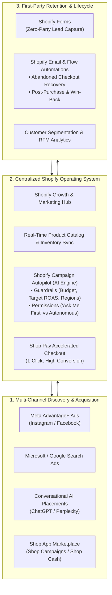
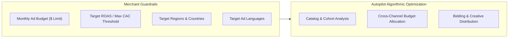
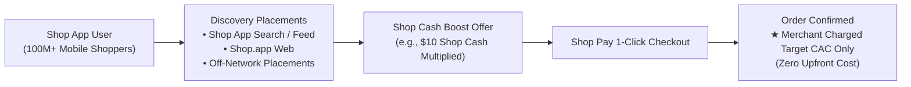
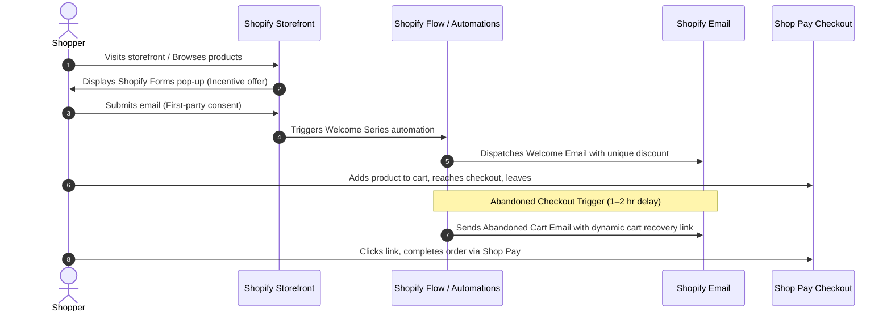

# Shopify Omnichannel Marketing: Architecture, Automation & Execution Guide

---

## Executive Summary

Omnichannel marketing in modern e-commerce has shifted from managing fragmented, siloed advertising platforms to operating a synchronized, autonomous growth engine. For Shopify merchants, omnichannel execution integrates first-party store data, machine learning campaign orchestration, risk-free marketplace discovery, and retention automation into a single operational core.

This guide synthesizes the strategic vision of **Shopify Campaign Autopilot** (as unveiled by Shopify product leadership on *The Unofficial Shopify Podcast*), practical multi-channel marketing workflows from *Learn with Shopify*, performance acquisition mechanics on the **Shop App** (Josh Dichele), and verified specifications from official Shopify Help Center documentation.



---

## 1. The Autonomous Omnichannel Paradigm: Shopify Campaign Autopilot

### 1.1 The Concept: An In-House AI Ad Agency Built into Shopify
As highlighted by **Sachin Malhotra** (Director of Product for Merchant Marketing at Shopify) in conversation with **Kurt Elster** on *The Unofficial Shopify Podcast*, traditional digital advertising imposes severe friction on independent merchants:
- High agency retainers ($3,000–$10,000+/month) or complex third-party software fees.
- Fragmented ad accounts across Meta, Google, Microsoft, TikTok, and Snapchat.
- Manual catalog feeds that break or fail to reflect real-time stock levels and pricing changes.
- Inefficient platform-specific bidding algorithms competing against one another rather than coordinating to maximize overall store profit.

**Campaign Autopilot** transforms the Shopify admin into an autonomous, in-house ad agency that is free for merchants (excluding actual media spend). Instead of requiring manual campaign creation in disparate ad managers, Autopilot ingests your live product catalog, historical sales data, and real-time inventory levels to autonomously draft, deploy, monitor, and optimize cross-network campaigns.

### 1.2 Cross-Channel Holistic Budget Arbitration
Unlike ad network algorithms that optimize only for their own inventory (e.g., Meta optimizing within Meta), Autopilot evaluates performance holistically across connected channels:
- **Meta (Instagram & Facebook):** Advantage+ checkout and catalog campaigns driven by verified purchase events.
- **Microsoft Advertising:** High-intent search and shopping placements.
- **Snapchat & Emerging Channels:** Social commerce touchpoints for younger demographics.
- **ChatGPT & AI Recommendation Engines:** Commercial discovery placements within conversational AI queries.
- **Shop Campaigns:** Organic and sponsored discovery across the 100M+ user Shop App ecosystem.

When performance decelerates on one channel or customer acquisition costs (CAC) spike due to auction pressure, Autopilot dynamically shifts budget toward the highest-performing channels while respecting user-defined boundaries.

### 1.3 Brand-Led Ads vs. Ecosystem Discovery
A vital distinction emphasized by Sachin Malhotra is the operational boundary between **Campaign Autopilot** and **Shop Campaigns**:
- **Campaign Autopilot:** Deploys ads directly from the merchant's authenticated ad accounts under the **merchant's own brand identity** (e.g., your store's Facebook Page, Instagram Handle, or domain name).
- **Shop Campaigns:** Operates across the Shop ecosystem and product network, highlighting deals and promotional offers under the Shop/Shopify consumer umbrella.

---

## 2. Setting Up Campaign Autopilot: Guardrails & Permissions

According to the official [Shopify Autopilot Documentation](https://help.shopify.com/en/manual/promoting-marketing/autopilot/setting-up-autopilot), Autopilot is managed directly in the Shopify Admin under **Growth** > **Autopilot**. Setting up Autopilot requires configuring three foundational layers: Channel Connections, Guardrails, and Operational Permissions.

### 2.1 Connecting Marketing Channels
Merchants connect supported marketing channels directly from the Autopilot configuration dashboard.
- **Navigation:** Shopify Admin > **Growth** > **Autopilot** > **Channels** > click **Connect**.
- **Third-Party Policy Compliance:** Certain networks require completing authentication and policy acknowledgments on the provider's side. For instance, connecting Microsoft Advertising requires confirming compliance with non-political advertising guidelines.
- **Unified Catalog Synchronization:** Connecting channels automatically activates continuous product catalog synchronization, ensuring out-of-stock items are not advertised.

### 2.2 Autopilot Guardrails: Budget & Performance Constraints
Guardrails protect merchants from runaway ad spend and misaligned algorithmic bidding. They dictate the exact financial and geographic boundaries within which the AI can operate.



#### Detailed Guardrail Parameters:
1. **Target Monthly Budget:**
   - Defines total maximum media spend across all connected paid channels for a given billing cycle.
   - *Delayed Attribution Policy:* In cases where delayed reporting from third-party networks results in slight spend beyond the target monthly budget, Shopify provides merchant protection: merchants can contact Shopify Support to request a credit for the difference between actual spend and the target budget.
2. **Target Return on Ad Spend (ROAS):**
   - Sets the baseline profitability threshold required for ad delivery.
   - *Learning Phase Considerations:* During initial ramp-up or when launching a new campaign, actual CAC or ROAS may temporarily fluctuate while the ad network's machine learning models discover ideal buyer cohorts. As performance data matures, metrics stabilize toward your targets.
3. **Geographic Constraints:**
   - Restricts ad delivery to specific countries, states, or shipping zones where your fulfillment, margins, and localization are optimized.
4. **Target Languages:**
   - Guarantees ad copy and creative variants only serve users matching your supported storefront languages.

#### Configuration Steps:
1. In Shopify Admin, navigate to **Growth** > **Autopilot**.
2. In the **Budget** section, click **Edit** and set your monthly ad spend ceiling.
3. In the **Guardrails** section, click **Edit**.
4. Set your target ROAS, target regions, and ad languages.
5. Click **Save**.

### 2.3 Autopilot Permissions: "Ask Me First" vs. Autonomous Execution
To solve the fear of losing control over marketing, Autopilot implements granular permission switches:

| Permission Mode | Mechanism | Best Suited For |
| :--- | :--- | :--- |
| **Supervised Approval ("Ask Me First")** | Autopilot generates growth strategies and specific tactics, but leaves them in **Pending actions** for explicit merchant sign-off. | Merchants testing Autopilot, stores with strict brand guidelines, or merchants new to paid ads. |
| **Autonomous Execution** | Autopilot creates, launches, scales, and pauses email campaigns and ad campaigns automatically within guardrails. | High-volume stores, experienced operators wanting hands-off efficiency, and stores running seasonal promotions. |

#### Reviewing Recommended Growth Strategies:
- Once a channel is connected and guardrails are saved, Autopilot evaluates your store history and outputs its first tailored growth strategy.
- Tactics appear under **Pending actions** in **Growth** > **Autopilot**, displaying:
  - Recommended marketing channel (e.g., Meta, Shopify Email).
  - Target audience segment.
  - Allocated budget.
  - Execution timeline and scheduling.
- **Actions:** Merchants click **Approve** to deploy immediately, or **Dismiss** to reject the tactic without spending budget.

#### Emergency Pause & Resume:
- If inventory drops unexpectedly or operations require an instant halt, merchants can pause all activity in one click:
  - **Growth** > **Autopilot** > **More actions** > **Pause all channels**.
- *System Effect:* All active ad campaigns pause immediately and scheduled email automations are canceled.
- *Preservation:* Connected channel tokens, saved guardrails, and permission settings are preserved. When ready, click **More actions** > **Resume all channels** without having to reconfigure the system.

---

## 3. Multichannel Campaigns Hub in Shopify Admin

Complementing autonomous ad execution is Shopify's central **Campaigns** infrastructure (under **Marketing** > **Campaigns** in the Shopify Admin), documented in [Shopify Marketing Campaigns](https://help.shopify.com/en/manual/promoting-marketing/create-marketing/campaigns).

### 3.1 Unifying Marketing Activities Under a Single Goal
Rather than viewing marketing as isolated emails or disconnected ad sets, Shopify Campaigns groups multiple cross-channel activities under a shared objective (e.g., "Black Friday Cyber Monday", "Summer Launch", "VIP Flash Sale").

```
Campaign: [BFCM 2026 Mega Sale]
├── Activity 1: Shopify Email (VIP Early Access Broadcast)
├── Activity 2: Meta Advantage+ Ad Set (Retargeting Engaged Visitors)
├── Activity 3: Google Search Ads (Branded Keyword Defense)
├── Activity 4: Shop App Campaign (Shop Cash 2x Boost Offer)
└── Activity 5: Custom Short Link & QR Code (Influencer & Packaging Touchpoint)
```

### 3.2 Automated UTM Parameters & Short Links
- **Native Short Links & QR Codes:** Generate trackable links directly from the admin for influencer partnerships, SMS marketing, or physical print packaging.
- **Deterministic UTM Injection:** Eliminates human error in parameter construction. Shopify automatically appends standard UTM parameters (`utm_source`, `utm_medium`, `utm_campaign`, `utm_content`) to campaign URLs, enabling seamless attribution inside Shopify Analytics and third-party tools like Google Analytics 4.

### 3.3 Closed-Loop Analytics
Because Shopify processes the actual transaction at checkout, Campaign metrics bypass pixel signal loss:
- Track gross sales, net orders, and conversion rates directly attributable to specific campaign activities.
- Measure actual customer acquisition cost against customer lifetime value (LTV).

---

## 4. Paid Social & Meta Integration (Instagram & Facebook)

As detailed in the *Learn with Shopify* masterclass ("How to Market Your Shopify Store Like a PRO!"), paid social marketing through Meta represents a primary top-and-middle funnel engine when tethered to Shopify.

### 4.1 Native Meta Channel Setup & Conversion Tracking
1. **Catalog Synchronization:** Connect the Meta sales channel to sync your complete catalog in real time. Products marked out of stock or drafted in Shopify are automatically updated or paused in Meta ad sets.
2. **Server-Side Tracking (Conversions API - CAPI):** In a privacy-first landscape (iOS ATT, browser cookie deprecation), client-side browser pixels alone suffer 15–30% signal loss. Shopify’s native Meta integration delivers server-to-server CAPI tracking, sending deduplicated checkout, add-to-cart, and purchase events directly from Shopify servers to Meta's algorithms.

### 4.2 Advantage+ Catalog & Shopping Ads
- Leverage Meta's machine learning models to dynamically pair browsing history with the most relevant items from your catalog.
- Autopilot utilizes Advantage+ checkout campaigns to test creative variants, headlines, and audience combinations, identifying low-cost conversion pockets automatically.

---

## 5. Risk-Free Performance Acquisition: Shop Campaigns & The Shop App

The **Shop App** has evolved into a powerhouse mobile marketplace with over 100 million registered consumers. Insights from **Josh Dichele**'s Shop App tutorial and the official [Shop Campaigns Guidelines](https://help.shopify.com/en/manual/online-sales-channels/shop/shop-campaigns) illustrate why Shop Campaigns is a core pillar of modern Shopify omnichannel strategy.



### 5.1 The Cost-Per-Acquisition (CPA) Economic Model
Unlike standard PPC advertising where merchants pay for clicks and impressions regardless of sales, **Shop Campaigns operates on a 100% pay-on-conversion model**:
- **Zero Upfront Budget:** No subscription fee, listing charge, or cost per click.
- **Target CAC Bidding:** Merchants specify the maximum average Customer Acquisition Cost they are willing to pay for a new customer (or set a target ROAS).
- **Billing Mechanics:** Merchants are billed **only after an order is completed**. *(Verified 2026 Update: Merchant-funded campaign fees and Shop Cash offers are billed directly to the merchant's monthly Shopify consolidated bill rather than deducted from Shopify Payments payouts).*

### 5.2 Placements Across and Beyond the Shop Network
Your Shop Campaign ads and boosted offers distribute across multiple high-intent surfaces:
1. **Shop App Mobile Feed & Search:** Prominently featured on the iOS and Android Shop app homepage and search results.
2. **Shop.app Web Marketplace:** Discovery on desktop and mobile web.
3. **Shopify Product Network:** Cross-recommendations across partner merchant stores within the ecosystem.
4. **Third-Party Off-Network Extensions:** Optional syndicated discovery driving traffic from external channels (Meta and Google) directly to Shop Pay checkout.

### 5.3 Shop Cash Multiplication & Offer Mechanics
- **Shop Cash:** Rewards balance earned by consumers when using Shop Pay.
- **Merchant Boosts:** Merchants fund exclusive multipliers (e.g., "Get 2x value on your Shop Cash when you spend over $50").
- **Eligibility Benchmark:** Offer qualification is calculated strictly on the **order subtotal** before shipping and taxes.
- **Merchant Experience Score (MES):** The frequency and visibility with which Shopify displays your Shop Campaign offers depends directly on your store's customer experience rating (fast shipping, low chargeback/dispute rates, accurate tracking, and positive reviews).

### 5.4 Synergy with Campaign Autopilot
Shop Campaigns does not compete with Campaign Autopilot—they amplify each other. Autopilot monitors your store margins and customer conversion rates, autonomously recommending and adjusting Shop Campaign CAC bids and budget limits based on overall business profitability.

---

## 6. Retention Architecture: Shopify Forms, Email & Abandoned Cart Recovery

As covered in the *Learn with Shopify* curriculum, paid customer acquisition without lifecycle retention creates an unsustainable leaky bucket. Shopify provides native zero-cost retention tools that integrate directly with omnichannel campaigns.



### 6.1 Lead Generation with Shopify Forms
- **Zero-Party Data Collection:** Capture email and SMS subscribers using branded, non-intrusive pop-ups and inline forms.
- **Immediate Segment Tagging:** Subscribers are instantly tagged in the Shopify Customer directory with explicit marketing consent status, feeding automated email welcome flows.

### 6.2 Shopify Email: Drag-and-Drop Native Marketing
- **Brand Continuity:** Automatically pulls store logos, colors, fonts, and product data cards (images, live pricing, stock) into emails without third-party template builders.
- **Dynamic Merchandising:** Showcase bestselling or personalized recommendations directly inside promotional campaigns.

### 6.3 Automated Abandoned Checkout Recovery
Cart and checkout abandonment recovery is one of the highest-ROI automations in e-commerce:
1. **Timing Strategy:** Send the first recovery email **1 to 2 hours** after checkout abandonment while purchase intent remains acute. Follow up with a secondary reminder at **24 hours**.
2. **Dynamic Checkout Links:** Shopify generates a persistent checkout link that restores the buyer's exact cart contents, pre-filled address, and applied discount code.
3. **Incentive Laddering:** Start with customer service reminders (e.g., "Did you experience an issue checking out?"), followed by limited-time discount incentives or free shipping thresholds if the cart remains unpurchased.

---

## 7. The Unified Omnichannel Implementation Playbook

To operationalize these technologies into a cohesive growth engine, follow this 4-phase rollout:

```mermaid
gantt
    title Omnichannel Deployment Roadmap
    dateFormat  X
    axisFormat  Day %d

    section Phase 1: Setup
    Connect Meta & Microsoft Channels       :0, 7
    Implement CAPI & Shopify Forms          :3, 10
    Configure Abandoned Checkout Flows      :5, 14

    section Phase 2: Autopilot
    Enable Growth > Autopilot               :14, 18
    Set Monthly Budget & Target ROAS        :16, 21
    Operate in 'Ask Me First' Approval Mode :18, 30

    section Phase 3: Shop Ads
    Activate Shop Sales Channel             :25, 32
    Launch Shop Campaign with Target CAC    :28, 40
    Review Shop Cash Multiplier Offers      :32, 45

    section Phase 4: Scaling
    Shift Autopilot to Autonomous Execution :45, 60
    Unify Seasonal Campaigns & UTM Hubs     :50, 70
    Iterate on RFM Segments & Retention     :60, 90
```



### Phase 1: Foundations & First-Party Data Capture (Days 1–14)
- Install and verify the **Meta channel** with maximum data sharing (CAPI + Pixel).
- Deploy **Shopify Forms** with a welcome offer to build your zero-party subscriber base.
- Activate native **Shopify Email automations**:
  - Welcome Series (1 immediate email + 1 nurture email after 48 hours).
  - Abandoned Checkout Flow (1-hour reminder + 24-hour urgency prompt).

### Phase 2: Autopilot Activation & Guardrails (Days 15–30)
- Navigate to **Growth** > **Autopilot** in your Shopify Admin.
- Connect your marketing channels (Meta, Microsoft Ads, Snap).
- Configure strict **Guardrails**:
  - Set a realistic monthly budget ceiling.
  - Set target ROAS based on minimum acceptable product margins.
  - Restrict targeting to your primary profitable fulfillment regions.
- Set **Permissions** to **"Ask Me First"** (supervised approval mode). Review and approve your first recommended tactics from the **Pending actions** dashboard.

### Phase 3: Risk-Free Discovery with Shop Campaigns (Days 31–45)
- Open the **Shop channel** and ensure compliance with Shop Merchant Guidelines.
- Set up a **Shop Campaign**:
  - Define your target CAC based on customer first-order profitability.
  - Configure Shop Cash bonus multipliers for orders exceeding your target AOV.
- Verify that customer order templates display Shop Cash promotions properly in order notifications.

### Phase 4: Full Autonomy & Holistic Scaling (Days 46+)
- Once Autopilot demonstrates consistent tactic generation and hits your target ROAS during the learning phase, switch Permissions to **Autonomous Execution** for paid ads and email.
- Group seasonal initiatives (BFCM, product drops, holiday promotions) under **Marketing** > **Campaigns** to track cross-channel short links, QR codes, and aggregated ROAS in real time.
- Review monthly ad spend invoices against target budgets, utilizing Shopify delayed-attribution credit requests if edge-case overages occur.

---

## 8. Summary Comparison of Shopify Marketing Channels

| Feature / Dimension | Shopify Campaign Autopilot | Shop Campaigns (Shop App) | Shopify Marketing Campaigns | Shopify Email & Automations |
| :--- | :--- | :--- | :--- | :--- |
| **Primary Channel Placements** | Meta (IG/FB), Microsoft, Snap, ChatGPT | Shop App Feed/Search, Shop Web, Product Network | Multi-channel wrapper (Meta, Google, Email, SMS) | Customer Inbox (Email) |
| **Pricing / Billing Model** | Media spend direct to ad networks (Pay-per-click/impression); no software fee | **Pay-per-conversion only** (Target CAC/CPA); billed on Shopify invoice | No platform fee; tracks external and native spend | Free tier (up to 10k emails/mo), then pay-per-email |
| **Branding Experience** | Merchant's standalone brand profile & ad accounts | Shop ecosystem & Shop-branded promotional discovery | Merchant's brand assets | Merchant's custom brand styling & domain |
| **Level of Automation** | **Autonomous AI Agency** (Catalog sync, budget shifting, tactic creation) | Algorithmic auction matching based on Merchant Experience Score | Manual campaign organization with automated UTM tracking | Automated workflow triggers based on customer events |
| **Control Mechanism** | Guardrails (Budget, Target ROAS, Regions) + Permissions | Target CAC caps, minimum order thresholds, pause toggles | Custom UTM tags, start/end schedules, budget tracking | Wait delays, conditional customer segmentation rules |

---

## 9. References & Verification Sources

### Video Resources & Interviews
1. **Sachin Malhotra & Kurt Elster** – *"Shopify's Campaign Autopilot: AI Ad Agency?"*  
   *The Unofficial Shopify Podcast* (Ethercycle)  
   [https://www.youtube.com/watch?v=o37HuSwFXfo](https://www.youtube.com/watch?v=o37HuSwFXfo)  
   *Key Topics:* AI-driven autonomous marketing, in-house agency model, cross-network optimization (Meta, Microsoft, Snap, ChatGPT), "ask me first" permission controls, catalog syncing, and stacking with Shop Campaigns.

2. **Learn with Shopify** – *"How to Market Your Shopify Store Like a PRO!"*  
   *Official Shopify Merchant Education Channel*  
   [https://www.youtube.com/watch?v=r34jBooJwUw](https://www.youtube.com/watch?v=r34jBooJwUw)  
   *Key Topics:* Navigating the Shopify Marketing tab, Meta Advantage+ setup, catalog feeds, CAPI integration, building subscriber lists with Shopify Forms, Shopify Email, and recovering abandoned checkouts.

3. **Josh Dichele** – *"Shopify Tutorial: Advertising with Shop"*  
   *Grow My Shop / Josh Dichele*  
   [https://www.youtube.com/watch?v=3zzWUoLVtZo](https://www.youtube.com/watch?v=3zzWUoLVtZo)  
   *Key Topics:* Step-by-step Shop App campaign creation, setting target CAC, Shop Cash promotional multipliers, Shop Pay conversion benefits, and Merchant Experience Score optimization.

### Official Shopify Help Documentation (Validated & Up to Date)
4. **Shopify Help Center** – *Shop Campaigns*  
   [https://help.shopify.com/en/manual/online-sales-channels/shop/shop-campaigns](https://help.shopify.com/en/manual/online-sales-channels/shop/shop-campaigns)  
   *Key Specifications:* Pay-per-conversion acquisition, placement surfaces (Shop app, Shop web, Shopify Product Network, off-network), Shop Cash offer rules, subtotal minimum calculations, and billing updates.

5. **Shopify Help Center** – *Campaigns for Multichannel Marketing*  
   [https://help.shopify.com/en/manual/promoting-marketing/create-marketing/campaigns](https://help.shopify.com/en/manual/promoting-marketing/create-marketing/campaigns)  
   *Key Specifications:* Centralizing multi-activity campaigns, custom short link creation, dynamic QR codes, automatic UTM parameters, and closed-loop campaign metrics.

6. **Shopify Help Center** – *Setting Up Campaign Autopilot: Guardrails*  
   [https://help.shopify.com/en/manual/promoting-marketing/autopilot/setting-up-autopilot#guardrails](https://help.shopify.com/en/manual/promoting-marketing/autopilot/setting-up-autopilot#guardrails)  
   *Key Specifications:* Managing monthly budget caps, delayed attribution overspend credits via Shopify Support, setting target ROAS, defining regional and language boundaries, and machine learning ramp-up behaviors.

7. **Shopify Help Center** – *Setting Up Campaign Autopilot: Permissions & Pending Actions*  
   [https://help.shopify.com/en/manual/promoting-marketing/autopilot/setting-up-autopilot#permissions](https://help.shopify.com/en/manual/promoting-marketing/autopilot/setting-up-autopilot#permissions)  
   *Key Specifications:* Configuring approval workflows ("Ask me first" vs autonomous campaign creation), reviewing and approving pending tactics, and single-click emergency pause/resume controls (`Pause all channels` / `Resume all channels`).
