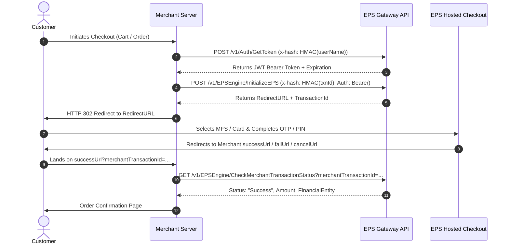
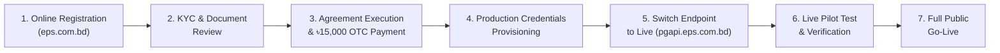

# EPS (Easy Payment System) Payment Gateway – Complete Research & Integration Guide

> **Authoritative Technical & Merchant Onboarding Reference for EPS Payment Gateway Bangladesh**  
> **Official Portal:** [eps.com.bd](https://www.eps.com.bd) | **Parent Company:** Optimum Solution and Services Limited (OSSL)  
> **Licensing & Security:** Bangladesh Bank Licensed Payment System Operator (PSO) | PCI DSS Certified Level 1  

---

## 1. Executive Summary & Platform Overview

**Easy Payment System (EPS)** is an online payment gateway and financial aggregator in Bangladesh, operated by **Optimum Solution and Services Limited (OSSL)** under the regulatory oversight of **Bangladesh Bank**. It enables eCommerce businesses, educational institutions, NGOs, FMCG companies, and service platforms to accept payments through a unified checkout interface.

### Supported Channels & Payment Methods

| Channel Category | Supported Providers / Methods |
| :--- | :--- |
| **Credit / Debit Cards** | VISA, MasterCard, American Express (Amex), Dutch-Bangla Bank (DBBL) Nexus, UnionPay, Mutual Trust Bank (MTB) cards |
| **Mobile Financial Services (MFS)** | bKash, Nagad, Rocket (DBBL), Upay (UCB), OK Wallet (One Bank), Tap, MCash, Meghna Pay, Islamic Wallet, EkPay |
| **Internet Banking** | Islami Bank Bangladesh (IBBL), Southeast Bank, City Bank (CityTouch), Meghna Bank, Al-Arafah Islami Bank |
| **Interoperable QR** | Bangla QR (allows QR scans from bank apps and MFS) |
| **Additional Features** | EMI (Equated Monthly Installment) facility, Instant Payment Notification (IPN), Payment Links, Recurring billing support |

---

## 2. YouTube & Tutorial Analysis

### 2.1 Video Analysis: `https://www.youtube.com/watch?v=U-MuQXSVUy4`
* **Title:** *Bangladesh Online Payment Gateway Solutions | EPS Payment Gateway*
* **Channel:** SamTech Digital / [@ecombuildr](https://www.youtube.com/@ecombuildr)
* **Core Topics Covered:**
  1. **Role of Payment Gateways in Bangladesh:** Why local eCommerce and funnel builders need an integrated gateway rather than relying purely on manual Cash-on-Delivery (COD) or manual bKash personal send-money.
  2. **eComBuildr / Storefront Setup:** How to connect EPS to online stores by configuring the merchant credentials (`Merchant ID`, `Store ID`, `Username`, `Password`, and `Hash Key`).
  3. **Checkout Experience:** How customers transition smoothly between cards, bKash, and Nagad without leaving the order funnel.
  4. **Trust & Compliance:** Emphasizes that EPS is a Bangladesh Bank licensed PSO, ensuring customer money does not get stuck in unregistered intermediary accounts.

### 2.2 Official EPS Video Tutorials (`eps.com.bd/help-support/tutorials`)
* **Merchant Dashboard Profile & KYC Upload:** ([YouTube `cCklq4e1SU8`](https://www.youtube.com/watch?v=cCklq4e1SU8)) – Walkthrough of uploading missing trade licenses, updating bank account information, and business profile verification.
* **Merchant Technical Integration Guide:** ([YouTube `sTE9e4Z3bcc`](https://www.youtube.com/watch?v=sTE9e4Z3bcc)) – API flow, HMAC-SHA512 hash calculation, sandbox token generation, and payment initialization.
* **Merchant Withdrawal & Settlement:** ([YouTube `kZeaPl39oW4`](https://www.youtube.com/watch?v=kZeaPl39oW4)) – Demonstrates how merchants monitor settled funds, check withdrawal thresholds, and initiate bank payouts.
* **WordPress / WooCommerce Plugin Setup:** ([YouTube `SY6LFRjH6ZM`](https://www.youtube.com/watch?v=SY6LFRjH6ZM)) – Installing and configuring the official `EPS_Woocommerce` plugin.
* **Universal Multi-Payment Demo:** ([YouTube `Iq8afHKQoqQ`](https://www.youtube.com/watch?v=Iq8afHKQoqQ)) – Demonstrates bKash, Nagad, and Visa cards unified on a single checkout screen.

---

## 3. Documents Required for Merchant Onboarding (KYC)

EPS enforces strict Know Your Customer (KYC) and Anti-Money Laundering (AML) standards compliant with Bangladesh Bank regulations.

### 3.1 Core Checklist (All Businesses)

1. **Trade License:** Valid, up-to-date Trade License (হালনাগাদ ট্রেড লাইসেন্স) for the current financial year.
2. **e-TIN Certificate:** Taxpayer Identification Number certificate in the name of the business or proprietor.
3. **National ID (NID) / Smart Card:** Clear scanned copy of the NID of the business owner or managing director.
4. **Passport-Sized Photograph:** Recent photograph(s) of the business owner / authorized signatories.
5. **Business Logo:** High-resolution digital logo in a **1:1 square ratio** (displayed on the hosted payment page and customer invoices).
6. **Proof of Bank Account:**
   * Scanned copy of a **blank MICR cheque leaf** (marked "CANCELLED") or
   * Official **Bank Account Statement** (with visible Bank Name, Branch, Account Name, Account Number, and Routing Number).
7. **Completed EPS Merchant Registration Form:** Filled via the online portal or physical PDF application.

### 3.2 Entity-Specific Requirements

| Business Structure | Additional Required Documentation |
| :--- | :--- |
| **Sole Proprietorship (একমালিকানা)** | • Personal NID & TIN of the proprietor<br>• Trade License reflecting the proprietor's name<br>• Current bank account in the proprietorship or proprietor name |
| **Partnership Firm (অংশীদারি কারবার)** | • Registered Partnership Deed (অংশীদারি চুক্তিপত্র)<br>• NID and TIN of all active partners<br>• Letter of authorization on company letterhead indicating the authorized operator |
| **Private Limited Company (প্রাঃ লিঃ)** | • Certificate of Incorporation (RJSC)<br>• Memorandum of Association (MOA) and Articles of Association (AOA)<br>• Form XII (List of Directors)<br>• Board Resolution approving payment gateway integration and designating authorized signatory<br>• NID & TIN of Managing Director / Directors |
| **eCommerce / fCommerce** | • Live website URL or active Facebook Page link<br>• Published terms & conditions, delivery timeline, and return/refund policy<br>• Working contact details and support channels visible on the website |
| **NGO / Education / Non-Profit** | • NGO Affairs Bureau / Social Welfare Department registration certificate<br>• Managing Committee resolution<br>• Approval letter from the governing body |

---

## 4. Pricing, Setup Fee & Commission Structure

### 4.1 Current Official EPS Pricing (Verified)

EPS operates on a transparent, single-tier model officially published on their portal ([eps.com.bd/join-us/pricing](https://www.eps.com.bd/join-us/pricing)):

| Fee Category | Cost / Rate | Notes & Comparison |
| :--- | :--- | :--- |
| **One-Time Cost (OTC) / Setup Fee** | **৳ 15,000 BDT** | **Non-refundable** upon account activation |
| **Credit / Debit Cards Fee** | **2.20%** | Per successful transaction (Visa, MasterCard, Amex, DBBL Nexus) |
| **Mobile Financial Services (MFS) Fee** | **2.00%** | Per successful transaction (bKash, Nagad, Rocket, Upay, OK Wallet) |
| **Internet Banking Fee** | **2.00%** | Per successful transaction (IBBL, City Bank, Southeast Bank, etc.) |
| **EMI (Installment) Service** | **Free Setup** | Enabled for existing EPS merchants at no additional gateway charge |
| **Annual Maintenance Fee (AMC)** | **৳ 0 / Waived** | Standard plans do not charge an annual renewal fee |

> [!NOTE]
> All fee deductions occur at source during transaction processing. The net amount is credited to the merchant's pending settlement balance.

---

### 4.2 Fee Verification: Why Did You Hear ৳ 7,000, and Why Is It ৳ 15,000 Now?

A common question among Bangladeshi merchants is why they may have heard of a **৳ 7,000 (or ৳ 6,999 / ৳ 7,500)** setup fee, whereas the official EPS website lists **৳ 15,000**. Comprehensive verification across web archives, industry data, and competitor analysis reveals the following concrete reasons:

#### 1. Confusion with Competing Gateways in Bangladesh
* **AamarPay (Starter / B2B Plan):** AamarPay's most popular entry-level B2B / eCommerce plan is famously priced at **৳ 6,999 (approx. ৳ 7,000)** (with Corporate at ৳ 15,999). Merchants frequently cross-compare AamarPay with EPS and misremember the ৳ 7,000 starter tier as belonging to EPS.
* **PayStation:** PayStation's entry-level starter plan is similarly marketed at **৳ 7,500** (often discounted).
* **SSLCOMMERZ:** SSLCOMMERZ charges **৳ 25,000 – ৳ 25,500** for corporate onboarding and around ৳ 15,000 during occasional SME fairs.

#### 2. Early-Bird Promotional Campaigns & Fairs
* During initial market rollout and major Bangladeshi fintech/IT events (such as **e-CAB e-Commerce Fairs** and **BASIS SoftExpo**), payment gateways (including EPS and partners) periodically run limited-time **50% promotional subsidies** on their standard ৳ 15,000 OTC, bringing the net entry cost down to approximately **৳ 7,000 – ৳ 7,500**.
* These promotional campaigns are temporary; once the promotional window ends, onboarding reverts to the standard baseline rate of **৳ 15,000**.

#### 3. Partner & Platform Ecosystem Offers (e.g., eComBuildr / Agencies)
* EPS offers an official **25% Referral Commission** on the One-Time Cost (`25% of ৳ 15,000 = ৳ 3,750`) to registered partners and agencies that refer new merchants ([eps.com.bd/join-us/refer-a-business](https://www.eps.com.bd/join-us/refer-a-business)).
* Partner platforms (such as agency bundles or eComBuildr promotional initiatives) sometimes absorb or discount a portion of the gateway setup fee as part of an bundled eCommerce website package, leading merchants to quote a lower out-of-pocket setup cost.

#### 4. All-Inclusive Feature Bundling at ৳ 15,000
While some cheaper tiers from other gateways restrict features (e.g., charging extra for EMI activation, charging extra for mobile SDKs, or charging annual renewal fees), EPS has set a single standard fee of **৳ 15,000** which bundles:
* **Full Channel Access:** Visa, Mastercard, Amex, DBBL Nexus, all MFS (bKash, Nagad, Rocket, Upay, OK Wallet), and Internet Banking.
* **Zero Extra Fee for EMI:** No additional ৳ 5,000 setup charge for card EMI facilities.
* **No Annual Maintenance Charge (AMC):** Unlike gateways that charge a recurring ৳ 5,000 – ৳ 10,000 yearly maintenance fee, EPS charges only the one-time onboarding fee.
* **Bangla QR & Payment Links:** Included out of the box without separate module fees.

#### 5. Industry-Specific & High-Volume Negotiations
* EPS explicitly states in their documentation and comparison policies that pricing is subject to dynamic market conditions. Merchants with high transaction volumes or registered under specific partner programs can contact the EPS Sales Team directly (`09609377377` / `support@eps.com.bd`) to request custom onboarding terms or campaign concessions.

---

## 5. Way to Test (Sandbox Integration & Technical Architecture)

EPS provides a dedicated sandbox environment to simulate end-to-end checkout, token exchange, and payment verification.

### 5.1 Official Sandbox Environment Credentials

The following credentials are provided by EPS for integration and sandbox testing:

```ini
EPS_USERNAME="Epsdemo@gmail.com"
EPS_PASSWORD="Epsdemo258@"
EPS_HASH_KEY="FHZxyzeps56789gfhg678ygu876o="
EPS_MERCHANT_ID="29e86e70-0ac6-45eb-ba04-9fcb0aaed12a"
EPS_STORE_ID="d44e705f-9e3a-41de-98b1-1674631637da"
```

### 5.2 API Base URLs

| Environment | Base URL |
| :--- | :--- |
| **Sandbox** | `https://sandboxpgapi.eps.com.bd` |
| **Production** | `https://pgapi.eps.com.bd` |
| **Sandbox Web Checkout Demo** | `https://sandboxpg.eps.com.bd/PaymentLink?id=66FF3A8C` |

### 5.3 Cryptographic Signature (HMAC-SHA512 Hash)

Every request to EPS requires a security header `x-hash`.  
**Hash Mechanism:**
1. Encode the secret `hashKey` using UTF-8.
2. Initialize an `HMAC-SHA512` instance using the encoded key.
3. Compute the hash using the targeted value (`userName` for authentication; `merchantTransactionId` for transaction calls).
4. Return the **Base64-encoded** digest.

#### Node.js / TypeScript Hash Implementation:
```typescript
import * as crypto from 'crypto';

export function generateHash(value: string, hashKey: string): string {
  const hmac = crypto.createHmac('sha512', Buffer.from(hashKey, 'utf8'));
  hmac.update(value, 'utf8');
  return hmac.digest('base64');
}
```

#### PHP Hash Implementation:
```php
function generateHash($data, $secretKey) {
    return base64_encode(hash_hmac('sha512', utf8_encode($data), $secretKey, true));
}
```

---

### 5.4 End-to-End API Integration Sequence



#### Step 1: Request Authentication Token
* **Endpoint:** `POST /v1/Auth/GetToken`
* **Headers:**
  * `Content-Type: application/json`
  * `x-hash: <Base64 HMAC-SHA512 of userName>`
* **Request Body:**
  ```json
  {
    "userName": "Epsdemo@gmail.com",
    "password": "Epsdemo258@"
  }
  ```
* **Response Body:**
  ```json
  {
    "token": "eyJhbGciOiJIUzI1NiIsIn...",
    "expireDate": "2026-09-30T12:00:00Z",
    "errorCode": null,
    "errorMessage": null
  }
  ```

#### Step 2: Initialize Transaction
* **Endpoint:** `POST /v1/EPSEngine/InitializeEPS`
* **Headers:**
  * `Content-Type: application/json`
  * `Authorization: Bearer <token>`
  * `x-hash: <Base64 HMAC-SHA512 of merchantTransactionId>`
* **Request Body:**
  ```json
  {
    "merchantId": "29e86e70-0ac6-45eb-ba04-9fcb0aaed12a",
    "storeId": "d44e705f-9e3a-41de-98b1-1674631637da",
    "CustomerOrderId": "ORD-10023",
    "merchantTransactionId": "2026092915401201",
    "transactionTypeId": 1,
    "totalAmount": 1250.00,
    "successUrl": "https://example.com/payment/success",
    "failUrl": "https://example.com/payment/fail",
    "cancelUrl": "https://example.com/payment/cancel",
    "customerName": "Abir Hasan",
    "customerEmail": "abir@example.com",
    "customerPhone": "01712345678",
    "customerAddress": "House 12, Road 4, Sector 11",
    "customerCity": "Dhaka",
    "customerState": "Dhaka",
    "customerPostcode": "1230",
    "customerCountry": "BD",
    "productName": "Wireless Headphone",
    "productProfile": "general",
    "productCategory": "Electronics"
  }
  ```
* **Response Body:**
  ```json
  {
    "TransactionId": "23e02880-f378-4594-86f8-30ecb5998094",
    "RedirectURL": "https://pg.eps.com.bd/PG?data=...",
    "ErrorCode": null,
    "ErrorMessage": null
  }
  ```

#### Step 3: Mandatory Server-to-Server Verification
* **Endpoint:** `GET /v1/EPSEngine/CheckMerchantTransactionStatus?merchantTransactionId=2026092915401201`
* **Headers:**
  * `Authorization: Bearer <token>`
  * `x-hash: <Base64 HMAC-SHA512 of merchantTransactionId>`
* **Response Body:**
  ```json
  {
    "MerchantTransactionId": "2026092915401201",
    "EpsTransactionId": "C2549190401",
    "Status": "Success",
    "TotalAmount": "1250.00",
    "TransactionDate": "29 Sep 2026 03:45:10 PM",
    "FinancialEntity": "bKash",
    "ErrorCode": null,
    "ErrorMessage": null
  }
  ```

> [!CAUTION]
> Never update order status to `PAID` merely based on the frontend query parameters at `successUrl`. Always issue the `CheckMerchantTransactionStatus` query from your secure backend to confirm that the transaction was legitimate and the amount matches.

---

### 5.5 Official & Open-Source Integration Libraries

EPS maintains several client integration packages available on [GitHub (EPS-PG)](https://github.com/EPS-PG):

* **Node.js / Express / TypeScript:** `npm install eps-gateway-nodejs`
* **PHP SDK:** [`EPS-PG/EPS_PHP`](https://github.com/EPS-PG/EPS_PHP)
* **WordPress / WooCommerce Plugin:** [`EPS-PG/EPS_Woocommerce`](https://github.com/EPS-PG/EPS_Woocommerce) (Supports WooCommerce blocks & shortcodes)
* **Laravel Framework Package:** [`EPS-PG/EPS_Laravel`](https://github.com/EPS-PG/EPS_Laravel)
* **Flutter Mobile SDK:** `flutter_eps` / [`EPS-PG/EPS_Flutter`](https://github.com/EPS-PG/EPS_Flutter)
* **ASP.NET MVC:** [`EPS-PG/EPS_ASP.NET-MVC`](https://github.com/EPS-PG/EPS_ASP.NET-MVC)
* **WHMCS Billing Module:** [`EPS-PG/EPS_WHMCS`](https://github.com/EPS-PG/EPS_WHMCS)

---

## 6. Way to Production (Go-Live Roadmap)



1. **Submit Registration:** Visit `https://www.eps.com.bd/payment-gateway-registration` and fill in personal and company information.
2. **KYC Document Submission:** Upload Trade License, TIN, NID, Bank Statement/Cheque leaf, and company logo.
3. **Compliance Review:** The EPS risk and compliance team reviews business legitimacy, website compliance (must feature privacy policy, terms, contact information, and refund policies).
4. **Contract & Fee Settlement:** Execute the Merchant Agreement and pay the **15,000 BDT** setup fee via bank transfer or EPS invoice.
5. **Credentials Delivery:** Receive live production credentials:
   * Production `Merchant ID` & `Store ID`
   * Production `Username` & `Password`
   * Production Base64 `Hash Key`
6. **Configuration Update:** Replace sandbox URLs (`sandboxpgapi.eps.com.bd`) with production endpoints (`pgapi.eps.com.bd`) and load live keys into environment variables.
7. **End-to-End Pilot Test:** Perform a live purchase using a personal card/bKash (e.g. ৳ 10 - ৳ 50 BDT) to confirm webhook callbacks and dashboard transaction tracking.

---

## 7. Settlements, Withdrawals & Payouts

EPS provides structured settlement procedures under Bangladesh Bank guidelines:

### 7.1 Payout Schedule
* **Cycle:** Typically **twice a week (Bi-weekly, e.g. T+2 to T+3 working days)**.
* **Payout Method:** Direct commercial bank transfer via **BEFTN** (Bangladesh Electronic Fund Transfer Network) or **NPSB** (National Payment Switch Bangladesh).
* **Bank Holidays:** Settlements scheduled on Fridays, Saturdays, or national public holidays are processed on the subsequent banking business day.

### 7.2 Merchant Dashboard Management
Through the EPS Merchant Portal, merchants can:
* Inspect **Real-Time Transactions** (Search by EPS Transaction ID, Merchant Order ID, Customer Mobile).
* View **Settlement Status** (`Pending`, `Processed`, `Disbursed`).
* Review transaction batch statements and download Excel/CSV reconciliation reports.
* Initiate manual withdrawal requests (subject to merchant agreement terms).

### 7.3 Bank Account Change Procedure
To alter the receiving bank account:
1. Submit an official **Bank Account Change Request** from the Merchant Dashboard.
2. Provide a formal letter on business letterhead and attach a new cancelled cheque leaf or bank certificate.
3. EPS compliance verifies the new account before routing upcoming settlements.

---

## 8. Return, Refund and Settlement Policy

EPS adheres to the Bangladesh Bank Payment Systems Regulations (2014) and e-Commerce Guidelines:

### 8.1 Refund Procedure
* **Merchant-Initiated:** The merchant initiates a refund request either via the Merchant API or by sending an official email to `support@eps.com.bd` within **90 working days** of the transaction.
* **Required Information:**
  * Transaction Date & Time
  * Merchant Name & Merchant ID
  * EPS Transaction ID
  * Customer Mobile Number
  * Original Transaction Amount
  * Amount to be Refunded (Full or Partial)
* **Settlement Fee Handling:**
  * **Full Refund:** EPS typically reverses its gateway settlement fee.
  * **Partial Refund:** Partial settlement fees may be deducted as mandated by downstream card networks/banks.
* **Timeline:** Refund requests are processed within **3 to 7 working days** (maximum 7 working days under standard circumstances).

### 8.2 Escrow & Delivery Confirmation
* In accordance with Bangladesh Bank e-commerce regulations, EPS reserves the right to hold transaction funds in escrow until the merchant provides proof of product shipment or delivery confirmation for physical goods.
* Digital services are considered completed once access is granted to the user.

---

## 9. Limitations, Constraints & Risk Factors

| Consideration | Details & Constraints |
| :--- | :--- |
| **Currency Support** | EPS processes natively in **BDT (Bangladeshi Taka)**. While international Visa/Mastercard credit cards can be accepted, funds are converted and settled into the merchant's local BDT account in compliance with Foreign Exchange Regulations. True multi-currency settlement (holding USD/EUR) is not available. |
| **Non-Refundable Setup Fee** | The ৳ 15,000 OTC is strictly non-refundable regardless of transaction volume or subsequent cancellation. |
| **Downstream Outages** | Availability of specific MFS channels (e.g. bKash or Nagad) or bank gateways depends on the third-party providers' switch uptime. EPS provides failover, but external maintenance windows will affect that specific channel. |
| **Chargebacks & Disputes** | Chargebacks for credit card payments are subject to Visa/Mastercard arbitration. The merchant must submit proof of delivery within the specified response window, or funds will be debited from pending balances. |
| **Prohibited Businesses** | EPS strictly prohibits integrations for unauthorized foreign exchange trading, cryptocurrency, gambling, unlicensed lotteries, MLM schemes, illicit adult entertainment, and counterfeit goods. |

---

## 10. Official Contacts & Support Channels

* **Official Portal:** [www.eps.com.bd](https://www.eps.com.bd)
* **Merchant Registration:** [eps.com.bd/payment-gateway-registration](https://www.eps.com.bd/payment-gateway-registration)
* **Technical Integration Support:** `integration@eps.com.bd` / `support@eps.com.bd`
* **Phone / Hotline:** `09609377377` / `+8801324722898` / `09614-770066`
* **Headquarters:** 38, Sonargaon Janapath Road, Sector-11, Uttara, Dhaka-1230, Bangladesh
* **Trade License:** `TRAD/DNCC/060179/2022`
