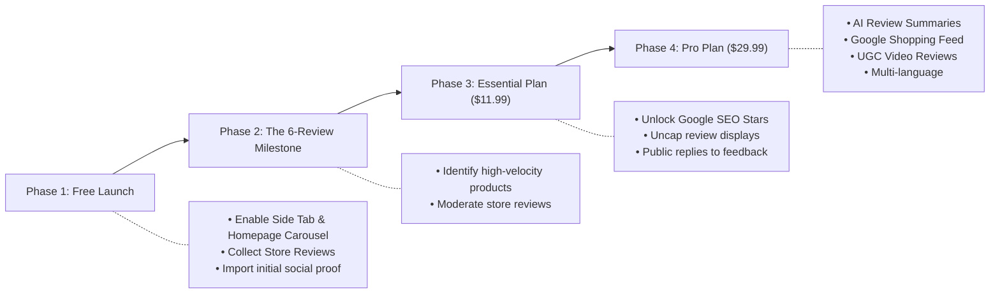

# CWILL (Trustoo / TrustWILL) Product Reviews: Complete App Guide & Strategy

> **App Store Listing:** [CWILL (Trustoo) Product Reviews on Shopify App Store](https://apps.shopify.com/sealapps-product-review)  
> **Developer:** CWILL (formerly SealApps / Trustoo.io)  
> **Rating:** 4.9 / 5.0 (1,560+ Reviews) • **Shopify Certification:** Built for Shopify  
> **Target Store Use-Case:** Store Reviews focus, Homepage Review Carousel, Floating Side Tab with Review Popup, and automated social proof engine.

---

## Table of Contents

1. [Executive Summary & App Overview](#1-executive-summary--app-overview)
2. [Pricing Plans & Tier Comparison](#2-pricing-plans--tier-comparison)
3. [Deep-Dive Feature Breakdown by Plan](#3-deep-dive-feature-breakdown-by-plan)
4. [Requirement Fit Analysis: Why Choose Trustoo?](#4-requirement-fit-analysis-why-choose-trustoo)
   - [Sidebar Floating Tab with Review Modal / Popup](#requirement-1-sidebar-floating-tab-with-review-modal--popup)
   - [Store Reviews Only / Brand-Level Reputation](#requirement-2-store-reviews-only-brand-level-reputation)
   - [Homepage Review Carousel (Card & Testimonial styles)](#requirement-3-homepage-review-carousel-card--testimonial-styles)
   - [10+ Customizable Widgets & Live Theme Customizer](#requirement-4-10-customizable-widgets--live-theme-customizer)
5. [Critical Considerations: The Free Plan Trade-Off](#5-critical-considerations-the-free-plan-trade-off)
6. [Step-by-Step Setup & Implementation Guide](#6-step-by-step-setup--implementation-guide)
   - [Enabling App Embeds in Shopify OS 2.0](#step-1-theme-app-embed-activation)
   - [Configuring Store Reviews vs Product Reviews](#step-2-configuring-store-reviews)
   - [Embedding the Homepage Carousel](#step-3-embedding-the-homepage-carousel)
   - [Activating the Side Tab & Popup Widget](#step-4-activating-the-side-tab--popup-widget)
7. [Competitive Comparison: Trustoo vs Judge.me vs Loox](#7-competitive-comparison-trustoo-vs-judgeme-vs-loox)
8. [Future Roadmap & Scaling Recommendations](#8-future-roadmap--scaling-recommendations)

---

## 1. Executive Summary & App Overview

**CWILL (Trustoo / TrustWILL)** is an enterprise-grade social proof and review generation platform built natively for Shopify. Originally released by **SealApps**, the app has grown into a versatile review app officially certified under Shopify’s **"Built for Shopify"** program—signaling adherence to Shopify’s strict performance, security, and user experience standards.

```
┌────────────────────────────────────────────────────────────────────────┐
│                        APP AT A GLANCE                                 │
├───────────────────────┬────────────────────────────────────────────────┤
│ Official App Name     │ CWILL(Trustoo) Product Reviews (TrustWILL)      │
│ App Store URL Handle  │ sealapps-product-review                        │
│ Shopify App Category  │ Social Proof & Product Reviews                 │
│ Rating & Feedback     │ 4.9 ★ / 5.0 (1,560+ merchant reviews)          │
│ Certification         │ "Built for Shopify" Verified                   │
│ Core Focus            │ Photo/Video Reviews, Store Reviews, Side Tab,  │
│                       │ Multi-widget Carousels, Auto-Translation       │
└───────────────────────┴────────────────────────────────────────────────┘
```

### Why It Stands Out
Unlike standard review apps that only provide a basic review form under single product pages, Trustoo is engineered around **flexible widget placement** across every page template:
- Floating **Side Tab** (sidebar widget) that opens a reviews drawer/popup modal.
- Dedicated **Store Review** collection (evaluating customer service, shipping, and store reliability independently of individual catalog SKUs).
- Multi-format **Carousels** for Homepage, About Us, and Cart pages.
- Built-in review imports (AliExpress, Amazon, CSV, and migrations from Loox/Judge.me).

---

## 2. Pricing Plans & Tier Comparison

Trustoo offers three clear pricing tiers: a **Free tier** and two paid tiers with a **7-day free trial** and **20% discount on annual billing**.

| Feature / Metric | Free Plan | Essential Plan | Pro Plan |
| :--- | :--- | :--- | :--- |
| **Monthly Price** | **$0 / month** | **$11.99 / month** | **$29.99 / month** |
| **Annual Price** | $0 | **$115.10 / year** (Save 20%) | **$287.90 / year** (Save 20%) |
| **Free Trial** | Forever Free | 7 Days Free Trial | 7 Days Free Trial |
| **Review Collection Volume** | Unlimited Product & Store Reviews | Unlimited Product & Store Reviews | Unlimited Product & Store Reviews |
| **Storefront Review Display Limit** | **6 reviews per product** ⚠️ | **Unlimited review displays** | **Unlimited review displays** |
| **Review Widgets Included** | 10+ Free Widgets (Side Tab, Carousel, Badges) | 10+ Widgets + Unlimited display | 10+ Widgets + Unlimited display |
| **Photo Reviews** | Yes (Free) | Yes | Yes |
| **Video Reviews** | No (Photos only) | No (Photos only) | **Yes (Photo + Video UGC)** |
| **AI Review Summary & Insights** | ❌ **No (Requires Pro)** | ❌ **No (Requires Pro)** | **Yes (Pro Plan - min. 15 reviews)** |
| **Google SEO Rich Snippets** | No | **Yes (JSON-LD Schema)** | **Yes (JSON-LD Schema)** |
| **Google Shopping Feed** | No | No | **Yes (Google PLA syndication)** |
| **Merchant Public Reply** | No | **Yes (Reply to reviews)** | **Yes (Reply to reviews)** |
| **Auto-Translation** | Manual / Default Language | **Auto-translate 1 language** | **Multi-language translation** |
| **App Integrations & API** | Standard Shopify | Standard Shopify | **Custom API & Integrations** |
| **Product Grouping** | No | No | **Yes (Share reviews across variants/SKUs)** |
| **Support** | 24/7 Live Chat Support | 24/7 Live Chat Support | 24/7 Priority Support |


---

## 3. Deep-Dive Feature Breakdown by Plan

### Plan 1: Free Plan ($0 / Month Forever)
The Free Plan is designed for stores looking to establish initial social proof without upfront software overhead.

**Included Features:**
1. **Unlimited Review Collection:** You can capture unlimited customer reviews and store reviews via automated email requests and external imports.
2. **10+ Customizable Display Widgets:**
   - **Side Tab / Sidebar Widget:** Sticky tab on the browser edge that triggers a review popup/drawer.
   - **Review Carousel:** Card Carousel, Testimonial Carousel, and Photo Carousel.
   - **Product Review Box:** Main review container with star rating filter.
   - **Star Rating Badges:** Product card badges on collection and home pages.
   - **Review Badges & Grid:** Grid layouts and social proof badges.
3. **Photo Review Collection:** Request and display photo uploads from customers.
4. **Basic Widget & Email Customization:** Customize star colors, button styles, typography, and email subject lines to match your brand palette.
5. **Multi-Source Review Import:** 1-click import from AliExpress, Amazon, DSers, CSV files, and previous review platforms.
6. **24/7 Live Chat Support:** Access to technical assistance for widget styling and theme embed troubleshooting.

> [!WARNING]
> **Free Plan Restriction:** The Free Plan limits visible reviews to **6 reviews per product** on your public storefront. Furthermore, **AI Review Summaries are NOT available on the Free or Essential plans**—AI Summarize is exclusively locked to the **Pro Plan ($29.99/mo)** and requires a minimum of 15 valid customer reviews.

---

### Plan 2: Essential Plan ($11.99 / Month or $115.10 / Year)
The Essential Plan unlocks uncapped display volume, critical SEO capabilities, and customer interaction tools.

**Everything in Free, plus:**
1. **Show Unlimited Reviews:** Completely removes the 6-review display cap, allowing your entire catalog to display 10, 50, or 500+ reviews per item.
2. **Google Rich Snippets (SEO Schema):** Automatically injects JSON-LD structured data into your store's HTML. This displays star ratings and review counts directly in Google organic search results, increasing search Click-Through Rate (CTR) by 15–30%.
3. **Branded Email Templates:** Advanced customization of transactional review request emails (custom logos, banners, dynamic coupon incentives).
4. **Public Merchant Replies:** Reply publicly to customer reviews to address feedback, resolve customer support concerns, and demonstrate active customer care.
5. **Single-Language Auto-Translation:** Automatically translate customer review text into 1 secondary store language.

---

### Plan 3: Pro Plan ($29.99 / Month or $287.90 / Year)
The Pro Plan provides enterprise features designed for scaling multi-product, multi-channel brands.

**Everything in Essential, plus:**
1. **AI Review Summary & AI Insights:** Automatically parses customer feedback, summarizes key product strengths, and highlights common customer sentiment into a concise summary block (requires a minimum of 15 approved reviews).
2. **Video Reviews Collection:** Allows customers to film and upload unboxing and product walkthrough videos directly from their mobile devices.
3. **Google Shopping Integration:** Syndicates approved reviews directly into Google Shopping Product Listing Ads (PLA) and Google Merchant Center feeds.
4. **Product Grouping (Shared Reviews):** Share reviews across product families (e.g., if you sell a shirt in 5 colors or different sizes, reviews across all variants aggregate into a single unified social proof pool).
5. **Multi-Language Translation Engine:** Full real-time translation across multiple international market locales.
6. **Developer API & Advanced Webhooks:** Integrate review triggers into custom CRM pipelines, headless storefronts, or Klaviyo marketing flows.

---

## 4. Requirement Fit Analysis: Why Choose Trustoo?

Your specific requirements match the native architectural strengths of Trustoo / TrustWILL:

```
MERCHANT REQUIREMENTS                         TRUSTOO NATIVE CAPABILITY
─────────────────────────────────────────────────────────────────────────────
[✓] Review Sidebar / Floating Tab     ───►    Native "Side Tab" widget
[✓] Adding Store Reviews Only         ───►    Independent Store Review data type
[✓] Carousel with Store Reviews       ───►    Home Page Card / Testimonial Carousel
[✓] All-Review Sidebar with Popup     ───►    Side Tab opens Full Modal / Drawer
[✓] Zero Initial Cost (Free Plan)     ───►    All 10+ widgets available on Free tier
```

### Requirement 1: Sidebar Floating Tab with Review Modal / Popup
- **How It Works:** Trustoo includes a dedicated **Side Tab** app embed. When turned on, a sticky vertical or horizontal badge (e.g., *"Reviews ★ 4.9"* or *"Customer Feedback"*) floats on the left or right margin of the browser window.
- **The Popup / Modal Experience:** When a customer clicks the floating tab from any page (Home, Collection, About Us, or Product), the app opens an overlay **modal popup or sliding drawer** displaying your aggregated reviews, overall star rating, and a *"Write a Review"* submission button.
- **Why It Matters:** Shoppers do not need to navigate away from their current page to verify store credibility.

### Requirement 2: Store Reviews Only (Brand-Level Reputation)
- **The Challenge with Generic Apps:** Many review apps strictly tie reviews to individual product handles (`product.id`). If you sell custom services, dropshipped goods, or want to emphasize store trust over SKU-specific feedback, generic apps force fake product bindings.
- **Trustoo's Advantage:** Trustoo natively distinguishes between **Product Reviews** (tied to a specific item) and **Store Reviews** (tied to the overall business, shipping reliability, and customer service).
- **Store-Only Configuration:** You can configure Trustoo to collect and display **Store Reviews only**, allowing you to showcase brand reliability across the entire site without requiring individual catalog review counts.

### Requirement 3: Homepage Review Carousel (Card & Testimonial Styles)
- **Card Carousel:** Displays high-converting cards featuring the reviewer's star rating, review text, customer name, verified buyer badge, and uploaded photos.
- **Filtering by Store Reviews:** You can set the carousel data source specifically to **Store Reviews** or curate your top 5-star customer testimonials.
- **Customization Options:** Responsive design with swipe controls on mobile, autoplay, customizable card background colors, star tinting, and typography matching your Shopify theme.

### Requirement 4: 10+ Customizable Widgets & Live Theme Customizer
- Trustoo integrates directly into Shopify Online Store 2.0 (OS 2.0) as **App Blocks** and **App Embeds**.
- You can position widgets visually using the standard Shopify Theme Editor without editing raw Liquid code.
- Color schemes, borders, radius, and star SVG styling can be adjusted live with real-time previewing.

---

## 5. Critical Considerations: The Free Plan Trade-Off

Before launching on the Free plan, keep the following architectural factors in mind:

```
┌────────────────────────────────────────────────────────────────────────┐
│                   FREE PLAN EVALUATION CHECKLIST                       │
├──────────────────────────────────────┬────────────┬────────────────────┤
│ Feature                              │ Free Plan  │ Upgrade Required?  │
├──────────────────────────────────────┼────────────┼────────────────────┤
│ Side Tab / Floating Sidebar Tab      │ Included   │ No                 │
│ Popup / Modal Review Viewer          │ Included   │ No                 │
│ Homepage Store Review Carousel       │ Included   │ No                 │
│ Store Review Collection Engine       │ Included   │ No                 │
│ Photo Uploads from Buyers            │ Included   │ No                 │
│ Display more than 6 reviews/product  │ Restricted │ Essential ($11.99) │
│ Google SEO Rich Snippets (SERP Stars)│ Restricted │ Essential ($11.99) │
│ Public Merchant Review Replies       │ Restricted │ Essential ($11.99) │
│ AI Review Summary & Insights         │ Restricted │ Pro ($29.99)       │
│ Video Review Submissions             │ Restricted │ Pro ($29.99)       │
└──────────────────────────────────────┴────────────┴────────────────────┘

```

> [!IMPORTANT]
> **Store Reviews vs Product Reviews Limit:** While individual product pages cap display at 6 reviews on the Free tier, store-wide widgets (such as the Side Tab and Homepage Carousel) can rotate through your approved store testimonials. Once your total review volume grows, upgrading to Essential ($11.99/mo) unlocks unlimited storefront rendering and SEO rich snippets.

---

## 6. Step-by-Step Setup & Implementation Guide

### Step 1: Theme App Embed Activation
1. Install the app via [Shopify App Store](https://apps.shopify.com/sealapps-product-review).
2. Open your **Shopify Admin** > **Online Store** > **Themes**.
3. Click **Customize** on your active theme (e.g., Dawn, Sense, or custom theme).
4. In the left-hand toolbar, click the **App Embeds** tab (the 3rd icon).
5. Toggle **Trustoo Core Script** / **App Embed** to **ON**.
6. Click **Save** in the top-right corner.

```
Shopify Theme Editor
 ├── Sections
 ├── Theme Settings
 └── App Embeds
      └── [✓] Trustoo Core Engine ───► Must be Enabled
```

---

### Step 2: Configuring Store Reviews
1. Open **Shopify Admin** > **Apps** > **CWILL(Trustoo) Product Reviews**.
2. Navigate to **Settings** > **Review Type** (or **Collect Reviews**).
3. Enable **Store Reviews**:
   - Customize the Store Review form fields (Customer Name, Rating, Review Content, Photo upload).
   - Configure review questions (e.g., *"How was your overall shopping experience?"*, *"How was the delivery speed?"*).
4. Set **Auto-Publish Criteria**:
   - Set to auto-publish reviews with 4 or 5 stars.
   - Send 1-3 star reviews to the moderation queue for private resolution before publishing.

---

### Step 3: Embedding the Homepage Carousel
1. In the Shopify Theme Editor, navigate to the **Home page** template.
2. In the left panel, scroll down to the bottom of the section list and click **Add section**.
3. Under the **APPS** heading, select **Trustoo - Card Carousel** (or **Featured Reviews Carousel**).
4. In the section configuration panel on the right:
   - **Data Source:** Select *Store Reviews* or *Curated Reviews*.
   - **Display Mode:** Choose *Carousel / Slider*.
   - **Items to Show:** Set 6 to 12 items.
   - **Cards Per View:** 3 on Desktop, 1 on Mobile.
   - **Styling:** Match card background (`#FFFFFF`), border radius (`8px` or `12px`), and star color (`#ECA72C` or your brand accent).
5. Reorder the section to sit above your Footer or directly below your Hero / Featured Collection.
6. Click **Save**.

---

### Step 4: Activating the Side Tab & Popup Widget
1. In the Trustoo App Admin dashboard, click on **Widgets** > **Side Tab** (or **Floating Widget**).
2. Toggle the widget status to **Active / Enabled**.
3. Configure the Side Tab settings:
   - **Position:** Choose *Middle Left* or *Middle Right*.
   - **Label Text:** *"Customer Reviews"*, *"★ Reviews"*, or *"Our Ratings"*.
   - **Color:** Set button background and font contrast color.
4. Configure the Popup Action:
   - Select **Open Drawer / Modal** upon click.
   - Choose which review pool to display: **All Reviews (Store + Products)** or **Store Reviews Only**.
   - Enable the **"Write a Review"** button inside the popup so new store visitors can easily leave direct feedback.
---

### Step 5: Viewing, Customizing & Testing Review Request Email Templates

To view and customize the automated review request email sent to your customers:

```
Shopify Admin
 └── Apps
      └── CWILL (Trustoo) Product Reviews
           └── Collect Reviews (or Request Emails)
                ├── Email Settings & Trigger Timing
                ├── Template Editor & Live Preview
                └── Send Test Email
```

1. **Navigate to the Email Settings:**
   - In **Shopify Admin**, click **Apps** > **CWILL(Trustoo) Product Reviews**.
   - In the app's left sidebar, click on **Collect Reviews** > **Email Requests** (or **Request Emails** / **Email Notifications**).
2. **Review the Email Status & Delivery Timing:**
   - Verify that **Automatic Review Requests** are toggled **ON**.
   - Check the **Sending Trigger**: Default is typically **7 to 14 days after fulfillment** or order delivery.
3. **Inspect the Email Template & Preview:**
   - Click **Customize** or click directly into the email template card.
   - You will see a split view:
     - **Left Panel (Editor):** Subject line (e.g., `How was your recent purchase with {{ store_name }}?`), sender name, reply-to email address, email copy, and discount code incentive toggle.
     - **Right Panel (Live Preview):** Real-time responsive preview showing how the email renders on **Desktop** and **Mobile** with product image and star rating call-to-action.
4. **Send a Test Email to Your Inbox:**
   - Click the **"Send Test Email"** button (located at the top right of the template editor).
   - Enter your personal email address and click **Send**.
   - Check your inbox to review the exact typography, buttons, and layout your customers will receive.
5. **(Optional) Advanced Email via Klaviyo / Omnisend:**
   - If using Klaviyo, go to **Integrations > Klaviyo** in the Trustoo dashboard to route review requests through your branded Klaviyo flows instead.

---


## 7. Competitive Comparison: Trustoo vs Judge.me vs Loox

To provide complete strategic context, here is how Trustoo compares against the primary market alternatives:

```
┌───────────────────┬────────────────────┬────────────────────┬────────────────────┐
│ Capability        │ Trustoo (CWILL)    │ Judge.me           │ Loox               │
├───────────────────┼────────────────────┼────────────────────┼────────────────────┤
│ Free Tier Cap     │ 6 reviews/product  │ Unlimited displays │ 14-day trial only  │
│ Free Side Tab     │ Built-in native    │ Floating tab incl. │ Floating tab incl. │
│ Free Carousel     │ Full carousel inc. │ Limited carousels  │ Paid only ($9.99+) │
│ Store Reviews     │ Native distinction │ Supported via tags │ Mixed with items   │
│ Video Reviews     │ Pro tier ($29.99)  │ Free tier included │ Paid tier ($34.99) │
│ Google SEO Schema │ Essential ($11.99) │ Free tier included │ Paid tier ($9.99+) │
│ UI Modernity      │ Very high (modern) │ Clean / functional │ Premium photo grid │
│ 24/7 Chat Support │ Fast & responsive  │ 24/7 Live chat     │ Email / Ticket     │
└───────────────────┴────────────────────┴────────────────────┴────────────────────┘
```

### Strategic Verdict
- **Pick Trustoo if:** You want stylish, modern visual widgets (Side Tab popup, homepage carousel, customizable badges) out of the box with zero setup friction, and you want an isolated Store Review system without complex custom coding.
- **Pick Judge.me if:** You want 100% free unlimited reviews and SEO rich snippets with zero display caps forever, and you are comfortable with more utilitarian widget styling.
- **Pick Loox if:** You have a dedicated budget ($35+/mo) and want aggressive post-purchase photo upsells.

---

## 8. Future Roadmap & Scaling Recommendations

Follow this phased operational roadmap to maximize ROI from your review system:



### Phase 1: Launch Stage (Current - Free Plan)
1. **Focus on Store Reviews First:** If launching with new or unproven products, prioritize collecting store-level feedback (shipping speed, customer service, packaging quality). This builds overall brand credibility faster than waiting for individual product reviews.
2. **Promote the Homepage Carousel:** Place the store review carousel prominently on the homepage to reduce bounce rate and reassure first-time visitors.
3. **Turn on the Side Tab:** Ensure the floating sidebar tab is visible across all collection and product pages.
4. **Automate Review Request Timing:** Set automated review collection emails to trigger **7 to 14 days post-fulfillment** (ensuring the customer has received and opened their package).

### Phase 2: Growth Stage (When to Upgrade to Essential @ $11.99/mo)
Upgrade to **Essential** when:
- Any top-selling product crosses **6 customer reviews** (to avoid hiding valid social proof).
- Your store begins generating consistent organic search traffic, and you want **Google Rich Snippets** (star ratings under your Google search listings) to boost click-through rates.
- You need to post public merchant responses to answer customer queries or address negative reviews constructively.

### Phase 3: Scaling Stage (When to Upgrade to Pro @ $29.99/mo)
Upgrade to **Pro** when:
- You want **AI Review Summaries & Insights** enabled on your product pages (requires Pro plan and minimum 15 valid reviews per product).
- You scale paid acquisition on **Google Shopping / Performance Max**, where displaying star ratings directly on Google ads drastically drops customer acquisition cost (CAC).
- Your brand launches an influencer or UGC campaign requiring **customer video review submissions**.
- You expand into cross-border ecommerce requiring automated multi-language review translation.


---

## Summary of Actionable Next Steps

1. **Install App:** Add `sealapps-product-review` from the Shopify App Store.
2. **Enable App Embed:** Turn on the Trustoo core engine in your Shopify Theme Editor under *App Embeds*.
3. **Configure Store Reviews:** Navigate to Trustoo Settings to enable store-level feedback and auto-publish rules.
4. **Deploy Widgets:**
   - Add **Trustoo - Card Carousel** to the Homepage section list.
   - Activate the **Side Tab** in Trustoo Widget settings and link it to the popup drawer.
5. **Review Monitoring:** Review incoming feedback weekly, curate top reviews for the homepage carousel, and upgrade to Essential when ready to scale beyond the 6-review display cap.
