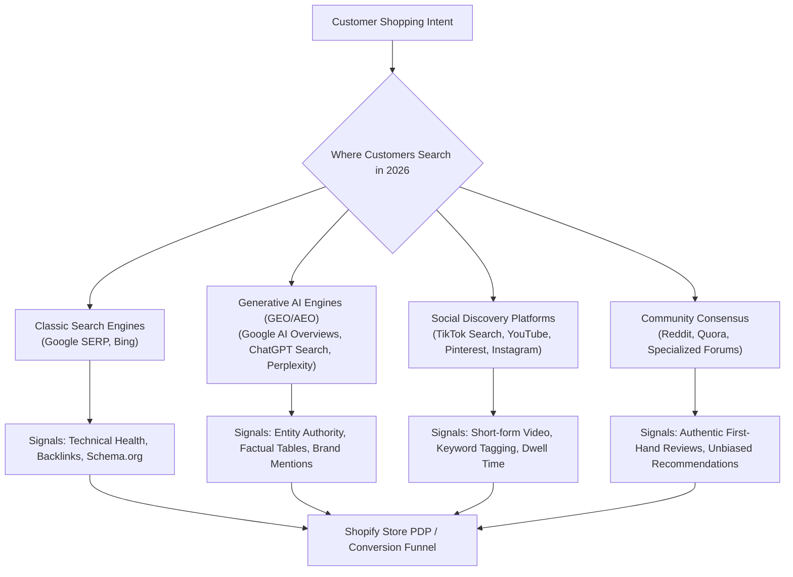
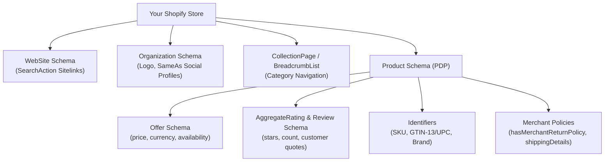
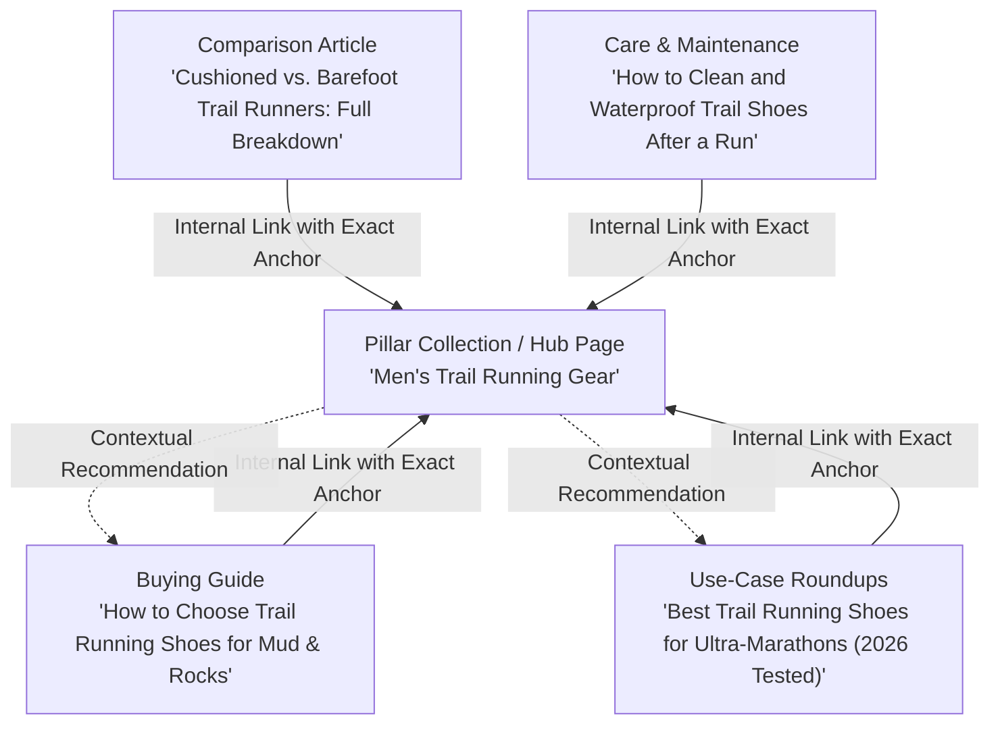
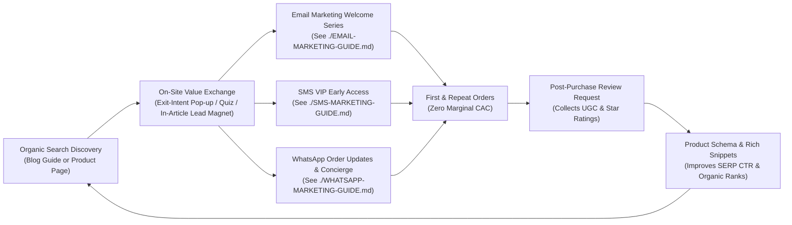

# SEO & Content Marketing for Shopify: The Complete Guide

> A comprehensive, data-backed guide to ecommerce Search Engine Optimization (SEO) and content marketing for Shopify stores. Grounded in official Shopify documentation, Google Search Central standards (updated for 2026 Core Systems and AI Overviews), and masterclasses from leading ecommerce practitioners.

*Last verified & updated: October 2026*  
*Target Audience: Shopify merchants, DTC brand founders, and ecommerce growth marketers looking to build compounding, zero-CAC organic acquisition engines.*

---

## Table of Contents

1. [What Is Shopify SEO & Content Marketing?](#1-what-is-shopify-seo--content-marketing)
2. [Why SEO & Content Matter for Shopify (The Zero-CAC Engine)](#2-why-seo--content-matter-for-shopify-the-zero-cac-engine)
3. [The Modern Search Landscape: From 10 Blue Links to Search Everywhere (GEO & AEO)](#3-the-modern-search-landscape-from-10-blue-links-to-search-everywhere-geo--aeo)
4. [Masterclass Takeaways: Brendan Gillen's Shopify SEO Series](#4-masterclass-takeaways-brendan-gillens-shopify-seo-series)
5. [Shopify Technical Architecture & Built-in Limitations](#5-shopify-technical-architecture--built-in-limitations)
6. [Ecommerce Keyword Research & Search Intent Mapping](#6-ecommerce-keyword-research--search-intent-mapping)
7. [On-Page Optimization: Product & Collection Pages](#7-on-page-optimization-product--collection-pages)
8. [Structured Data, Schema.org & Google Merchant Center](#8-structured-data-schemaorg--google-merchant-center)
9. [Content Marketing Strategy: Topic Clusters & High-Converting Formats](#9-content-marketing-strategy-topic-clusters--high-converting-formats)
10. [Site Speed & Core Web Vitals (INP, LCP, CLS)](#10-site-speed--core-web-vitals-inp-lcp-cls)
11. [Link Building & Digital PR for Ecommerce](#11-link-building--digital-pr-for-ecommerce)
12. [Tools & App Ecosystem (October 2026 Verified Pricing)](#12-tools--app-ecosystem-october-2026-verified-pricing)
13. [Measuring Performance: GSC, GA4 & Shopify Analytics](#13-measuring-performance-gsc-ga4--shopify-analytics)
14. [Cross-Channel Synergy: Connecting SEO to Email, SMS & WhatsApp](#14-cross-channel-synergy-connecting-seo-to-email-sms--whatsapp)
15. [90-Day Implementation Roadmap](#15-90-day-implementation-roadmap)
16. [Common Shopify SEO Mistakes to Avoid](#16-common-shopify-seo-mistakes-to-avoid)
17. [Quick Reference Checklist](#17-quick-reference-checklist)
18. [References & Verified Sources](#18-references--verified-sources)

---

## 1. What Is Shopify SEO & Content Marketing?

Shopify SEO is the process of optimizing your online store's technical architecture, on-page content, internal structure, and external authority so that search engines (Google, Bing) and AI search agents (Google AI Overviews, ChatGPT Search, Perplexity) rank your products, collections, and informational resources at the top of organic results.

Content marketing is the strategic creation of high-value, educational, and problem-solving editorial assets (buying guides, comparison tables, how-to tutorials, video breakdowns) designed to attract prospective shoppers during their research phase and convert them into buyers.

### The Organic Ecommerce Growth Loop

While paid social (Meta, TikTok) and paid search (Google Shopping Ads) operate as "pay-to-play" taps—where traffic stops the second ad spend is paused—SEO and content marketing function as capital assets that compound in value over time:

```
+-------------------------------------------------------+
|                THE ORGANIC COMPOUNDING LOOP           |
|                                                       |
|  1. Comprehensive Guide / Optimized Product Page      |
|                        |                              |
|                        v                              |
|  2. Ranks for High-Intent & Commercial Keywords       |
|                        |                              |
|                        v                              |
|  3. Captures Continuous High-Intent Organic Traffic    |
|                        |                              |
|                        v                              |
|  4. Captures Email/SMS/WhatsApp Leads ($0 CAC)        |
|                        |                              |
|                        v                              |
|  5. Generates Orders, Customer Reviews & Backlinks    |
|                        |                              |
|                        v                              |
|  6. Boosts Domain Authority & AI Entity Recognition   |
|                        |                              |
|                        +-----> Loops back to Step 1   |
+-------------------------------------------------------+
```

---

## 2. Why SEO & Content Matter for Shopify (The Zero-CAC Engine)

In an environment characterized by rising ad costs (Meta CPMS up year-over-year) and privacy restrictions (Apple ATT, third-party cookie deprecation), brands that rely solely on paid acquisition face diminishing profit margins.

### The Numbers Behind Organic Search

- **43% of all ecommerce traffic** originates from organic Google search queries.
- **Organic search delivers an average conversion rate of 2.8%**, compared to 1.5% - 2.1% for paid social ads.
- **Compounds with zero marginal CAC**: Once an article or collection page ranks in the top 3, every incremental click and transaction carries a Customer Acquisition Cost of $0.
- **Higher Customer Lifetime Value (LTV)**: Customers who discover a brand organically demonstrate 22% higher 12-month retention rates than customers acquired via impulse-driven social media ads.

### Paid vs. Organic Acquisition Comparison

| Metric | Paid Social (Meta/TikTok) | Paid Search (Google Ads) | SEO & Content Marketing |
| :--- | :--- | :--- | :--- |
| **Upfront Cost** | Low to Medium | Medium | Medium (time/production) |
| **Speed to Results** | Immediate (24-48 hours) | Immediate (1-7 days) | Compounding (60-180 days) |
| **Sustainability** | Stops immediately when budget is cut | Stops immediately when budget is cut | Continues delivering traffic for years |
| **Audience Intent** | Passive / Interruption | Active / High Intent | Active / High & Research Intent |
| **Traffic Scalability** | Linear to budget | Linear to budget | Exponential compounding |
| **Long-Term Asset Value** | Zero (rented channel) | Zero (rented channel) | High (owned enterprise equity) |

---

## 3. The Modern Search Landscape: From 10 Blue Links to Search Everywhere (GEO & AEO)

Search has evolved dramatically. Today, consumers do not rely solely on traditional search engine results pages (SERPs). Instead, discovery is fragmented across multiple AI engines and social platforms.

### Search Everywhere Optimization Framework



### Key Dimensions of the Shift

1. **Generative Engine Optimization (GEO) & Answer Engine Optimization (AEO)**:
   - Search engines like Google now present **AI Overviews** (formerly SGE) at the top of results for complex, conversational, and informational queries.
   - ChatGPT Search and Perplexity synthesize answers from multiple authoritative web sources, citing specific brands and products directly in their synthesized answers.
   - To be cited by AI engines, content must feature clear semantic structure, concise factual statements, structured tables, and verifiable third-party consensus.

2. **The Role of Reddit & Community Discussions**:
   - Google's Helpful Content System and Core Updates heavily weight first-hand human experience (E-E-A-T). For query modifiers like "best", "review", and "reddit", Google frequently displays Reddit and forum discussions prominently.
   - Brands must engage in authentic community advocacy and ensure real customer satisfaction, as AI search models scrape forum consensus to form product recommendations.

3. **Demystifying `llms.txt`**:
   > [!NOTE]
   > `llms.txt` is an open community-proposed standard (introduced in late 2024 / 2025) intended to provide a markdown-formatted directory of a website for Large Language Models.
   > **Official Search Reality:** As of late 2026, neither Google, Microsoft Bing, nor major commercial AI crawlers use `llms.txt` as a formal ranking signal or official indexing standard. Official search engines and AI crawlers (Googlebot, Bingbot, GPTBot, PerplexityBot) rely on standard HTML, clean DOM structure, XML sitemaps, JSON-LD structured data, and robots.txt directives. While publishing an `llms.txt` does no harm, it is not a replacement for rock-solid technical and semantic SEO.

---

## 4. Masterclass Takeaways: Brendan Gillen's Shopify SEO Series

In his masterclasses and tutorials (*@theecomacademy*), ecommerce practitioner Brendan Gillen breaks down the exact methodologies used to scale multi-million dollar Shopify stores through organic search. Below is an executive synthesis of the three key videos referenced in this curriculum, reconciled with Google Search Central guidelines:

### Video 1: "Shopify SEO Optimisation Guide (Advanced Strategies)" (`xf2x919Nf8A`)
- **Structured Data & Schema as a Competitive Moat**: Most Shopify themes only implement rudimentary schema. Adding granular schema (Product, AggregateRating, Offer, InStock, FAQ) directly drives visual rich snippets (star ratings, price tags, inventory status) that lift SERP click-through rates (CTR) by 20% to 35%.
- **Product Page FAQ Sections**: Integrating a dedicated FAQ accordion onto every core product detail page (PDP) accomplishes two goals:
  1. Captures long-tail informational searches (e.g., "is [brand product] waterproof?").
  2. Directly satisfies customer pre-purchase friction, increasing conversion rates.
- **Image Optimization Framework**: Image compression alone is insufficient. File naming must be descriptive and hyphenated (e.g., `mens-waterproof-trail-running-shoes-black.jpg` instead of `IMG_9482.jpg`), accompanied by accurate, context-specific `alt` attributes.

### Video 2: "SEO for Shopify Masterclass [LIVE STREAM]" (`8gOB1IQrNyU`)
- **Google Search Console (GSC) as the Primary Operating System**: Stop guessing rankings using third-party scrapers. GSC provides first-party impression, click, and query data. Filter for pages ranking in positions 4-15 with high impressions and optimize title tags/meta descriptions to capture low-hanging clicks.
- **Competitor Keyword Gap Identification**: Use tools like Semrush or Ahrefs to identify keywords where your top 3 competitors rank on page 1, but your domain has no indexed URL. These gaps define your immediate editorial content roadmap.
- **Link Building via Commercial Partnerships**: Forget low-quality guest posts and spam directory submissions. The highest-converting, safest backlinks for ecommerce come from:
  - Manufacturer/Supplier directories ("Where to Buy" links).
  - Co-marketing partnerships with complementary non-competing DTC brands.
  - Digital PR around proprietary product data or unique industry insights.

### Video 3: "SEO Has Changed Forever in 2026" (`P3Gfo3JZXYU`)
- **From Single-Channel to Search Everywhere**: Ranking #1 on Google's desktop search is no longer enough. Modern consumers search on TikTok for styling, YouTube for in-depth reviews, Amazon for fast comparisons, and Reddit for unfiltered opinions.
- **Creating Digital Real Estate Properties**: Brands must secure and optimize ancillary digital properties (YouTube channel, Pinterest boards, TikTok storefront, Substack/Medium profiles) to dominate the entire first page of branded search results ("SERP Domination").
- **Optimizing for AI Summaries**: Write content in structured, direct-answer format. When answering "How to choose a mechanical keyboard," provide a definitive 40-word summary upfront before diving into nuanced sub-sections. AI scrapers favor concise, authoritative answer blocks.

---

## 5. Shopify Technical Architecture & Built-in Limitations

Shopify provides an exceptionally robust, fast cloud hosting infrastructure backed by a global CDN (Cloudflare). However, its rigid architectural opinion presents several unique technical SEO quirks that every merchant must understand and optimize.

### Built-in Shopify SEO Features vs. Technical Constraints

| Category | Native Shopify Capability | Architectural Constraint / Limitation | Optimization Solution |
| :--- | :--- | :--- | :--- |
| **URL Structure** | Automatically organizes content into clean subfolders | Hardcoded prefixes: `/products/`, `/collections/`, `/pages/`, `/blogs/` cannot be removed | Embrace the hierarchy; optimize slugs (`/products/mens-leather-wallet`) without stuffing |
| **Duplicate URLs** | Generates canonical tags automatically | Products accessed via collections create duplicate URLs: `/collections/mens/products/wallet` | Edit theme Liquid to link directly to the root `/products/` URL |
| **Sitemaps** | Generates `/sitemap.xml` automatically, updating with new products/pages | Sitemaps cannot be manually edited or re-ordered directly in the admin | Ensure non-indexed pages are set to `noindex` via theme metafields or Liquid tags |
| **robots.txt** | Native default rules block cart, checkout, admin, and internal search | Historically locked; merchants could not modify crawler directives | Edit `robots.txt.liquid` directly in the theme code to add custom allow/disallow rules |
| **301 Redirects** | Built-in zero-latency redirect manager with automatic prompt upon handle change | Wildcard and regex redirects are not supported natively | Use Shopify URL Redirects under Navigation; handle bulk migrations via CSV |

### Resolving the Shopify Duplicate Collection-Product URL Issue

By default, many older Shopify themes link to products inside collections using the following Liquid filter:
```liquid
{{ product.url | within: collection }}
```
This generates URLs like:
`https://yourstore.com/collections/summer-sale/products/linen-shirt`

While Shopify includes a `rel="canonical"` tag pointing back to the root `https://yourstore.com/products/linen-shirt`, search engines must expend crawl budget discovering both URLs, and internal link equity (PageRank) becomes fragmented across multiple variations.

**The Fix:**
In your theme code (typically `snippets/card-product.liquid` or `snippets/product-grid-item.liquid` in Dawn and modern OS 2.0 themes), ensure the anchor tag uses direct product URL linking:

```liquid
<!-- Change from: -->
<a href="{{ product.url | within: collection }}">

<!-- To: -->
<a href="{{ product.url }}">
```
This ensures 100% of internal links point directly to the canonical product URL, consolidating all internal authority onto a single URL.

### Customizing `robots.txt.liquid`

Shopify allows full customization of your robots directives via a `robots.txt.liquid` file in your theme templates.

```liquid
# In templates/robots.txt.liquid

  {{ group.user_agent }}

  
    {{ rule }}
  

  
    # Disallow internal search and faceted filter bloat
    Disallow: /*?*q=*
    Disallow: /*?*filter.*
    Disallow: /*?*sort_by=*
    Disallow: /collections/*+*
    Disallow: /collections/*%2B*
  

  
    {{ group.sitemap }}
  

```

---

## 6. Ecommerce Keyword Research & Search Intent Mapping

Ecommerce keyword research differs fundamentally from publisher keyword research. High search volume informational terms often deliver poor conversion rates, while lower-volume commercial terms drive immediate revenue.

### The 4 Search Intents in Ecommerce

```
+-------------------------------------------------------------------------+
|                  SEARCH INTENT IN ECOMMERCE FUNNEL                      |
|                                                                         |
|  1. Informational   "why is my cast iron skillet sticking"              |
|                     -> Target: Blog Tutorial / How-To Guide            |
|                                                                         |
|  2. Commercial      "best cast iron skillets for induction stoves"      |
|     Investigation   -> Target: Buying Guide / Comparison Article        |
|                                                                         |
|  3. Transactional   "buy 12 inch seasoned cast iron skillet"            |
|                     -> Target: Product Detail Page (PDP)                |
|                                                                         |
|  4. Navigational    "lodge cast iron official store"                    |
|                     -> Target: Homepage / Brand Landing Page            |
+-------------------------------------------------------------------------+
```

### Keyword Mapping Matrix

| Page Type | Primary Intent | Keyword Pattern | Example Query | Target Page Element |
| :--- | :--- | :--- | :--- | :--- |
| **Homepage** | Navigational / Broad Brand | [Brand Name] + [Core Category] | "Peak Design camera bags" | Title, H1, Meta Description |
| **Collection Page** | Category Transactional | [Category Keyword] / [Plural] | "mens waterproof hiking boots" | Collection Title, Filter URLs, H1, Subtext |
| **Product Page (PDP)**| Specific Transactional | [Brand] + [Model] + [Color/Size/SKU]| "Merrell Moab 3 Waterproof Olive 10.5" | Product Title, SKU, Specs, Schema |
| **Blog / Guide** | Informational / Commercial | "how to choose [product]" / "best [product] for [use-case]" | "how to break in hiking boots without blisters" | Long-form Editorial, Comparison Tables |

---

## 7. On-Page Optimization: Product & Collection Pages

Collection and product pages are your store's primary revenue drivers. Optimizing them requires balancing search crawler accessibility with human conversion rate optimization (CRO).

### 1. Collection Page Optimization Architecture

Collection pages represent your biggest opportunity to rank for high-volume, category-level keywords.

- **Title Tag Formulation**:
  `[Primary Category Keyword] | [Secondary Modifier or Value Prop] | [Brand Name]`  
  *Example:* `Men's Waterproof Hiking Boots | Lightweight & Trail-Tested | AlpineGear` (Keep under 60 characters).
- **Meta Description**:
  *Example:* `Shop trail-ready men's waterproof hiking boots engineered for rugged durability and breathable comfort. Free US shipping over $75. Order online today.` (Keep between 145-155 characters).
- **H1 Heading**: Keep clean and descriptive. One single `<h1>` tag matching the primary category.
- **Top Contextual Intro**: Include 2-3 sentences (40-60 words) immediately beneath the H1 explaining what the collection is and who it is for. This provides immediate semantic relevance for crawlers without pushing products down the fold on mobile devices.
- **Bottom Content Block**: Add an editorial section beneath the product grid (300-500 words) addressing:
  - How to select the right product from this collection.
  - Materials, sizing, and craftsmanship details.
  - An expandable FAQ accordion answering 3-5 common customer questions.

### 2. Product Detail Page (PDP) Optimization Checklist

- **Product Title**: Structure clearly: `[Brand] + [Product Style/Name] + [Key Material/Feature]`.
- **Descriptive Product Copy**: Avoid copying generic manufacturer descriptions verbatim. Duplicate manufacturer copy triggers Google's duplicate content filters and fails E-E-A-T standards. Write original, benefit-led descriptions highlighting real-world applications.
- **Specification Tables**: Present dimensions, materials, care instructions, compatibility, and certifications in structured HTML `<table>` elements. Search crawlers and AI models index HTML tables reliably for extraction into comparison features.
- **Image Optimization Best Practices**:
  - File format: Modern Shopify stores automatically serve WebP/AVIF via the CDN.
  - Descriptive file naming: Name images before uploading (`alpine-mens-waterproof-boot-brown-side-view.jpg`).
  - Meaningful Alt Text: Alt text serves accessibility first, SEO second. Describe what is visually depicted: `Side profile of AlpineGear men's waterproof hiking boot in espresso brown leather`. Never stuff raw keyword lists into alt tags.

---

## 8. Structured Data, Schema.org & Google Merchant Center

Structured data (schema markup) is machine-readable code (JSON-LD) that tells search engines exactly what is on your page. Proper schema markup unlocks **Rich Results** (star ratings, review counts, pricing, in-stock badges) in Google SERPs and powers Google Merchant Center free organic listings.

### Required Schema Types for Shopify Stores



### Complete JSON-LD Implementation Example for a Product Page

```html
<script type="application/ld+json">
{
  "@context": "https://schema.org/",
  "@type": "Product",
  "name": "AlpineGear Men's Waterproof Trail Boot",
  "image": [
    "https://yourstore.com/cdn/shop/products/boot-front.jpg",
    "https://yourstore.com/cdn/shop/products/boot-side.jpg"
  ],
  "description": "Engineered for alpine trails with genuine waterproof nubuck leather and high-traction Vibram outsoles.",
  "sku": "ALP-TRL-BRN-105",
  "mpn": "ALP-105",
  "gtin13": "0123456789012",
  "brand": {
    "@type": "Brand",
    "name": "AlpineGear"
  },
  "aggregateRating": {
    "@type": "AggregateRating",
    "ratingValue": "4.9",
    "reviewCount": "128"
  },
  "offers": {
    "@type": "Offer",
    "url": "https://yourstore.com/products/alpine-trail-boot",
    "priceCurrency": "USD",
    "price": "189.00",
    "priceValidUntil": "2027-12-31",
    "itemCondition": "https://schema.org/NewCondition",
    "availability": "https://schema.org/InStock",
    "seller": {
      "@type": "Organization",
      "name": "AlpineGear"
    },
    "shippingDetails": {
      "@type": "OfferShippingDetails",
      "shippingRate": {
        "@type": "MonetaryAmount",
        "value": "0.00",
        "currency": "USD"
      },
      "shippingDestination": {
        "@type": "DefinedRegion",
        "addressCountry": "US"
      }
    },
    "hasMerchantReturnPolicy": {
      "@type": "MerchantReturnPolicy",
      "applicableCountry": "US",
      "returnPolicyCategory": "https://schema.org/MerchantReturnFiniteReturnWindow",
      "merchantReturnDays": 30,
      "returnMethod": "https://schema.org/ReturnByMail",
      "returnFees": "https://schema.org/FreeReturn"
    }
  }
}
</script>
```

### Google Merchant Center: Free Organic Product Listings

Connecting your Shopify store to Google Merchant Center via the official Google & YouTube Shopify App unlocks **Free Product Listings** on the Google Shopping tab, Google Images, and Google Lens.

**Prerequisites for Free Organic Listings:**
- Accurate GTIN / UPC barcodes entered in Shopify product variant settings.
- Clearly defined Return and Refund policies in Shopify settings and schema markup.
- Verified physical business address and contact information on store pages.
- SSL active across entire checkout flow.

---

## 9. Content Marketing Strategy: Topic Clusters & High-Converting Formats

Creating random blog posts yields minimal organic growth. Successful Shopify content marketing operates on the **Topic Cluster (Hub and Spoke)** framework, where high-intent commercial content is supported by educational informational assets.

### The Ecommerce Topic Cluster Model



### 4 High-Converting Content Formats for Shopify

#### 1. In-Depth Buying Guides ("How to Choose...")
- **Goal:** Educate customers at the beginning of their buying journey.
- **Structure:** Introduce key criteria (fit, materials, technical specs, budget), provide decision trees or comparison tables, and recommend specific Shopify products with direct "Add to Cart" buttons or collection links.

#### 2. Head-to-Head Comparisons ("X vs. Y")
- **Goal:** Capture high-intent shoppers comparing your product against an incumbent brand or comparing two of your own models.
- **Structure:** Neutral, fair feature breakdown, clear summary comparison table, pros and cons of each option, and definitive verdicts based on specific customer use cases.

#### 3. Problem-Solving Tutorials & How-To Articles
- **Goal:** Capture informational search queries from users experiencing pain points your products resolve.
- **Structure:** Step-by-step instructions, high-resolution original photography or diagrams, common mistakes to avoid, and contextual product recommendations.

#### 4. Curated Roundups & "Best [Product] for [Audience]"
- **Goal:** Rank for commercial investigation keywords.
- **Structure:** Clear category divisions (e.g., "Best Overall", "Best Budget", "Best for Beginners"), testing methodology, and first-hand reviewer notes demonstrating E-E-A-T.

---

## 10. Site Speed & Core Web Vitals (INP, LCP, CLS)

Page experience and loading speed are confirmed ranking factors that directly impact conversion rates. A 1-second delay in mobile page load time can reduce ecommerce conversions by up to 20%.

### Core Web Vitals Benchmarks (Google Standards)

| Metric | Full Name | Target (Good) | What It Measures | Primary Causes of Failure on Shopify |
| :--- | :--- | :--- | :--- | :--- |
| **LCP** | Largest Contentful Paint | **< 2.5 seconds** | Loading speed of the main visual element (hero banner or product image) | Uncompressed hero images, render-blocking third-party scripts |
| **INP** | Interaction to Next Paint | **< 200 milliseconds** | Overall page responsiveness to user taps/clicks (replaced FID in 2024) | Heavy JavaScript execution from tracking pixels, chat widgets, and review apps |
| **CLS** | Cumulative Layout Shift | **< 0.1** | Visual stability during page load | Images and banners loading without explicit width/height attributes |

### Practical Optimization Steps for Shopify

1. **Audit Third-Party Apps**: Review your installed apps every quarter. Uninstall apps that inject heavy JavaScript into storefront templates if they do not generate measurable revenue. Delete orphan Liquid code left behind in `theme.liquid`.
2. **Set Explicit Dimensions on Images**: Ensure all `` tags specify `width` and `height` attributes to reserve layout space and prevent CLS.
3. **Lazy-Load Below-the-Fold Media**: Modern Shopify themes automatically lazy-load secondary images. Ensure the primary above-the-fold product image uses `loading="eager"` and `fetchpriority="high"`.
4. **Use Shopify's Online Store Speed Dashboard**: Monitor your store's 75th percentile real-user measurements (CruX data) directly in Shopify admin under **Online Store > Themes**.

---

## 11. Link Building & Digital PR for Ecommerce

High-quality backlinks remain one of the strongest organic ranking signals in Google's core algorithms. However, mass outreach and low-tier link exchanges violate Google Search Essentials and can trigger algorithmic devaluations.

### Legitimate, High-Impact Ecommerce Link Strategies

1. **Manufacturer & Supplier "Where to Buy" Backlinks**:
   - If you retail third-party brands, contact manufacturers and request inclusion on their official "Authorized Retailers" or "Store Locator" pages. These provide high-authority, relevant backlinks.
2. **Digital PR via Data-Driven Studies**:
   - Analyze your proprietary store data (anonymized purchasing trends, seasonal shifts, survey results) and package findings into a newsworthy report for trade publications and journalists.
3. **Product Seeding & Genuine Reviews**:
   - Send free product samples to reputable industry reviewers, YouTubers, and niche bloggers without requiring a guaranteed link. Focus on high-quality coverage and natural editorial citations.
4. **Unlinked Brand Mentions**:
   - Use Google Alerts or brand monitoring tools to identify media outlets that mention your brand name without linking to your site. Send a polite email thanking them and requesting a link so readers can find the referenced product.

---

## 12. Tools & App Ecosystem (October 2026 Verified Pricing)

Selecting the right tooling stack ensures efficient workflow management without cluttering your theme with unnecessary bloat.

### Verified Tools Comparison Matrix

| Tool / Platform | Category | Monthly Pricing | Best Suited For | Key Differentiator |
| :--- | :--- | :--- | :--- | :--- |
| **Shopify Search & Discovery** | Native App / Filtering | **Free** | All stores | Native integration, 0ms speed penalty, custom synonyms & boost rules |
| **Google Search Console** | First-Party Analytics | **Free** | All stores | Direct, uncensored click and impression data from Google |
| **Google Merchant Center** | Shopping Feed | **Free** | All stores | Powers organic Google Shopping tab listings |
| **Plug in SEO** | Shopify App | **$29.99 / mo** | SMB Stores | Automated SEO health audits, broken link checking, structured data fix |
| **Booster SEO & Image Optimizer**| Shopify App | **Free / $39 / $69 mo**| Visual-heavy stores | Automated bulk image compression, alt text automation, meta tag rules |
| **JSON-LD for SEO** | Shopify App | **$399 / yr or $39 / mo**| Mid-Market / Enterprise | Gold standard for bulletproof Schema.org rich snippets with zero code |
| **Semrush** | Research Platform | **$139.95 / mo (Pro)** | Growing brands / Agencies | Comprehensive competitor keyword gaps, backlink audits, SERP tracking |
| **Ahrefs** | Research Platform | **$129.00 / mo (Lite)**| Growing brands / Agencies | Industry-leading backlink index and organic search volume accuracy |
| **Screaming Frog SEO Spider** | Desktop Crawler | **Free (<500 URLs) / £259 yr**| Technical Audits | Deep crawl inspection of status codes, canonicals, and duplicate pages |

---

## 13. Measuring Performance: GSC, GA4 & Shopify Analytics

Effective SEO governance requires tracking leading metrics (crawls, indexation, keyword rankings) and lagging business outcomes (organic sessions, revenue, blended ROAS).

### Essential SEO Dashboards & KPIs

```
+-------------------------------------------------------------------------+
|                       THE 3-TIER SEO KPI DASHBOARD                      |
|                                                                         |
|  Tier 1: Leading Indicators (Google Search Console)                     |
|  - Valid Indexed Pages in Sitemaps                                      |
|  - Total Impressions for Non-Branded Keywords                           |
|  - Average CTR by Query Category                                        |
|  - Top 10 Ranking Keyword Count (Semrush/Ahrefs)                        |
|                                                                         |
|  Tier 2: Traffic & Engagement (GA4)                                     |
|  - Organic Search Landing Page Sessions                                 |
|  - Organic Engagement Rate & Average Session Duration                   |
|  - Organic Conversion Rate to Add-to-Cart                               |
|                                                                         |
|  Tier 3: Commercial Impact (Shopify Analytics)                          |
|  - First-Click & Last-Click Organic Revenue                             |
|  - Organic Order Volume & Average Order Value (AOV)                     |
|  - Blended Customer Acquisition Cost (CAC) Reduction                    |
+-------------------------------------------------------------------------+
```

### The Low-Hanging Fruit Optimization Framework

In Google Search Console, filter your Performance report by:
- **Pages**: Top commercial collection pages.
- **Position**: Queries with average positions between **4.0 and 15.0**.
- **Impressions**: High impressions with low CTR (< 2%).

**Action Plan:** These queries represent search terms where Google already views your page as relevant, but searchers are choosing competitors. Update your page title and meta description to explicitly include the query modifier (e.g., adding "Waterproof", "Free Shipping", or the current year) to rapidly boost clicks without building new links.

---

## 14. Cross-Channel Synergy: Connecting SEO to Email, SMS & WhatsApp

Organic search should never exist in a silo. Organic traffic is the top-of-funnel fuel that powers your high-margin owned retention channels.

### Channel Orchestration Architecture



### Strategic Integration Rules

1. **Contextual Lead Magnets on High-Traffic Articles**:
   - Rather than showing a generic "10% off" pop-up on an educational blog post, offer a relevant guide or quiz (e.g., "Take our 60-second Boot Sizing Quiz").
2. **Review Syndication for Rich Results**:
   - Leverage post-purchase email and SMS flows to gather verified customer reviews. Sync those reviews directly into your Product Schema markup to maintain authentic star ratings in Google SERPs.
3. **Retargeting Inactive Organic Leads**:
   - When organic searchers browse 3+ product pages without buying, trigger browse abandonment sequences via email or SMS before deploying paid retargeting ads.

---

## 15. 90-Day Implementation Roadmap

| Phase | Timeline | Core Focus Areas | Deliverables & Action Items |
| :--- | :--- | :--- | :--- |
| **Phase 1: Foundation** | **Days 1–30** | Technical Health & Setup | - Verify domain in Google Search Console and Bing Webmaster Tools.<br>- Connect Google Merchant Center with accurate GTINs.<br>- Audit and eliminate collection-product duplicate links in Liquid.<br>- Configure `robots.txt.liquid` and submit XML sitemaps.<br>- Resolve Core Web Vitals issues (LCP/CLS) and delete orphan app code. |
| **Phase 2: Optimization** | **Days 31–60** | High-Intent On-Page & Schema | - Optimize Title Tags, H1s, and meta descriptions across top 20 collections.<br>- Add 300-word editorial sections and FAQ accordions to key category pages.<br>- Implement comprehensive JSON-LD Product & Review schema.<br>- Conduct image optimization audit (file names, alt text, compression).<br>- Identify competitor keyword gaps in Semrush/Ahrefs. |
| **Phase 3: Authority** | **Days 61–90** | Content Engine & Search Everywhere | - Publish 4 high-converting buying guides and 2 product comparison articles.<br>- Implement internal linking from blogs to commercial collections.<br>- Secure manufacturer/supplier "Where to Buy" backlinks.<br>- Set up brand video real estate (YouTube shorts, TikTok tutorials).<br>- Establish weekly GSC review cadence for low-hanging CTR opportunities. |

---

## 16. Common Shopify SEO Mistakes to Avoid

1. **Keyword Stuffing in Meta Titles**: Loading your titles with repeated variations (`Leather Boots, Mens Leather Boots, Best Boots Leather`) looks spammy, lowers CTR, and triggers algorithmic suppression.
2. **Deleting Products Without 301 Redirects**: When a product goes out of stock permanently, do not simply delete it. Implement a 301 redirect to the closest relevant category page or successor product to preserve acquired link equity.
3. **Ignoring Collection Page Content**: Treating collection pages as purely visual image grids without contextual introductory copy, FAQs, or structured text prevents them from ranking for competitive category keywords.
4. **Publishing Unedited Mass-Generated AI Content**: Google's March 2024 Core Update specifically targets mass-produced, unhelpful content generated without original perspective or first-hand experience. Every article must demonstrate genuine product expertise and unique brand insights.
5. **Overloading the Store with SEO Apps**: Installing multiple overlapping SEO apps causes conflicting schema markups, duplicate meta tags, and severe site latency. Choose a lean, dedicated toolkit.

---

## 17. Quick Reference Checklist

Use this high-priority checklist when launching new products or auditing your current store:

- [ ] **Canonical URL Consolidated**: Confirmed theme links directly to `/products/[handle]`.
- [ ] **Google Search Console Connected**: Sitemaps submitted (`/sitemap.xml`) with zero coverage errors.
- [ ] **Google Merchant Center Synced**: Free listings approved with active GTIN/UPC attributes.
- [ ] **Title Tag Formatted**: Primary keyword included upfront, under 60 characters total.
- [ ] **Meta Description Compelling**: Includes key value prop and call-to-action (145-155 characters).
- [ ] **Single H1 Tag**: Exactly one `<h1>` per page matching target intent.
- [ ] **Images Optimized**: Descriptive hyphenated file names and meaningful alt text.
- [ ] **JSON-LD Schema Active**: Product, Offer, AggregateRating, and InStock schema verified in Google Rich Results Test.
- [ ] **FAQ Section Present**: Addresses 3-5 pre-purchase customer questions.
- [ ] **Internal Links Established**: Relevant blog posts link to the product using natural, contextual anchor text.

---

## 18. References & Verified Sources

### Practitioner Video Masterclasses
- **Shopify SEO Optimisation Guide (Advanced Strategies)** — Brendan Gillen (*@theecomacademy*): [YouTube Video](https://www.youtube.com/watch?v=xf2x919Nf8A). *Covers schema implementation, FAQ rich snippets, and product image optimization.*
- **SEO for Shopify Masterclass [LIVE STREAM]** — Brendan Gillen (*@theecomacademy*): [YouTube Video](https://www.youtube.com/watch?v=8gOB1IQrNyU). *Covers Google Search Console operations, competitor keyword gap analysis, and link building.*
- **SEO Has Changed Forever in 2026** — Brendan Gillen (*@theecomacademy*): [YouTube Video](https://www.youtube.com/watch?v=P3Gfo3JZXYU). *Covers Search Everywhere Optimization (GEO/AEO), AI summaries, and multi-platform authority.*
- **Full Shopify Masterclass Series** — [YouTube Playlist](https://www.youtube.com/playlist?list=PLzLtAnYMubjdWF405LoZeEKurWqzfdh5A).

### Official Shopify Documentation
- **Shopify Help Center: Improving Search Engine Optimization (SEO)**: [Official Docs](https://help.shopify.com/en/manual/promoting-marketing/seo)
- **Shopify Help Center: Editing robots.txt.liquid**: [Official Docs](https://help.shopify.com/en/manual/promoting-marketing/seo/editing-robots-txt)
- **Shopify Help Center: Finding and Submitting Sitemaps**: [Official Docs](https://help.shopify.com/en/manual/promoting-marketing/seo/find-site-map)
- **Shopify Help Center: Setting up 301 URL Redirects**: [Official Docs](https://help.shopify.com/en/manual/online-store/menus-and-links/url-redirect)
- **Shopify Search & Discovery App**: [Shopify App Store](https://apps.shopify.com/search-and-discovery)
- **Shopify Web Performance & Speed Report**: [Shopify Admin Help](https://help.shopify.com/en/manual/online-store/web-performance)

### Official Google Search Central Documentation
- **Google Search Central: Creating Helpful, Reliable, People-First Content**: [Google Search Docs](https://developers.google.com/search/docs/fundamentals/creating-helpful-content)
- **Google Search Central: Product (Product, Offer) Structured Data**: [Google Search Docs](https://developers.google.com/search/docs/appearance/structured-data/product)
- **Google Search Central: Merchant Listings & Free Shopping Features**: [Google Search Docs](https://developers.google.com/search/docs/appearance/structured-data/merchant-listing)
- **Google Search Central: Core Web Vitals (INP, LCP, CLS)**: [Google Web Vitals Docs](https://web.dev/explore/learn-core-web-vitals)
- **Google Search Central: Spam Policies & Link Spam Guidelines**: [Google Search Docs](https://developers.google.com/search/docs/essentials/spam-policies)

### Internal Marketing Playbooks in this Repository
- **Digital Marketing 101 (Part 1 Overview)**: [digital-marketing-101-part_1.md](file:///home/fahad/Projects/shopify/marketing/digital-marketing-101-part_1.md)
- **Email Marketing Complete Guide**: [EMAIL-MARKETING-GUIDE.md](file:///home/fahad/Projects/shopify/marketing/EMAIL-MARKETING-GUIDE.md)
- **SMS Marketing Complete Guide**: [SMS-MARKETING-GUIDE.md](file:///home/fahad/Projects/shopify/marketing/SMS-MARKETING-GUIDE.md)
- **WhatsApp Marketing Complete Guide**: [WHATSAPP-MARKETING-GUIDE.md](file:///home/fahad/Projects/shopify/marketing/WHATSAPP-MARKETING-GUIDE.md)
