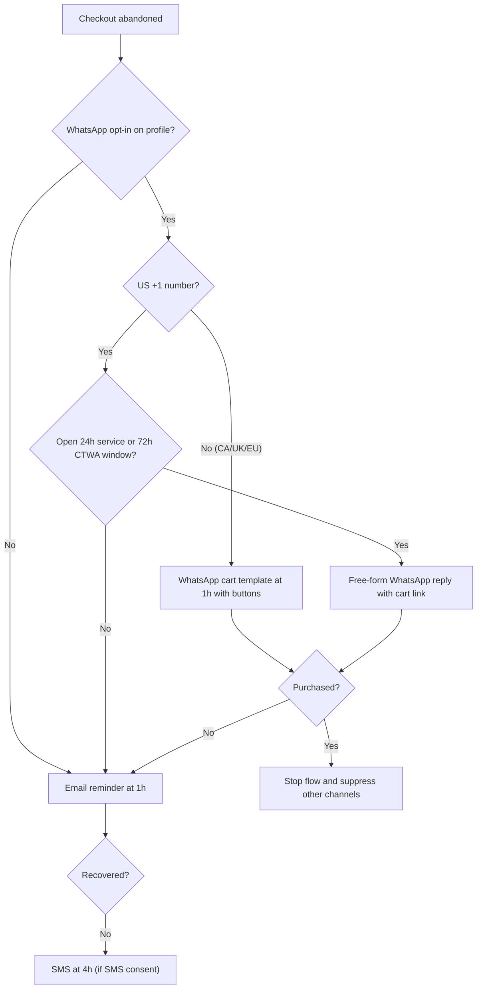
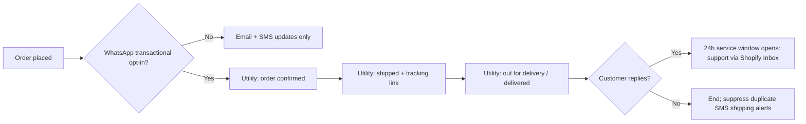
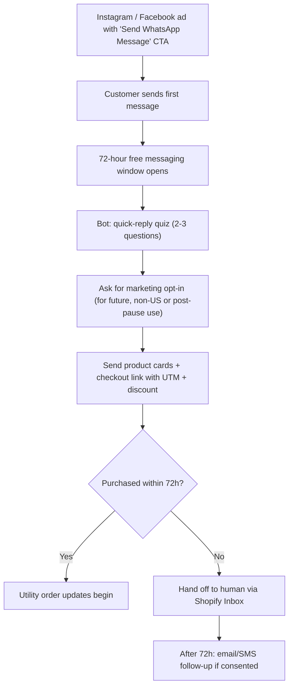
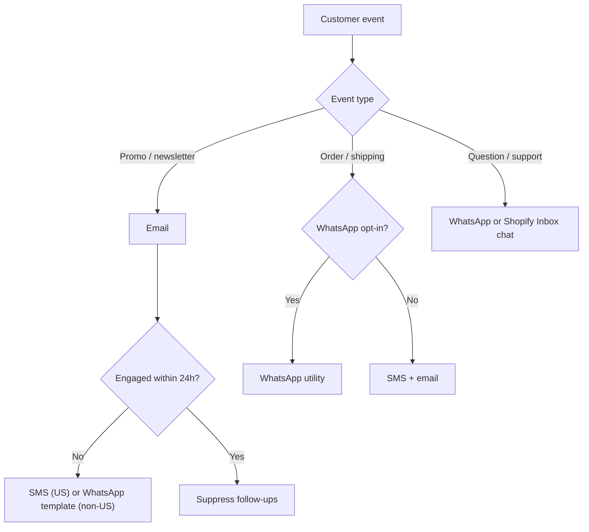

# WhatsApp Marketing for Shopify: The Complete Guide

> A comprehensive, data-backed guide to WhatsApp marketing for Shopify stores — covering platform fundamentals, Meta's per-message pricing model, the critical US market regulatory landscape and Meta's outbound marketing pause, third-party Business Solution Providers (BSPs), high-converting conversational automation flows, and global cross-border expansion. Grounded in official Shopify documentation and Meta Business platform standards verified for **October 2026**.

**Last verified: October 2026** · **Audience:** US Shopify SMB/DTC merchants already running email and SMS who want to add WhatsApp without breaking compliance or budget.

> [!WARNING]
> **Change watch.** Two things move fast and directly change this playbook: (1) **Meta's pause on marketing templates to US (+1) numbers** (error `131049`) — if it lifts, see [Readiness: When the US Pause Lifts](#readiness-when-the-us-pause-lifts); (2) **Meta per-message rate cards**, which Meta revises quarterly and Shopify passes through. Re-check the [Shopify WhatsApp pricing page](https://help.shopify.com/en/manual/promoting-marketing/create-marketing/shopify-messaging/whatsapp/pricing) and [Meta pricing docs](https://developers.facebook.com/docs/whatsapp/pricing) before budgeting.

---

## Table of Contents

1. [What Is WhatsApp Marketing?](#what-is-whatsapp-marketing)
2. [Why WhatsApp Marketing Matters for Shopify](#why-whatsapp-marketing-matters-for-shopify)
3. [The US Market Reality: Meta's Outbound Pause & The Inbound Opportunity](#the-us-market-reality-metas-outbound-pause--the-inbound-opportunity)
   - [The Meta Outbound Marketing Pause for US (+1) Numbers](#the-meta-outbound-marketing-pause-for-us-1-numbers)
   - [Official Shopify Messaging Restriction Verified](#official-shopify-messaging-restriction-verified)
   - [What US Merchants CAN Do on WhatsApp](#what-us-merchants-can-do-on-whatsapp)
   - [The Cross-Border Multiplier for US Brands](#the-cross-border-multiplier-for-us-brands)
4. [The Messaging Triad: Email vs. SMS vs. WhatsApp](#the-messaging-triad-email-vs-sms-vs-whatsapp)
5. [How WhatsApp Marketing Works on Shopify](#how-whatsapp-marketing-works-on-shopify)
6. [Account Tiers & Verification (WABA, Embedded Signup, Green Tick)](#account-tiers--verification-waba-embedded-signup-green-tick)
   - [WhatsApp Personal vs. Business App vs. WhatsApp Business Platform (API)](#whatsapp-personal-vs-business-app-vs-whatsapp-business-platform-api)
   - [Meta Embedded Signup & Business Verification](#meta-embedded-signup--business-verification)
   - [Official Business Account (OBA) "Green Tick" Status](#official-business-account-oba-green-tick-status)
   - [Tiered Messaging Volume Limits](#tiered-messaging-volume-limits)
7. [Pricing & Cost Breakdown (October 2026 Verified)](#pricing--cost-breakdown-october-2026-verified)
   - [The Per-Message Billing Model (Effective October 1, 2026)](#the-per-message-billing-model-effective-october-1-2026)
   - [Official Shopify Messaging WhatsApp Rates by Country](#official-shopify-messaging-whatsapp-rates-by-country)
   - [Service Message Billing & The 1,000 Free Monthly Allowance](#service-message-billing--the-1000-free-monthly-allowance)
   - [Free Entry Point Window: Click-to-WhatsApp (CTWA) Ads (72 Hours)](#free-entry-point-window-click-to-whatsapp-ctwa-ads-72-hours)
   - [Setting Spending Thresholds & Shopify Invoicing](#setting-spending-thresholds--shopify-invoicing)
   - [Estimated Monthly Spend across Store Tiers](#estimated-monthly-spend-across-store-tiers)
   - [Worked US Cost Scenarios](#worked-us-cost-scenarios)
   - [WhatsApp vs. SMS Cost Comparison (US)](#whatsapp-vs-sms-cost-comparison-us)
8. [WhatsApp Marketing Tools & Platforms for Shopify](#whatsapp-marketing-tools--platforms-for-shopify)
   - [Start Here: Native Shopify Messaging + Decision Table by Store Size](#start-here-native-shopify-messaging--decision-table-by-store-size)
   - [Tier 1: Built-In / Native Shopify Messaging](#tier-1-built-in--native-shopify-messaging)
   - [Tier 2: Unified Omnichannel CRMs (Klaviyo WhatsApp, Omnisend)](#tier-2-unified-omnichannel-crms-klaviyo-whatsapp-omnisend)
   - [Tier 3: Specialized DTC WhatsApp Platforms (Charles, QuickSend)](#tier-3-specialized-dtc-whatsapp-platforms-charles-quicksend)
   - [Tier 4: Conversational Chatbots & Automation Engines (ManyChat, Wati)](#tier-4-conversational-chatbots--automation-engines-manychat-wati)
   - [Tier 5: Two-Way Customer Care Inboxes (Shopify Inbox, Gorgias, Zendesk)](#tier-5-two-way-customer-care-inboxes-shopify-inbox-gorgias-zendesk)
9. [Setting Up Your WhatsApp Marketing Program](#setting-up-your-whatsapp-marketing-program)
10. [Essential WhatsApp Automation Flows & Templates](#essential-whatsapp-automation-flows--templates)
    - [Flow 1: Click-to-WhatsApp Inbound Welcome & VIP Concierge (US Compliant)](#flow-1-click-to-whatsapp-inbound-welcome--vip-concierge-us-compliant)
    - [Flow 2: Two-Way Abandoned Cart Recovery (Interactive Buttons)](#flow-2-two-way-abandoned-cart-recovery-interactive-buttons)
    - [Flow 3: Post-Purchase Order Tracking & Utility Updates (US & Global)](#flow-3-post-purchase-order-tracking--utility-updates-us--global)
    - [Flow 4: Back-in-Stock & High-Urgency VIP Product Drops (Global)](#flow-4-back-in-stock--high-urgency-vip-product-drops-global)
    - [Flow 5: Win-Back & Customer Re-Engagement](#flow-5-win-back--customer-re-engagement)
11. [Copywriting & Interactive Template Best Practices](#copywriting--interactive-template-best-practices)
12. [Compliance, Quality Rating & Account Health](#compliance-quality-rating--account-health)
    - [Meta Business & Commerce Policies](#meta-business--commerce-policies)
    - [Strict Opt-In & Mandatory Unsubscribe Architecture](#strict-opt-in--mandatory-unsubscribe-architecture)
    - [WhatsApp Quality Rating & Avoiding Rate Limits](#whatsapp-quality-rating--avoiding-rate-limits)
    - [US Legal Layer: TCPA & State Mini-TCPA Laws](#us-legal-layer-tcpa--state-mini-tcpa-laws)
    - [Copy-Paste Opt-In Language](#copy-paste-opt-in-language)
    - [Quality-Rating Checklist](#quality-rating-checklist)
13. [Measuring Performance & ROI](#measuring-performance--roi)
14. [Advanced Strategies for Shopify Brands](#advanced-strategies-for-shopify-brands)
    - [Strategy 1: The Click-to-WhatsApp (CTWA) Ad Funnel](#strategy-1-the-click-to-whatsapp-ctwa-ad-funnel)
    - [Strategy 2: AI Shopping Concierge & Automated Cart Injection](#strategy-2-ai-shopping-concierge--automated-cart-injection)
    - [Strategy 3: Cross-Border Geotargeting & Currency Alignment](#strategy-3-cross-border-geotargeting--currency-alignment)
15. [Cross-Channel Orchestration: Email, SMS & WhatsApp](#cross-channel-orchestration-email-sms--whatsapp)
16. [Readiness: When the US Pause Lifts](#readiness-when-the-us-pause-lifts)
17. [Quick Reference: Getting Started Guide](#quick-reference-getting-started-guide)
18. [References & Verified Sources](#references--verified-sources)

---

## What Is WhatsApp Marketing?

WhatsApp marketing is the practice of using the **WhatsApp Business Platform (Cloud API)** to deliver permission-based promotional campaigns, automated transactional updates, dynamic cart recovery messages, and real-time conversational shopping experiences directly to customers' personal messaging threads.

With over **2.7 billion active users** worldwide and more than **140 billion messages** processed daily, WhatsApp operates as the dominant communication fabric of modern commerce. Unlike traditional email or one-way SMS, WhatsApp is an **interactive, media-rich, bidirectional communication channel**:

- **98% Open Rate:** Messages delivered via WhatsApp are opened almost universally, with 80%+ viewed within the first 5 minutes of receipt.
- **45%–60% Click-Through Rates (CTR):** Interactive quick-reply buttons and call-to-action (CTA) links generate engagement rates that exceed traditional email by 4× to 10×.
- **Conversational Checkout:** Customers can browse interactive product catalogs, select variants, resolve sizing doubts with an agent or AI bot, and receive pre-filled Shopify checkout links without leaving the chat thread.

### The 4 Core Message Architectures (Meta October 2026 Model)

Meta classifies all WhatsApp Business communications into four distinct functional categories, each governing pricing, template submission requirements, and customer initiation windows:

| Message Category | Description | Template Approval Required? | Billing Trigger | Primary Use Cases |
|---|---|---|---|---|
| **Marketing Messages** | Outbound business-initiated promotional messages, product drops, sales announcements, back-in-stock alerts, and cart reminders. | **Yes** (Strictly audited by Meta) | Billed per delivered message | Product launches, seasonal discount codes, event invitations, automated cross-sells. |
| **Utility Messages** | Transactional updates triggered by a customer action or order state change. | **Yes** (Template approval required) | Billed per delivered message | Order confirmations, shipping updates, out-for-delivery alerts, return/refund receipts. |
| **Authentication Messages** | Sensitive security notifications and identity verification. | **Yes** (Template approval required) | Billed per delivered message | One-time passwords (OTP), two-factor account login codes, account recovery links. |
| **Service Messages** | Freeform text and multimedia replies sent by merchants to answer customer-initiated queries within a **24-hour Customer Service Window**. | **No** (Freeform text, images, docs allowed) | First 1,000 free/month, then billed per message | Customer support, product consultations, sizing assistance, live agent chat. |

---

## Why WhatsApp Marketing Matters for Shopify

### The Performance Benchmarks

Data compiled from verified Shopify merchant studies, Meta Business partner analytics (Charles, Wati, Interakt), and Omnisend benchmark reports:

```
┌────────────────────────────────────────────────────────┐
│           ENGAGEMENT BENCHMARKS ACROSS CHANNELS        │
├────────────────────┬───────────┬───────────┬───────────┤
│ Metric             │ Email     │ SMS (US)  │ WhatsApp  │
├────────────────────┼───────────┼───────────┼───────────┤
│ Open / Read Rate   │ 18%–25%   │ 95%–98%   │ 98%+      │
│ Average CTR        │ 1.5%–3.0% │ 10%–14%   │ 35%–55%   │
│ Conversion Rate    │ 1%–2%     │ 2%–4%     │ 5%–12%    │
│ Cart Recovery Rate │ 8%–12%    │ 14%–19%   │ 22%–34%   │
│ Average Read Time  │ 90 mins   │ 3 mins    │ < 5 mins  │
└────────────────────┴───────────┴───────────┴───────────┘
```

- **Abandoned Cart Salvage:** Interactive WhatsApp cart flows recover **22% to 34% of abandoned carts**, compared to 8%–12% for email alone. WhatsApp lets shoppers reply to ask questions (*"Does this run small?"*) or tap a single button (*"Complete My Order with 10% Off"*).
- **Revenue Per Recipient (RPR):** Klaviyo and Charles aggregate merchant datasets report average revenue per WhatsApp marketing recipient between **$1.80 and $3.90**, with top-decile DTC beauty and apparel brands exceeding **$6.50 per send**.
- **Customer Lifetime Value (LTV) Boost:** Customers who engage in a two-way WhatsApp conversation with a Shopify brand exhibit a **33% higher repeat purchase rate** within 90 days compared to single-channel shoppers.

---

## The US Market Reality: Meta's Outbound Pause & The Inbound Opportunity

A critical operational requirement for any Shopify merchant operating in or targeting the United States is understanding the **Meta policy and regulatory framework** governing WhatsApp in North America.

### The Meta Outbound Marketing Pause for US (+1) Numbers

> [!IMPORTANT]
> **The Official Meta US Restriction:**  
> Meta has placed a platform-wide pause on delivering **business-initiated outbound marketing-category template messages** to WhatsApp phone numbers with a United States (+1) country code. Any attempt to broadcast an outbound marketing template to a US subscriber results in a delivery failure (API error code `131049`).

This restriction is tied to US telecom spam environments, consumer privacy mandates, carrier relations, and Meta’s commitment to preventing WhatsApp in North America from turning into an unsolicited broadcast channel.

### Official Shopify Messaging Restriction Verified

Shopify's official documentation ([Shopify Messaging WhatsApp Requirements & Pricing](https://help.shopify.com/en/manual/promoting-marketing/create-marketing/shopify-messaging/whatsapp/pricing)) explicitly confirms this restriction:

> *"The pricing on this page applies only to messages sent to customers in supported regions. **You can't send WhatsApp marketing messages to customers in China, Crimea, Cuba, Donetsk, Iran, Luhansk, North Korea, Syria, or the United States.**"*  
> *"United States: WhatsApp marketing messages can't be sent to customers in the United States. However, if your store is located in the United States, then you can still use WhatsApp to send marketing messages to your subscribers in other supported countries."*

### What US Merchants CAN Do on WhatsApp

Despite the outbound marketing template pause, **WhatsApp remains a massive commercial revenue driver in the United States** through four specific, fully supported mechanisms:

```
┌────────────────────────────────────────────────────────────────────────┐
│               COMPLIANT US WHATSAPP MARKETING FRAMEWORK                │
├────────────────────────────────────────────────────────────────────────┤
│                                                                        │
│   1. Click-to-WhatsApp (CTWA) Ads (IG & Facebook)                      │
│      → Customer clicks ad → Opens WhatsApp thread                      │
│      → Unlocks 72-HOUR FREE CONVERSATION WINDOW                        │
│      → Merchant delivers interactive catalog, coupon & checkout links  │
│                                                                        │
│   2. User-Initiated On-Site Chat (Shopify Inbox / Chat Widgets)       │
│      → Customer clicks widget on product/cart page                     │
│      → Unlocks 24-HOUR CUSTOMER SERVICE WINDOW                         │
│      → Merchant answers questions, offers bundles, sends checkout      │
│                                                                        │
│   3. Transactional Utility Updates (Permitted to US Numbers)           │
│      → Order confirmations, live tracking links, return approvals      │
│      → Builds brand trust directly in the user's favorite chat thread  │
│                                                                        │
│   4. Cross-Border Outbound Broadcasts from US Store                   │
│      → US-based business exports to Canada, UK, Europe, LatAm, APAC    │
│      → Full outbound marketing broadcasts enabled to those regions     │
│                                                                        │
└────────────────────────────────────────────────────────────────────────┘
```

1. **Inbound Conversational Commerce (The Click-to-WhatsApp Bypass):** When a US customer initiates contact (by clicking an ad or scanning a QR code), they open a conversation window. Within this active window, merchants can share product links, size recommendations, and discount codes.
2. **Click-to-WhatsApp (CTWA) Ads with 72-Hour Free Window:** Meta provides a **72-hour completely free messaging window** when a customer initiates contact via a Click-to-WhatsApp ad on Instagram or Facebook. No per-message fees apply during this window.
3. **Utility & Post-Purchase Messaging:** Outbound transactional utility templates (order confirmations, delivery tracking, account status) **are permitted** to US phone numbers because they provide verified order utility rather than unsolicited promotion.
4. **Demographic Concentration in the US:** Over **100 million people** in the United States use WhatsApp monthly. Adoption is intensely concentrated among:
   - Hispanic and Latino Americans (where WhatsApp is the primary daily app).
   - Immigrant and multicultural communities with cross-border family ties.
   - International students, digital nomads, and frequent travelers.
   - Gen Z and tech professionals adopting privacy-first, end-to-end encrypted messaging.

### The Cross-Border Multiplier for US Brands

For US-based Shopify merchants selling globally, WhatsApp is not just an optional channel—it is the **primary digital storefront**:

- In **Latin America (Mexico, Brazil, Colombia)**, **Western Europe (UK, Germany, France, Spain, Italy)**, and **Asia-Pacific (India, Indonesia, Singapore)**, WhatsApp penetration exceeds **85%–95%** of smartphone users.
- US brands selling internationally that deploy WhatsApp marketing to these regions achieve **3× to 5× higher conversion rates** than relying on email alone, converting international shoppers who rarely open promotional emails.

---

## The Messaging Triad: Email vs. SMS vs. WhatsApp

A balanced Shopify omnichannel messaging strategy assigns distinct roles to each channel:

```
                               THE DTC MESSAGING TRIAD
                               
           EMAIL                            SMS                          WHATSAPP
    (Brand Storytelling)             (Lock Screen Push)           (Conversational Commerce)
    ┌──────────────────┐             ┌──────────────────┐           ┌──────────────────┐
    │ • Low send cost  │             │ • Standard in US │           │ • 2.7B worldwide │
    │ • Long-form copy │             │ • 160-char text  │           │ • Rich media/cards│
    │ • Rich catalogs  │             │ • 98% open rate  │           │ • 2-way live chat│
    │ • 20% open rate  │             │ • Domestic push  │           │ • Global standard│
    └─────────┬────────┘             └─────────┬────────┘           └─────────┬────────┘
              │                                │                              │
              ▼                                ▼                              ▼
    Nurture, Education,              High-urgency US flash          Two-way consulting, VIP
    Weekly Newsletters,              sales, 10DLC alerts,           concierge, CTWA ad funnels,
    Catalog Merchandising            instant US cart ping           cross-border international
```

### Detailed Channel Matrix

| Strategic Feature | Email Marketing | SMS Marketing (US) | WhatsApp Marketing |
|---|---|---|---|
| **Primary Geographic Strength** | Universal / Global | **United States & Canada** | **Global / LatAm / Europe / APAC / US Inbound** |
| **Average Cost Per Send** | ~$0.001 – $0.003 | ~$0.012 – $0.025 (plus carrier pass-through) | **$0.024 – $0.248** (varies by market & message type) |
| **Media & Interaction Capabilities** | Full HTML, images, layouts, long text | Plain text (160 chars) or MMS image (1,600 chars) | **Rich cards, images, PDFs, quick-reply buttons, CTA links, catalogs** |
| **Two-Way Conversational Power** | Poor (asynchronous support desk) | Moderate (text replies handled via app) | **Outstanding (native chat UI, automated bots, agent handoff)** |
| **Regulatory & Spam Framework** | CAN-SPAM, CASL, GDPR | TCPA, CTIA, 10DLC, Toll-Free Verification | **Meta Business Policy, WABA Templates, 24h/72h Windows** |
| **US Market Outbound Push** | Full Outbound Broadcast | **Full Outbound Broadcast (Standard)** | **Inbound & Utility Only (Marketing Pause on +1 numbers)** |
| **Opt-Out Mechanism** | Unsubscribe footer link | Reply `STOP` | Reply `STOP` / Tap native **Unsubscribe** button |

---

## How WhatsApp Marketing Works on Shopify

WhatsApp marketing connects directly to your Shopify store infrastructure via webhooks, Meta Graph APIs, and native checkout hooks.

```
1. Customer Opt-In or Inbound Trigger
   ├── US Shoppers: Click-to-WhatsApp (CTWA) Ad on IG/FB or On-Site Chat Bubble
   └── International Shoppers: Shopify Checkout Opt-In Checkbox, On-Site Modal, or Pop-Up
         │
         ▼
2. Consent Logging & Segmentation
   ├── Logged in Shopify Customer Record & Third-Party CRM (Klaviyo / Charles)
   └── Segmented by Country Code (+1 vs. Global), Purchase History, and Intent
         │
         ▼
3. Message Execution Engine
   ├── Outbound International: Pre-approved Meta Template delivered via WhatsApp Cloud API
   ├── Outbound US: Transactional Utility Template (Order Confirmation / Shipping)
   └── Inbound Conversational: 24h Customer Service Window (or 72h CTWA Free Window)
         │
         ▼
4. Two-Way Conversational Automation
   ├── Automated AI / Bot handles sizing, product lookups, and discount delivery
   └── Human agent handoff via Shopify Inbox, Gorgias, or Zendesk
         │
         ▼
5. Direct Revenue Attribution
   └── Tracked via pre-filled Shopify checkout URLs, unique discount codes, and UTM tags
```

---

## Account Tiers & Verification (WABA, Embedded Signup, Green Tick)

To send commercial messages through Shopify or third-party tools, you cannot use an ordinary smartphone WhatsApp application. You must establish an enterprise **WhatsApp Business Account (WABA)**.

### WhatsApp Personal vs. Business App vs. WhatsApp Business Platform (API)

```
┌───────────────────────────┬───────────────────────────┬───────────────────────────┐
│     PERSONAL WHATSAPP     │   WHATSAPP BUSINESS APP   │ WHATSAPP BUSINESS API/WABA│
├───────────────────────────┼───────────────────────────┼───────────────────────────┤
│ • 1 phone / 1 user        │ • Small local shops       │ • Automated Shopify sync  │
│ • Zero marketing automation│ • Max 256 broadcast limit │ • Unlimited scale         │
│ • No Shopify integration  │ • Manual typing on phone  │ • Pre-approved templates  │
│ • High risk of ban for DTC│ • No CRM segmentation     │ • Multi-agent team inboxes│
└───────────────────────────┴───────────────────────────┴───────────────────────────┘
```

For Shopify stores, **WhatsApp Business Platform (API)** is the only viable infrastructure. It is accessed natively through **Shopify Messaging** or via Business Solution Providers (BSPs) like Klaviyo, Charles, Wati, or ManyChat.

### Meta Embedded Signup & Business Verification

Connecting WhatsApp to Shopify takes place through **Meta Embedded Signup**:

1. **Meta Business Manager:** You must own an active Meta Business Manager account linked to your store's Facebook Page and Instagram profile.
2. **Clean Phone Number:** You need a dedicated phone number that is **not currently registered to any personal WhatsApp or WhatsApp Business mobile app**. (If currently registered, the number must be deleted from the mobile app first).
3. **Business Verification:** While unverified businesses can test with low volume, full scale requires submitting official documentation to Meta:
   - Official legal entity name and physical address.
   - Business registration identifier (EIN for US businesses, Articles of Incorporation, or Tax Certificate).
   - Utility bill or bank statement showing business name and address.
   - Official website domain verification (via DNS TXT record).

### Official Business Account (OBA) "Green Tick" Status

The coveted **Green Verified Checkmark** badge displays next to your brand name in customer chat lists, showing that Meta has verified your brand as an authentic, notable entity.

- **Requirements:** Verified Meta Business Manager, 2-Factor Authentication enabled, and demonstrated brand notability (significant press coverage, Wikipedia presence, or large search volume).
- **Benefit:** Customers see your brand name even if they haven't saved your phone number in their contacts, eliminating spam suspicion and driving higher read rates.

### Tiered Messaging Volume Limits

Meta enforces automated messaging tiers governing how many unique customers a business can initiate outbound conversations with in a rolling 24-hour window:

| Tier Level | Daily Unique Customer Limit | How to Advance |
|---|---|---|
| **Unverified Trial** | 250 unique customers / 24 hours | Complete Meta Business Verification. |
| **Tier 1** | 1,000 unique customers / 24 hours | Automatically awarded upon Business Verification. |
| **Tier 2** | 10,000 unique customers / 24 hours | Send 500+ messages in Tier 1 with High Quality Rating within 7 days. |
| **Tier 3** | 100,000 unique customers / 24 hours | Send 5,000+ messages in Tier 2 with High Quality Rating within 7 days. |
| **Tier 4** | Unlimited unique customers / 24 hours | Maintained through high volume and low customer block rates. |

---

## Pricing & Cost Breakdown (October 2026 Verified)

> [!NOTE]
> All rates in this section are verified directly against official **[Shopify Messaging WhatsApp Pricing Documentation](https://help.shopify.com/en/manual/promoting-marketing/create-marketing/shopify-messaging/whatsapp/pricing)** and current **Meta Business Platform Rate Cards** for October 2026.

### The Per-Message Billing Model (Effective October 1, 2026)

Meta has unified WhatsApp Business Platform billing onto a **per-delivered-message** model, replacing the legacy 24-hour session conversation fees. 

Costs depend on:
1. **Recipient Country Code:** The geographical location of the customer's phone number.
2. **Message Category:** Marketing vs. Utility vs. Service.

### Official Shopify Messaging WhatsApp Rates by Country

When sending messages via Shopify Messaging, merchants are billed monthly per delivered message. Charges appear directly on the merchant's unified Shopify invoice.

```
┌────────────────────────────────────────────────────────────────────────┐
│            VERIFIED PER-MESSAGE RATES (SHOPIFY MESSAGING)              │
├──────────────────────────┬──────────────────────┬──────────────────────┤
│ Country or Region        │ Marketing Message    │ Service Message      │
├──────────────────────────┼──────────────────────┼──────────────────────┤
│ United States            │ NOT SUPPORTED (Pause)│ Free / Service Rate  │
│ Canada                   │ $0.050 USD           │ $0.0034 USD          │
│ United Kingdom           │ $0.106 USD           │ $0.0220 USD          │
│ Germany                  │ $0.248 USD           │ $0.0550 USD          │
│ France                   │ $0.172 USD           │ $0.0300 USD          │
│ Spain                    │ $0.112 USD           │ $0.0200 USD          │
│ Italy                    │ $0.126 USD           │ $0.0300 USD          │
│ Netherlands              │ $0.290 USD           │ $0.0500 USD          │
│ Mexico                   │ $0.076 USD           │ $0.0085 USD          │
│ Brazil                   │ $0.125 USD           │ $0.0068 USD          │
│ Colombia                 │ $0.031 USD           │ $0.0008 USD          │
│ India                    │ $0.024 USD           │ $0.0014 USD          │
│ Indonesia                │ $0.082 USD           │ $0.0250 USD          │
│ Singapore                │ $0.146 USD           │ $0.0160 USD          │
│ United Arab Emirates     │ $0.100 USD           │ $0.0157 USD          │
│ Saudi Arabia             │ $0.100 USD           │ $0.0107 USD          │
│ South Africa             │ $0.076 USD           │ $0.0076 USD          │
│ Australia / Rest of APAC │ $0.146 USD           │ $0.0113 USD          │
│ Rest of Latin America    │ $0.148 USD           │ $0.0113 USD          │
│ Rest of Western Europe   │ $0.118 USD           │ $0.0171 USD          │
│ Other International      │ $0.121 USD           │ $0.0077 USD          │
└──────────────────────────┴──────────────────────┴──────────────────────┘
```

*Note: Free test messages: Shopify Messaging allows up to **25 test messages per week for free**.*

### Service Message Billing & The 1,000 Free Monthly Allowance

- Every WhatsApp Business Account receives **1,000 free service messages per month** across all platforms connected to the account.
- **Critical Policy Update (October 1, 2026):** Service messages sent beyond the 1,000 free threshold are charged at the regional service message rate (e.g., $0.0034 in Canada, $0.0220 in the UK).
- A **24-Hour Customer Service Window** opens whenever a customer messages the business. Each subsequent customer reply resets the 24-hour timer.

### Free Entry Point Window: Click-to-WhatsApp (CTWA) Ads (72 Hours)

When a customer clicks a **Click-to-WhatsApp ad** on Instagram or Facebook and sends a message to your store:
- Meta provides a **72-hour completely free messaging window**.
- Messages sent by the merchant to the customer during these 72 hours do not incur marketing or service fees.
- This creates an effective acquisition funnel for US and international brands: paid media ad spend covers initial lead capture, while subsequent conversational closing messages are delivered free of per-message Meta fees.

### Setting Spending Thresholds & Shopify Invoicing

All WhatsApp messaging charges incur directly under the **WhatsApp** line item in your Shopify billing profile (`Settings > Billing`). To prevent accidental overspend during high-volume sales events, Shopify allows merchants to define a **Monthly Spending Threshold** in the Shopify Messaging settings. Once this spend ceiling is reached, automated marketing sends pause until adjusted.

### Estimated Monthly Spend across Store Tiers

```
┌────────────────────────────────────────────────────────────────────────┐
│             ESTIMATED MONTHLY WHATSAPP MARKETING BUDGETS               │
├────────────────────┬─────────────────────────────┬─────────────────────┤
│ Store Profile      │ Message Volume Profile      │ Est. Monthly Spend  │
├────────────────────┼─────────────────────────────┼─────────────────────┤
│ Starter Store      │ 300 CTWA Inbound Chats      │ $0.00               │
│ (US / Domestic)    │ 500 Service Messages        │ (Covered by 1,000   │
│                    │                             │ free monthly allow.)│
├────────────────────┼─────────────────────────────┼─────────────────────┤
│ Growing Brand      │ 1,500 Inbound Service Msgs  │ $5.00 – $25.00      │
│ (US Inbound + CA)  │ 500 Canada Marketing Sends  │ (Usage fees only)   │
├────────────────────┼─────────────────────────────┼─────────────────────┤
│ Cross-Border DTC   │ 5,000 UK Marketing Sends    │ $650 – $850         │
│ (US Base + UK/EU)  │ 1,500 Germany Marketing     │                     │
│                    │ 2,000 Service Inbound Msgs  │                     │
├────────────────────┼─────────────────────────────┼─────────────────────┤
│ Global Enterprise  │ 50,000 Global Marketing     │ $3,500 – $6,500     │
│ (Scale Ecommerce)  │ 10,000 Service Inbound Msgs │ (Plus BSP software  │
│                    │                             │ platform fees)      │
└────────────────────┴─────────────────────────────┴─────────────────────┘
```

### Worked US Cost Scenarios

The scenarios below model the **inbound-first** US playbook (no outbound marketing templates to +1 numbers). Assumptions are stated so you can swap in your own numbers.

> [!NOTE]
> US utility and over-allowance service rates are not published in the Shopify table above (which marks US marketing as unsupported). The scenarios use **$0.0034 per US utility message** and **$0.0034 per US service message beyond the 1,000 free**, in line with Meta's North America rate card — confirm the live figure in your Shopify Messaging billing settings. Utility templates sent *inside* an open 24-hour service window or the 72-hour CTWA window are not charged.

**Scenario A — 5,000 orders/month US store (inbound-first)**

| Line Item | Assumption | Billable Messages | Est. Cost |
|---|---|---|---|
| CTWA ad conversations | 600 chats/mo × ~6 merchant replies, all inside the 72-hour free window | 0 | **$0.00** (ad spend billed separately by Meta Ads) |
| Order updates (utility) | 40% of buyers opt in to WhatsApp updates = 2,000 customers × 3 templates (confirmed, shipped, delivered) | 6,000 | **$20.40** |
| Customer service chat | 1,500 service replies; first 1,000 free | 500 | **$1.70** |
| **Total Meta/Shopify usage** | | **6,500** | **≈ $22/month** (≈ $0.004 per order) |

**Scenario B — 1,000 orders/month starter store**

| Line Item | Assumption | Billable Messages | Est. Cost |
|---|---|---|---|
| CTWA conversations | 150 chats, inside free window | 0 | $0.00 |
| Order updates (utility) | 400 opted-in buyers × 2 templates (shipped, delivered) | 800 | $2.72 |
| Service chat | 600 replies (under 1,000 free) | 0 | $0.00 |
| **Total** | | **800** | **≈ $3/month** |

> [!TIP]
> Third-party tools (Klaviyo, Charles, Wati, ManyChat) add a **platform subscription** on top of these Meta usage fees, and some add a per-message markup. Native Shopify Messaging passes Meta rates through with no monthly fee.

### WhatsApp vs. SMS Cost Comparison (US)

Using SMS rates from the [SMS Marketing Guide](./SMS-MARKETING-GUIDE.md#pricing--cost-breakdown-october-2026-verified) (blended carrier fees ≈ $0.0042–$0.0045 per SMS):

| Message Job (US recipient) | WhatsApp (Shopify Messaging) | SMS — Shopify Messaging (~$0.012) | SMS — Postscript Starter ($0.009 + ~$0.0045 carrier) | SMS — Klaviyo (~$0.012, carrier bundled) |
|---|---|---|---|---|
| 1 order-update message | ~$0.0034 (utility) | ~$0.012 | ~$0.0135 | ~$0.012 |
| 6,000 order updates/mo (Scenario A) | **~$20** | ~$72 | ~$81 | ~$72 |
| Rich media (image + buttons) | Same utility rate | MMS ~3× SMS | $0.045 MMS + ~$0.009 carrier | MMS credits |
| Reply to an inbound question | Free (1,000/mo, then service rate) | Billed per segment | Billed per segment | Billed per segment |
| Promotional broadcast to US | **Not available** (Meta pause) | ~$0.012 | ~$0.0135 | ~$0.012 |

**Takeaway:** WhatsApp is roughly **3–4× cheaper than SMS for transactional/utility and conversational traffic** in the US, but SMS remains the only one of the two that can carry **US promotional broadcasts** today. Use each where it is strongest (see [Cross-Channel Orchestration](#cross-channel-orchestration-email-sms--whatsapp)).

---

## WhatsApp Marketing Tools & Platforms for Shopify

### Start Here: Native Shopify Messaging + Decision Table by Store Size

For most US merchants the right first step is **native Shopify Messaging** (WhatsApp channel) plus **Shopify Inbox** for chat: no monthly fee, Meta rates passed through on your Shopify invoice, and consent stored on the Shopify customer record you already use for email and SMS. Move to a third-party tool only when you need something specific in the table below.

| Store Size (monthly orders / revenue) | Recommended Stack | Why | Watch Out For |
|---|---|---|---|
| **< 1,000 orders / < $50k** | **Shopify Messaging + Shopify Inbox** | $0 platform fee; utility + service + CTWA chats cover the US use cases | Basic builder; no carousels |
| **1,000–5,000 orders, CTWA-heavy** | **ManyChat** (+ Shopify Messaging for updates) | Best visual builder for Click-to-WhatsApp quiz/lead funnels from $15/mo | Not a full retention CRM |
| **1,000–10,000 orders, support-heavy or international** | **Interakt / Wati** | Low-cost shared team inbox, chatbots, broadcast scheduler for non-US lists (from ~$49/mo) | Per-message markups on some plans; US marketing still blocked |
| **Already on Klaviyo for email/SMS** | **Klaviyo WhatsApp** | One profile, one consent ledger, cross-channel splits and suppression | Usage + plan cost; feature set evolving |
| **10,000+ orders / Plus, EU/UK exposure** | **Charles** | Chat-ins, product carousels, conversational checkout, dedicated CSM | €300–€500+/mo; overkill for US-only inbound |


### Tier 1: Built-In / Native Shopify Messaging

| Feature | Details |
|---|---|
| **App Name** | **Shopify Messaging** (Native App) |
| **App Store Rating** | **4.8★** (Shopify App Store) |
| **Starting Monthly Fee** | **$0 / month** (Pay-as-you-go per delivered message) |
| **Best For** | Beginners, lean store owners, and US brands launching international broadcasts. |
| **Pros** | Zero third-party apps required; unified Shopify billing; native sync with Shopify Segments; 25 free weekly tests. |
| **Cons** | Basic visual editor; no interactive multi-product carousels; outbound marketing restricted to non-US numbers. |

### Tier 2: Unified Omnichannel CRMs (Klaviyo WhatsApp, Omnisend)

| App | App Store Rating | Starting Monthly Price | Key Features & Architecture |
|---|---|---|---|
| **Klaviyo WhatsApp** | **4.7★** (3,350+ reviews) | Free tier available; tiered per-profile + per-message usage | Unifies WhatsApp alongside Email and SMS in a single CRM canvas. Create multi-channel conditional splits (*"If customer didn't open email in 2 hours, send WhatsApp"*). Includes rich buttons, image headers, and full revenue attribution. |
| **Omnisend** | **4.7★** (3,100+ reviews) | Pro plan from **$41.30/mo** + usage credits | Cross-channel customer workflows combining email, SMS, push, and WhatsApp. Pre-built international cart abandonment flows. |

### Tier 3: Specialized DTC WhatsApp Platforms (Charles, QuickSend)

| App | App Store Rating | Starting Monthly Price | Key Features & Architecture |
|---|---|---|---|
| **Charles** | **4.9★** (Top European BSP) | From **€300–€500/mo** (Tailored for mid-market & enterprise) | Dedicated conversational commerce powerhouse. Features "Chat-ins" (website popups driving to WhatsApp), dynamic interactive product carousels, custom checkout URLs, and deep Shopify Plus integration. |
| **QuickSend / BiteSpeed** | **4.8★** (600+ reviews) | Free tier; paid from **$49.00/mo** | Dedicated to high-speed cart recovery, WhatsApp shop widgets, and automated review collection. |

### Tier 4: Conversational Chatbots & Automation Engines (ManyChat, Wati)

| App | App Store Rating | Starting Monthly Price | Key Features & Architecture |
|---|---|---|---|
| **ManyChat** | **4.7★** (Industry Leader) | Pro starts at **$15.00/mo** (scales by contacts) | Premier visual flow builder for **Click-to-WhatsApp (CTWA)** ad funnels. Automates lead qualification, discount delivery, and interactive Q&A flows before routing to Shopify checkout. |
| **Wati** | **4.6★** (Shopify Partner) | From **$49.00/mo** | Built on official WhatsApp Cloud API. Shared multi-agent inbox, broadcast scheduler, and no-code chatbot builder. |

### Tier 5: Two-Way Customer Care Inboxes (Shopify Inbox, Gorgias, Zendesk)

| App | Best For | Architecture & Integration |
|---|---|---|
| **Shopify Inbox** | Solo merchants & small teams | **Free native app.** Connects customer WhatsApp messages into the unified Shopify Inbox on web and mobile. Agents can send product recommendations, cart links, and discounts directly in chat. |
| **Gorgias** | Scaling DTC support teams | Consolidates WhatsApp threads alongside email, SMS, and Instagram DMs. Direct Shopify order edit and refund actions inside the ticket. |
| **Zendesk** | Enterprise multi-tier operations | Enterprise SLA management, AI agent deflection, and omnichannel routing. |

---

## Setting Up Your WhatsApp Marketing Program

```
┌────────────────────────────────────────────────────────┐
│            5-STEP SETUP IMPLEMENTATION ROADMAP         │
├────────────────────────────────────────────────────────┤
│ Step 1: Secure a Dedicated Business Telephone Number   │
│ Step 2: Connect Meta Business Manager via Embedded     │
│ Step 3: Configure Marketing & Transactional Consent    │
│ Step 4: Submit Message Templates for Meta Pre-Approval │
│ Step 5: Activate Automated Workflows & Inbound Widgets │
└────────────────────────────────────────────────────────┘
```

### Step 1: Secure a Dedicated Business Phone Number
- You must use a phone number capable of receiving SMS or voice verification codes from Meta.
- **Crucial Rule:** The number must not be registered on the consumer WhatsApp app or WhatsApp Business mobile app. If currently registered, open WhatsApp settings on the phone, go to **Account > Delete My Account**, and proceed.

### Step 2: Connect Meta Business Manager via Embedded Signup
1. Navigate to your Shopify Admin or chosen WhatsApp app (e.g., Klaviyo).
2. Go to **Marketing > Shopify Messaging > WhatsApp** (or **Klaviyo > Settings > WhatsApp**).
3. Click **Connect Account** to launch the Meta Embedded Signup modal.
4. Select your verified **Meta Business Manager**, input your business details, and verify your phone number via 6-digit OTP.

### Step 3: Configure Marketing & Transactional Consent
- **Shopify Checkout Consent:** Enable WhatsApp opt-in under **Settings > Checkout > Marketing Options**.
- Ensure the opt-in checkbox is **unchecked by default** to comply with international privacy standards and Meta guidelines.
- **On-Site Inbound Bubbles:** For US stores, install an on-site chat bubble (Shopify Inbox or WhatsApp widget) with language: *"Chat with our product specialists on WhatsApp"*.

### Step 4: Submit Message Templates for Meta Pre-Approval
- Every outbound message template must be approved by Meta before deployment.
- Meta’s AI review checks categorization (Marketing vs. Utility), character syntax, and policy compliance. Most templates are approved within 15 minutes to 2 hours.

---

## Essential WhatsApp Automation Flows & Templates

### Flow 1: Click-to-WhatsApp Inbound Welcome & VIP Concierge (US Compliant)

**Trigger:** Customer clicks a Click-to-WhatsApp ad on Instagram/Facebook or scans an on-site QR code.  
**Cost:** **$0.00** (Covered under Meta's 72-Hour Free CTWA Window).  
**Permitted Region:** Fully compliant for US and international shoppers.

```
[CUSTOMER SENDS AUTO-POPULATED INBOUND MESSAGE]
"Hi! I saw your summer collection on Instagram and want to unlock the VIP 15% discount."

[MERCHANT AUTOMATED RESPONSE - IMMEDIATE]
"Welcome to the {{store_name}} inner circle! 🎉 

Here is your exclusive 15% off code: VIP15

What type of fit are you shopping for today? Tap below and our stylist bot will guide you:

[Button 1: 👔 Slim Fit Collection]
[Button 2: 👕 Relaxed Oversized]
[Button 3: 💬 Chat with a Stylist]

Reply STOP to unsubscribe."
```

---

### Flow 2: Two-Way Abandoned Cart Recovery (Interactive Buttons)

**Trigger:** Customer abandons checkout; 45 minutes elapsed.  
**Permitted Region:** Global / International customers (+1 numbers restricted from outbound marketing templates; use for Canada, UK, EU, LatAm, etc.).

```
[HEADER: PRODUCT IMAGE OF ABANDONED ITEM]

"Hey {{first_name}}, we noticed you left your {{product_name}} in your cart! 🛍️

Items in our limited drop sell out quickly, so we've reserved yours for the next 4 hours.

Need a hand finishing checkout?"

[Quick-Reply Button: 💳 Complete My Order]  --> (Pre-filled Shopify checkout link)
[Quick-Reply Button: ❓ Ask About Sizing]   --> (Routes to support agent)

"Reply STOP to unsubscribe."
```

*Results: Adding the "Ask About Sizing" quick reply recovers 28% more abandoned carts than sending a checkout link alone, as hesitation around sizing is the #1 objection for apparel DTC.*

---

#### Cart Recovery Logic (Diagram)



### Flow 3: Post-Purchase Order Tracking & Utility Updates (US & Global)

**Trigger:** Shopify order status changes to `Fulfilled` / Tracking number added.  
**Category:** **Utility Message** (Approved for US +1 numbers and international).  
**Cost:** ~$0.0034 – $0.055 depending on country.

```
[HEADER: STORE LOGO / SHIPPING GRAPHIC]

"Great news, {{first_name}}! 📦 Your order #{{order_number}} is on its way.

Carrier: {{shipping_carrier}}
Tracking Number: {{tracking_number}}

Track your delivery in real time:
{{tracking_url}}

If you have any questions about your delivery, simply reply to this text anytime!"

[Button: 🚚 Track My Package]
```

---

#### Order Update Logic (Diagram)



### Flow 4: Back-in-Stock & High-Urgency VIP Product Drops (Global)

**Trigger:** Product inventory increases from 0 to >10 units on Shopify; sent to waitlist segment.  
**Category:** Marketing Message (International subscribers).

```
[HEADER: HIGH-RES PRODUCT PHOTO]

"It’s finally back, {{first_name}}! 🔥

The {{product_name}} that sold out in 48 hours is officially restocked in your size. We’re giving our WhatsApp VIPs 2 hours of private early access before public announcement.

Claim yours before inventory runs out:"

[Button: ⚡ Shop Private Restock]

"Reply STOP to opt out."
```

---

### Flow 5: Win-Back & Customer Re-Engagement

**Trigger:** 60 days since last purchase; customer has not opened recent emails.  
**Category:** Marketing Message (International subscribers).

```
"Hey {{first_name}}, it’s been a while! ✨

We’ve just dropped 15 new arrivals that match your previous style. To welcome you back, here’s an exclusive $15 gift card on your next order over $60.

Use code: WELCOMEBACK15 at checkout."

[Button: 🛍️ Explore New Arrivals]
[Button: ❌ Not Interested]

"Reply STOP to opt out."
```

---

## Copywriting & Interactive Template Best Practices

```
┌────────────────────────────────────────────────────────┐
│          WHATSAPP COPYWRITING GOLDEN RULES             │
├────────────────────────────────────────────────────────┤
│ 1. Front-Load the Value Proposition in the First Line  │
│ 2. Always Include an Interactive Button (CTA or Quick) │
│ 3. Keep Message Body Under 60 Words (Mobile Scanning)  │
│ 4. Leverage Emojis Strategically as Visual Bullets     │
│ 5. Ensure Mandatory Unsubscribe Text Is Present        │
└────────────────────────────────────────────────────────┘
```

### Anatomy of a High-Converting WhatsApp Template

```
[IMAGE / VIDEO HEADER]           --> High-res product or lifestyle hero visual
             │
[BODY COPY (40–60 words)]        --> "Hey Sarah! Your Summer VIP drop is live..."
             │
[INTERACTIVE BUTTONS]            --> Max 3 Quick Replies OR 2 CTA Action Buttons
 ├── Button 1 (URL): "Claim 20% Off" (Pre-filled discount link)
 └── Button 2 (Phone/Chat): "Talk to Stylist"
             │
[MANDATORY FOOTER]               --> "Reply STOP to unsubscribe."
```

1. **Quick-Reply Buttons vs. Call-to-Action (CTA) URL Buttons:**
   - **CTA URL Buttons:** Open a web browser directly to a pre-filled checkout link with discount applied.
   - **Quick-Reply Buttons:** Transmit a pre-set text reply back into the chat (e.g., *"Show Men's"*, *"Show Women's"*), triggering an instant automated sub-flow.
2. **Dynamic Personalization Variables:** Always utilize Shopify dynamic parameters: `{{first_name}}`, `{{product_name}}`, `{{discount_code}}`, and `{{order_number}}`.
3. **Pacing & Frequency:** Never treat WhatsApp like email. Sending more than **1 to 2 marketing broadcasts per month** to the same subscriber causes customer block rates to spike, damaging your Meta phone number quality score.

---

## Compliance, Quality Rating & Account Health

### Meta Business & Commerce Policies

To protect your WhatsApp Business Account from suspension:
- **Prohibited Goods:** Strict ban on alcohol, tobacco, adult products, weapons, prescription drugs, and predatory financial services.
- **Unsolicited Cold Messaging:** Never purchase external phone lists. Meta’s algorithm monitors how frequently recipients press **"Block & Report Spam"**. If your block rate exceeds 2%, your account will be throttled.

### Strict Opt-In & Mandatory Unsubscribe Architecture

- **Express Consent Required:** Consent for WhatsApp cannot be bundled with email or SMS. It requires an independent checkbox or dedicated phone submission.
- **Mandatory Opt-Out Syntax:** In Shopify Messaging, every marketing template automatically appends an uneditable **"Reply STOP to unsubscribe"** prompt. When a customer replies `STOP`, Shopify automatically flags their profile as `unsubscribed` and prevents further outbound sends.

### WhatsApp Quality Rating & Avoiding Rate Limits

Inside your Meta Business Manager, your phone number displays a real-time **Quality Rating**:

```
🟢 GREEN (High Quality)  --> Normal delivery; eligible for daily volume tier increases.
🟡 YELLOW (Medium)       --> Warning sign; recipient blocks or negative feedback increasing.
🔴 RED (Low Quality)     --> Immediate danger; message throughput throttled; risk of suspension.
```

#### What to Do If Your Quality Score Drops to Yellow or Red:
1. Immediately pause mass broadcast campaigns for 7 days.
2. Only send high-value transactional utility updates (order confirmations).
3. Tighten your marketing audience segments to customers who purchased within the last 30 days.
4. Verify that message templates deliver clear value rather than repetitive promotional urgency.

> [!CAUTION]
> **Not legal advice.** The notes below are a practical summary for US merchants as of October 2026. TCPA and state laws change and are litigated frequently — have counsel review your consent flows.

### US Legal Layer: TCPA & State Mini-TCPA Laws

Meta's opt-in rules are the *platform* layer; US law is a separate layer that applies on top of it.

- **Meta opt-in rules:** You must obtain opt-in before sending business-initiated templates, clearly state that the customer will receive messages **on WhatsApp**, name your business, and honor opt-outs promptly. A customer messaging you first (CTWA, chat widget) permits replies in that window, not ongoing marketing.
- **Federal TCPA:** Treat WhatsApp marketing like SMS marketing — get **prior express written consent** (checkbox not pre-ticked, consent not a condition of purchase), keep timestamped records, and honor revocation by any reasonable means. Respect quiet hours (8 AM–9 PM recipient local time).
- **State "mini-TCPA" laws:** **Florida (FTSA)** and **Oklahoma (OTSA)** add private rights of action with per-message statutory damages and restrict automated marketing messages without consent; **Washington, Maryland, Virginia, Connecticut, Texas** and others have their own telemarketing/text rules (quiet hours, registration, frequency caps). Apply the strictest rule list-wide rather than per-state logic.
- **Separate consent per channel:** WhatsApp consent is distinct from SMS and email consent. Store it as its own field (Shopify Messaging does this natively).

### Copy-Paste Opt-In Language

**Checkout / form checkbox (marketing):**
> ☐ Yes, send me offers and product news from **[Store Name]** on **WhatsApp** at the number provided. Up to 4 msgs/month. Consent is not a condition of purchase. Reply STOP to opt out anytime. [Privacy Policy] · [Terms]

**Transactional-only checkbox:**
> ☐ Send my order confirmations and shipping updates on **WhatsApp**. Reply STOP to turn off.

**In-chat opt-in (CTWA / chat widget):**
> "Want early access to drops and member-only offers here on WhatsApp? Tap **Yes, sign me up** — you can reply STOP anytime."  [Yes, sign me up] [No thanks]

### Quality-Rating Checklist

- [ ] Every recipient has a stored, timestamped WhatsApp-specific opt-in
- [ ] Templates categorized correctly (utility is not disguised marketing — Meta re-categorizes and may restrict)
- [ ] First message sets expectations and names the brand
- [ ] Opt-out (STOP / button) on every marketing template; processed immediately
- [ ] Frequency ≤ 2 marketing sends per subscriber per month (non-US)
- [ ] Segments exclude unengaged (no read in 90 days) contacts
- [ ] Monitor quality rating and block rate weekly; pause broadcasts on Yellow
- [ ] Spending threshold set in Shopify Messaging
- [ ] Human handoff available within business hours

---

## Measuring Performance & ROI

Track these core metrics inside your Shopify Messaging and WhatsApp analytics dashboard:

```
┌──────────────────────────┬──────────────────────────┬──────────────────────────┐
│ METRIC                   │ HEALTHY BENCHMARK        │ ACTION IF BELOW TARGET   │
├──────────────────────────┼──────────────────────────┼──────────────────────────┤
│ **Delivery Rate**        │ 96% – 99%                │ Clean disconnected numbers│
│ **Read Rate (Blue Ticks)│ 80% – 95%                │ Improve message timing   │
│ **Click-Through (CTR)**  │ 25% – 45%                │ Use bold CTA buttons     │
│ **Conversion Rate**      │ 4% – 10%                 │ Optimize mobile checkout │
│ **Block / Unsub Rate**   │ Under 0.5%               │ Decrease send frequency  │
│ **Revenue Per Send (RPR)│ $1.50 – $4.00+           │ Enhance personalization  │
└──────────────────────────┴──────────────────────────┴──────────────────────────┘
```

### Attribution Architecture
- **UTM Tracking:** Tag all WhatsApp CTA links with distinct parameters:  
  `?utm_source=whatsapp&utm_medium=messaging&utm_campaign=summer_drop_vip`
- **Shopify Discount Tracking:** Assign unique auto-generated discount codes to each automated flow to measure exact closed-won gross merchandise value (GMV).

---

## Advanced Strategies for Shopify Brands

### Strategy 1: The Click-to-WhatsApp (CTWA) Ad Funnel

The single most profitable WhatsApp strategy for US merchants is running **Instagram Stories and Reels ads with a "Send WhatsApp Message" call-to-action**:

```
[INSTAGRAM AD]
Visual: 15-second product demonstration
Hook: "Want to find your exact skincare routine in 60 seconds?"
CTA: "Tap to Chat on WhatsApp"
      │
      ▼
[WHATSAPP AUTOMATED CHAT]
Customer lands in chat thread (Unlocks 72-HOUR FREE WINDOW)
Bot asks 3 diagnostic skin type questions via Quick-Reply buttons
      │
      ▼
[PERSONALIZED BUNDLE LINK]
Bot outputs: "Here is your custom bundle + 15% off applied"
Customer clicks pre-filled Shopify checkout link → Order completed!
```

#### CTWA Funnel (Diagram)



### Strategy 2: AI Shopping Concierge & Automated Cart Injection

Integrate AI shopping assistants (via Shopify Inbox, ManyChat, or TxtCart):
- Customers reply with complex queries: *"I have an outdoor wedding in Miami in July, what should I wear?"*
- The AI agent scans Shopify store collections, selects breathable linen dresses in stock in the user's size, and sends product card previews directly in chat.
- The AI generates a customized draft order link with one-click checkout.

### Strategy 3: Cross-Border Geotargeting & Currency Alignment

For US merchants expanding globally:
- Group international subscribers into country-specific clusters (e.g., UK, Canada, Germany, Mexico, Australia).
- Align WhatsApp campaigns with local time zones (sending at 11:00 AM local time).
- Match currency displays in copy (e.g., `£` for UK, `€` for Germany, `CAD $` for Canada) linking directly to localized Shopify Markets checkout URLs.

---

## Cross-Channel Orchestration: Email, SMS & WhatsApp

WhatsApp should slot into, not duplicate, the email and SMS programs described in the [Email Marketing Guide](./EMAIL-MARKETING-GUIDE.md) and [SMS Marketing Guide](./SMS-MARKETING-GUIDE.md).

| Role | Email | SMS | WhatsApp (US, today) |
|---|---|---|---|
| Promotional broadcasts | **Primary** (lowest cost, richest content) | **Secondary** (urgent offers, VIP drops) | Not available to +1 numbers |
| Abandoned cart | First touch (1h) | Second touch (4–24h) | Only inside open service/CTWA window; full template for non-US |
| Order updates | Receipt + record | Fallback | **Primary** for opted-in buyers (cheapest, rich tracking) |
| Support / pre-sale questions | Ticket | Limited | **Primary** (two-way, free 1,000/mo) |
| Paid acquisition | — | — | **CTWA ads** (72h free window) |

**Sequencing and suppression rules:**
1. **One channel per job.** If a customer receives shipping updates on WhatsApp, suppress the SMS shipping alert.
2. **Escalate by cost.** Email → SMS → WhatsApp for non-US marketing; for US, email → SMS.
3. **Stop on conversion everywhere.** A purchase or reply in any channel exits all parallel flows.
4. **Respect the strictest frequency cap across channels** combined (e.g., ≤ 1 promotional SMS or WhatsApp per week).
5. **Share consent and suppression lists** — a STOP on SMS does not revoke WhatsApp consent (and vice versa), but a complaint or legal request should suppress all channels.



---

## Readiness: When the US Pause Lifts

Meta currently rejects marketing templates sent to US (+1) numbers with error **`131049`**. Use the pause to prepare so you can switch on outbound quickly if and when it lifts:

1. **Collect WhatsApp marketing consent now** (CTWA chats, checkout checkbox) using the [opt-in language above](#copy-paste-opt-in-language) — consent is valid even if you can't send yet.
2. **Pre-approve templates** (welcome, cart recovery, back-in-stock, win-back) so they're ready; test on CA/UK numbers.
3. **Build the suppression logic** in your email/SMS platform so WhatsApp replaces — not adds to — SMS sends for overlapping subscribers.
4. **Budget with the rate card:** model US marketing at Meta's published North America marketing rate and compare with SMS (~$0.012–$0.0135/msg).
5. **Ramp slowly** on launch: start with recent purchasers (last 30 days), ≤ 2 sends/month, and watch quality rating daily for the first two weeks.
6. **Monitor:** Meta developer changelog, Shopify Messaging release notes, and your BSP's status page for the lift announcement.

---

## Quick Reference: Getting Started Guide

| Merchant Stage | Recommended Setup | Primary Channel Goal | Action Steps |
|---|---|---|---|
| **Early Stage / Lean US Store (<$10k/mo)** | **Shopify Messaging + Shopify Inbox** | Inbound Support & Global Testing | Connect WABA via Embedded Signup; install Shopify Inbox chat widget; utilize 1,000 free service messages/mo. |
| **Growing US Brand ($10k–$50k/mo)** | **ManyChat + Shopify Messaging** | Inbound CTWA Lead Funnels | Run Click-to-WhatsApp Instagram ads; build automated quiz flows; capture 72-hour free window conversions. |
| **Omnichannel DTC ($50k–$250k/mo)** | **Klaviyo WhatsApp** | Unified Retention & Cross-Border | Unify Email, SMS, and WhatsApp under Klaviyo flows; deploy WhatsApp cart recovery for UK/EU/CA audiences. |
| **High-Volume Global Brand ($250k+/mo)** | **Charles or Klaviyo + Gorgias** | Full Conversational Commerce | Deploy on-site Chat-Ins, segmented international drops, multi-agent live chat, and automated AI concierges. |

---

## References & Verified Sources

### Official Shopify Resources
1. **Pricing and Billing for WhatsApp Marketing Campaigns**  
   https://help.shopify.com/en/manual/promoting-marketing/create-marketing/shopify-messaging/whatsapp/pricing
2. **Requirements and Considerations for WhatsApp Marketing Campaigns**  
   https://help.shopify.com/en/manual/promoting-marketing/create-marketing/shopify-messaging/whatsapp/requirements
3. **Shopify Messaging Overview & App Listing**  
   https://help.shopify.com/en/manual/promoting-marketing/create-marketing/shopify-messaging
4. **Setting Up WhatsApp Marketing Consent at Checkout**  
   https://help.shopify.com/en/manual/promoting-marketing/create-marketing/shopify-messaging/whatsapp/setup

### Meta Official Documentation & Regulatory Policies
5. **Meta WhatsApp Business Platform Pricing Overview (October 2026 Live Model)**  
   https://developers.facebook.com/docs/whatsapp/pricing/
6. **Meta Per-User Marketing Template Message Limits & United States Restrictions**  
   https://developers.facebook.com/documentation/business-messaging/whatsapp/templates/marketing-templates/per-user-limits#united-states-phone-numbers
7. **WhatsApp Business Messaging Policy & Guidelines**  
   https://www.whatsapp.com/legal/business-solution-terms
8. **WhatsApp Cloud API Rate Limits & Quality Metrics**  
   https://developers.facebook.com/docs/whatsapp/cloud-api/overview

### Shopify Ecosystem App Platforms
9. **Klaviyo WhatsApp Marketing Integration & Documentation**  
   https://www.klaviyo.com/features/whatsapp
10. **Charles: Conversational Commerce for Shopify**  
    https://www.hello-charles.com/
11. **ManyChat: WhatsApp Automation & Click-to-WhatsApp Solutions**  
    https://manychat.com/
12. **Wati: WhatsApp Business API Platform for Shopify**  
    https://www.wati.io/

---

*Last updated & verified: October 2026*
